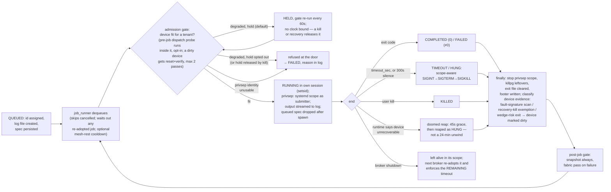

<!--
SPDX-FileCopyrightText: © 2026 Tenstorrent USA, Inc.

SPDX-License-Identifier: Apache-2.0
-->

# Jobs

Scope: the job subsystem — queue, runner, lifecycle, timeouts, retention, environment
resolution, process-group cleanup, log files, and job survival across a broker restart.
All in `server.py` unless named otherwise.

## Purpose

The broker exists to serialize all tenant access to one Tenstorrent device: every command
runs as a job, jobs run strictly one at a time, and every job leaves a complete durable
record (its log file) regardless of how it ended. The job subsystem is the main loop —
`job_runner` — plus the submission funnel (`_queue_job`) and the persistence that lets both
the queue and a running job outlive the broker process.

## Invariants

- **I1** — At most one job is RUNNING at any time. The runner is a single task that
  dispatches, awaits, and finalizes one job before dequeuing the next, and it MUST wait out
  any job re-adopted from a previous broker instance before dispatching
  (`readopted_scopes`). Killing a re-adopted job does not end that wait: its entry stays
  until its scope has stopped (`_monitor_readopted_scope`).
- **I2** — `MAX_TIMEOUT_SEC` (1500 s / 25 min) is a hard ceiling on `timeout_sec`, clamped
  in `_queue_job` — the single funnel shared by the MCP tools and the REST route — never
  only at a tool schema. At the ceiling, the timeout message MUST NOT offer a way to raise
  it. A no-timeout-except-on-contention job's `timeout_sec` is clamped the same way (I20).
- **I3** — The job log file is created at queue time, before the job is enqueued, so it can
  be tailed immediately; it is the complete, durable record of the run (in-memory capture is
  a bounded tail, `JOB_CAPTURE_MAX_LINES`).
- **I4** — Every job starts in its own session (`os.setsid`), so pid == pgid, and the
  runner's `finally` block sweeps every process the job left behind so no orphaned child
  can hold the device after the job is finalized. A privsep job's scope is stopped
  first, on every end (`_stop_job_scope`): a child that left the job's process group
  survives `killpg` but not its scope. The stop follows I5's ladder (SIGINT, then
  `systemctl stop` after `GRACEFUL_KILL_GRACE_SEC`) and costs one `systemctl is-active`
  when the scope already ended with its job. A scope still active is re-checked for up to
  `_SCOPE_SETTLE_SEC` (systemd sees an emptied cgroup asynchronously) before it counts as a
  leftover. After a kill or a hung reap the SIGINT was already sent, so it is not repeated:
  the stop waits out the grace and then reaps. A leftover that is still active after the
  grace, so it needs the `systemctl stop` reap, marks the device dirty whatever the job's
  exit (an exit-0 job included): the reap kills it without the SIGINT unwind, possibly
  mid-device-op, so the post-job gate runs the full check, fabric pass included, and the
  device is not handed to the next job until it verifies (I5; gate internals spec 03). A
  job the broker's own recovery killed is exempt (I14). The SIGKILL is a sweep of what is
  left once the job has exited or been through the I5 ladder, never the first signal a job
  that may still hold the device receives.
  The sweep (`job_reap.reap_job_survivors`) then takes what is left. A process
  belongs to the job when it shares its process group or session, sits in its scope's
  cgroup, carries the run's `TT_DEVICE_MCP_JOB_TAG` value (exported into every job's shell,
  so a child that started its own session is still found after its parent exits), or
  descends from any of those. Leftovers get SIGTERM, then SIGKILL after
  `SURVIVOR_TERM_GRACE_SEC` (5 s); with nothing left, the sweep costs one /proc scan and a
  `killpg` backstop. A process still alive after SIGKILL (state D: stuck in the kernel) is
  named in the broker log and the job log, and if it holds or may hold the device, the
  device is marked dirty with the job and pid, so the next job waits until it is gone. A
  broker shutdown that lands mid-sweep lets the sweep and the job's bookkeeping finish first.
- **I5** — A job is never killed with bare SIGKILL first. Termination is the ladder SIGINT
  (`GRACEFUL_KILL_GRACE_SEC` = 60 s) → SIGTERM (`SIGTERM_GRACE_SEC` = 15 s) → SIGKILL,
  because only SIGINT unwinds a Python/ttnn job into the teardown that releases the device.
  A job running in a systemd scope (privsep, or re-adopted) MUST be signalled via the
  scope, never by `killpg` on the wrapper pid (`_terminate_job`). A finished job's
  leftover that outlives SIGINT and needs the `systemctl stop` reap leaves the device
  dirty (I4); `_terminate_scope` reports whether it escalated. The ladder holds on every path that ends
  a running job: timeout, the hung reaper, a user kill, and an error raised in the broker
  itself while the job runs (the runner's exception path). A SIGKILL as the first signal
  skips the runtime's device close, which leaves its chips at the busy clock.
- **I6** — A broker restart loses no job. RUNNING jobs are re-adopted from their
  `ttdev-job-<id>.scope` units; QUEUED jobs are restored from persisted specs in queue
  order: by `queued_at`, then the job id as a number, never by filename (ids wrap, and a
  filename sort runs the `000` that followed `999` first), with an unparseable `queued_at`
  after the rest and an operator verification job back at the head (I21); an unreadable spec is set aside (`.invalid`), never guessed at; a job whose
  process is already live is never revived from its spec (the scope, not the spec, owns
  it from dispatch on), nor is one whose spawn failed (it is terminal: FAILED), nor one
  whose log already carries the `FINISHED:` footer — a spec that outlived its job is set
  aside (`.finished`), not requeued — nor one whose id a live job holds (ids wrap).
- **I7** — A re-adopted job keeps its original `timeout_sec` reservation, with time already
  served counted against it (`_readopted_deadline`); re-adoption never grants a fresh
  clock, and the deadline is enforced by `_monitor_readopted_scope`. A re-adopted job that
  deadline, a requested kill or a preemption past SIGINT stopped owes the mesh one reset, then the full check (spec 03
  I69), paid before the next job's door or by the idle relift. A re-adopted
  no-timeout-except-on-contention job (header `PREEMPTABLE: yes`) is held to I20 instead:
  past its deadline it is preempted only once another job waits.
- **I8** — A job's exit status comes from the job itself: the shell preamble
  (`_exit_trap_preamble`) traps EXIT/TERM/INT and writes the status to
  `job_exit_file(job_id)`. A re-adopted job with no exit file MUST be reported FAILED,
  never "completed"; a signalled job records a real 128+N status. The file is always the
  current job's: before a job starts the broker removes any file at that path (ids recycle)
  and creates it new and empty, owned by the uid the job runs as (`prepare_job_exit_file`), so
  the job's trap can write it in the sticky shared dir. At startup, after re-adoption, the exit
  files of jobs not re-adopted are removed (`sweep_job_exit_files`). A re-adopted job's file is
  read only against its known start time: missing, unreadable, empty, malformed, last written
  before the start, or no start time all mean status UNKNOWN. Unknown is never exit 0: the job
  is reported FAILED and the device is marked dirty, so a reset and the full check (fabric
  included) pass before the next job.
- **I9** — Job ids ("000".."999", recycled) are never reissued while anything still answers
  to them: an in-memory job, a live scope, a reserved action/hold row, or a log among the
  newest `JOB_ID_RECENT_WINDOW` (200) log files. The counter is reseeded from the newest
  log name on restart (`seed_job_counter`).
- **I10** — A running job that produces no output for `HUNG_SILENCE_SEC` (default 300 s) is
  reaped as HUNG, with periodic silence notices before the reap; a job whose own output
  declares the device unrecoverable (`DOOMED_PATTERNS`) is reaped `DOOMED_GRACE_SEC`
  (default 45 s) after the declaration rather than waiting out its unwind. Setting either
  env knob to 0 disables that reaper. A no-timeout-except-on-contention job (I20) is not
  reaped for silence while no other job is queued; once one is, the silence reaper applies
  to it as to any job until its preemption is due (x passed and a job queued): from then on
  the preemption owns the stop, bounded by its own kill deadline, and the silence reaper
  neither relabels it HUNG nor signals it again.
- **I11** — Environment resolution priority is `env_file` > `inherited_env` > workspace
  defaults, and each level REPLACES the one below wholesale — no merging
  (`get_activation_script`). Env vars are resolved and validated once, at queue time; the
  env file is not re-read at dispatch.
- **I12** — Invalid submitter input (missing env file, unparseable YAML, non-dict content,
  missing python env) is returned as a structured refusal `{"error": ...}`, never a 500.
- **I13** — Finished jobs (COMPLETED / FAILED / TIMEOUT / KILLED) are removed from memory
  once older than `JOB_RETENTION_SEC` (300 s, `constants.py`); the log file remains the
  record. Sweeps run at runner events (job end, refusals, hold-loop passes), not on a
  standalone timer.
- **I14** — Every job end is classified for device evidence before the next dispatch: the
  log tail is scanned for runtime fault signatures (`_scan_output_for_device_fault`), and
  a wedge-risk end (KILLED / TIMEOUT / HUNG, or FAILED by signal under either the waitpid
  −N or shell 128+N convention — `_is_wedge_risk_exit`) marks the device dirty. This
  applies equally to re-adopted jobs. A job the broker's own recovery killed is exempt —
  a reset must not justify the next reset.
- **I15** — Job admission is blocking, not advisory: no job is dispatched onto a device the
  admission gate reports degraded, nor while the gate errors instead of reaching a verdict
  (see Queueing and dispatch). By default the job is HELD at the door and re-gated the moment
  the device is released (spec 03 I65), else on `TENANT_HOLD_POLL_SEC` (60 s), until fit, at most `TT_DEVICE_MCP_TENANT_HOLD_MAX_SEC` (I19;
  a kill releases the hold sooner);
  with `TT_DEVICE_MCP_TENANT_HOLD=0` it is refused at the door as FAILED with the reason in
  its log. Gate internals are spec 03. Before the gate, a job waits while a process
  outside the broker holds the device (`_wait_out_foreign_holder`): a holder with uid ≥
  `MIN_TENANT_UID` that is not the broker itself or its children (a holder whose parent
  chain reaches the broker's pid; one reparented away from it still counts). The wait re-scans every
  `_HOLDER_WAIT_POLL_SEC` and ends when the holder exits, so the gate then checks the
  device the holder left. A busy device is not a degraded one: the wait opens no
  `device_held` episode and the hold deadline does not count it. With
  `TT_DEVICE_MCP_TENANT_HOLD=0` the job is refused instead ("device busy"), naming the
  holder. Holders below `MIN_TENANT_UID` (root, service daemons) are ignored, and an
  incomplete scan does not block — a per-user broker cannot see other users' processes,
  and a dispatch, unlike a reset, harms no one it cannot see.
- **I16** — A process a finished job left holding `/dev/tenstorrent` (a *reaped job's
  leftover*) fences the device: no job is dispatched and no reset runs (spec 04 I21) until it
  closes its fds. A holder is a leftover when it sits in a `ttdev-job-<id>.scope` cgroup of a
  job that is not running, being torn down or re-adopted, or when the job's survivor sweep
  named it (same pid and starttime, so a reused pid is not mistaken for it). The check runs
  before the tenant filter of I15 and ignores uid and parentage: a process stuck in the kernel
  is never reaped, so it can still be the broker's child. The fence names each holder (job,
  pid, state, wchan, SIGKILL pending) and says that one stuck in the kernel with SIGKILL
  pending cannot be killed and only a host reboot clears it; the broker requests that host rung
  itself once such a holder has stood for 600 s (spec 04 I70), so the fence never holds open-ended. One
  `reaped_leftover_holds_device` event opens the episode and one `reaped_leftover_released`
  closes it; repeated scans emit nothing. The health gate skips its probes over a leftover and
  keeps the device dirty (`foreign_holder`), so the verify runs once it is gone. A scan error
  reads as no leftover. A hold it keeps past the 10-min bound gets the host rung (spec 04 I76),
  since no reset can run over it. Motivating incident: a reaped job's process stuck in state D with
  SIGKILL pending kept 192 device fds open for about an hour until a host reboot; in that time
  a reset ran over it and a new job was dispatched beside it.
- **I17** — A job's output outlives the broker that spawned it. Its stdout and stderr go to
  spool files in `job_spool_dir()` (outside the unit's RuntimeDirectory, which systemd removes
  on every restart), never to pipes: a pipe's read end dies with the broker, and a job that kept
  printing then failed (Python exits 120 when its last stdout flush hits the broken pipe). The
  broker tails the spool into the job log and its bounded capture, records in a sidecar how far
  it has copied, and frees what it has read (hole punch), so the spool stays near empty while a
  broker runs. A re-adopted job's monitor resumes the copy from that offset, so its log carries
  everything the job printed across the restart, once. A job's spool is removed when the job is
  finalized; at startup, spools of jobs not re-adopted are removed, after what each stream holds
  past the recorded offset (output written while no broker ran) is appended to the job's log: at
  most the last `SPOOL_SALVAGE_MAX_BYTES` (8 MiB) per stream, with a line naming any bytes dropped. A spool that cannot be
  created falls back to pipes (the old behaviour), never to a refused job. The streams end when
  the job's process exits, not when every descendant has closed them; the survivor sweep (I4)
  deals with descendants. The reader wakes on that exit, not on its next poll, so a short job
  ends as promptly as it did on pipes.
- **I18** — The runner starts no job while the autoupdate dispatch hold is held
  (`dispatch_hold()`: a file naming a live pid, younger than `DISPATCH_HOLD_MAX_SEC`). The check
  is the last step before the job flips RUNNING, so the updater's busy check cannot race a
  dispatch into the restart it is about to make (spec 08 I18). A hold whose pid is gone, that
  cannot be read, or that is older than the bound is ignored (and removed), so a dead or stuck
  updater never wedges the queue. A job held there stays QUEUED with its persisted spec (I6).
  The hold can stand for minutes and the device can change under it, so a job it kept waiting
  runs its whole admission (I15: the outside-holder wait, the external-step wait, the gate) again
  once it ends, as if just dequeued, and dispatches only from a pass that ends with no hold.
- **I19** — The I15 hold is bounded; no job is held open-ended. A job is held at most
  `TT_DEVICE_MCP_TENANT_HOLD_MAX_SEC` (default the hold deadline, 2× the escalation ceiling:
  1200 s at the 600 s default), counted from the device's hold episode start, or from the job's
  own hold if no older episode is open, so a queue of jobs cannot stretch one outage to a
  bound per job. Past it the job is refused FAILED at the door, never dispatched onto the
  degraded device, and its error and log name the bound, what was escalated and the degraded
  reason. The hold is not just dropped: a `tenant_hold_bound_exceeded` event is written and,
  if this episode has not yet had a forced run (ceiling window, off-bus one-shot or an earlier
  bound), the forced recovery ladder of spec 03 I23 is started, once per episode. A run
  already spent is not repeated on the job's clock, since that would climb the ladder (warm
  reboot, power cycle) on a short timer. The deadline watchdog keeps escalating per window. No
  value turns the bound off: garbage, non-finite or non-positive reads as the default. With
  `TT_DEVICE_MCP_FORCE_ESCALATE=0` a job failing below the device's 10-min hold bound says
  nothing was escalated and that the watchdog runs the ladder at that bound; past it the
  escalation still starts (spec 04 I76).
- **I20** — A job submitted with `no_timeout_except_on_contention` (CLI
  `--no-timeout-except-on-contention`, alias `--preemptable`; `Job.preemptable`) has no
  timeout except on contention. `timeout_sec` (x) is its time limit: while no other job is
  queued it is never stopped for time or for silence (I10), before or after x, and a job
  queued before x does not preempt it. Once x has passed and a job is queued, preemption
  starts: the stop goes out at once (`_preempt_job`: SIGINT, SIGTERM `SIGTERM_GRACE_SEC`
  before the kill) and SIGKILL lands at `max(start + x, arrival of the first waiting job) +
  PREEMPT_GRACE_SEC` (60 s), never later (`_preempt_kill_deadline`). Both instants are on the
  monotonic clock (`Job.queued_monotonic`; a job restored from the spool reads its `queued_at`
  once and kept as its monotonic arrival), so a wall-clock step or DST change never moves the
  kill. A re-adopted job whose kill instant is already past still gets `2 × SIGTERM_GRACE_SEC`
  (SIGINT, then SIGTERM) before the SIGKILL. The field's earlier name
  `preemptable` is still accepted on submit and still set in job status. A started preemption
  completes even if the waiter leaves. The job ends `preempted`. Status, wherever job state
  shows (queue status, job status, wait progress, `/health`, the CLI), reads
  `PREEMPTABLE <x>min` while it runs and, during the minute, `PREEMPTING <s>s` (seconds left
  before the kill, counting down).
  A preempted job's end is a failed end for the post-job gate (fabric pass forced, I14 rules
  for dirtiness): the gate, fabric included, passes before the waiting job is dispatched. A
  SIGINT exit (−2 / 130) is the stop it was asked for, not a wedge; a kill by any other signal,
  or no exit status, marks the device dirty. A preemption whose stop ladder went past SIGINT
  (SIGTERM, `systemctl stop`, or the SIGKILL at the window's end) is a broker-side timeout: it
  also owes the mesh one reset, then the full check, fabric included (spec 03 I69), paid by its
  post-job gate (or, re-adopted, before the next job's door) before the waiting job runs. A re-adopted job (I6) has no post-job gate, so
  its preemption marks the device dirty whatever its exit status: the reset + full check,
  fabric included, passes before the waiting job is dispatched. Preemption adds no wait, gate
  or cooldown to any reset, hold or recovery path. Anyone using the option MUST watch the
  broker (queue status, or the job's own status): once a job queues after the limit, they shut
  down gracefully within one minute or are killed.
- **I21** — An operator verification job runs first and is the one job a fabric-only hold
  admits. A job is one when its submitter is root or a uid in `TT_DEVICE_MCP_OPERATOR_UIDS`
  (comma- or space-separated) and its command runs exactly one broker-shipped check under the
  broker root (`TTDEV_ROOT`, default `/opt/tt-device-broker`): `fabric-check.sh` (kind
  `fabric`) or `eth-heartbeat-probe.py` (kind `eth`), directly or through an interpreter
  installed under that root, with no shell metacharacters. The kind is derived from command and
  submitter on submit and on restore, never read from a spec. Such a job is queued at the head,
  FIFO among its own kind; tenant jobs stay FIFO behind it. It is dispatched through a hold only
  when the hold is fabric-only: no broker device op running, the FSM RECOVERING or DOWN with
  `why=fabric_unverified`, nothing dirty, no runtime-reported fault and no chip off the bus now;
  the hold stays latched (`verification_passes_hold`). Every other hold holds it like any job. A
  tenant job held on a fabric-only hold while a verification job waits hands the runner back
  (`HOLD_YIELDED_TO_VERIFICATION`) and goes back first among the tenant jobs, its hold clock
  carried over (it is per episode, I19). After the job, before the post-job gate, a `fabric` job
  that COMPLETED with exit 0, ran the check with no arguments, while the hold was still
  fabric-only, and with the broker's own `TTDEV_*` environment (the broker's environment plus the
  job's `env_vars`; only the `env_vars` under privsep with a non-root submitter) is the fabric
  half of the full check. The broker then reads enum+ARC itself under its device-op lock (no
  second fabric pass) and lifts the hold as verified (`verification_lifted_hold`,
  `last_fabric_ok` true) only when that read is healthy, no reset ran since the job started (the
  reset clock is taken at dispatch), and the hold is still fabric-only after the read. With no
  reset since it started, the pass is folded in as the monitor's own healthy pass would be: it
  settles the post-reset fabric debt a broker start or a reset left (spec 04 I32) and ends a known
  fabric fault (spec 03 I46). A pass whose output carries a topology marker ran on the discovered
  links only and is folded in for nothing; the monitor's own pass handles it (spec 03 I45). The
  lift is reported only when the release went through. Anything else keeps the hold for the
  bounded recovery (`verification_not_lifted`): a differing environment, an unhealthy read, a reset
  since the start, a fault landing during the read, a topology marker or a refused release. A
  failed check never releases the device. An `eth` job never lifts it.
- **I66** — A `tt_device_job_run` whose client goes away kills its job. A client cancel
  (`notifications/cancelled`) and a dropped HTTP stream both cancel the tool's handler; the
  handler then stops the job through the same path as `tt_device_job_kill` (a running job gets
  the SIGINT, SIGTERM, SIGKILL ladder on its scope or process group; a queued one is cancelled and
  its spec dropped). The kill runs on its own task, because an await inside the cancelled handler
  is cancelled again before it can act. It is logged and journaled (`job_run_client_gone`). A
  caller that wants the job to outlive it sets `keep_running_on_disconnect`; the job then runs to
  its own end or timeout as before. `tt_device_job_run_bg` is unchanged: it returns at once and its
  jobs never belonged to a connection. A job killed this way is a requested kill of a running job,
  so the post-job gate resets the device and runs the full check before release (spec 03 I69).
  Time to recover (a job whose client gave up): the device is freed after the kill ladder (at most
  `GRACEFUL_KILL_GRACE_SEC` + `SIGTERM_GRACE_SEC`, 75 s) and the I69 reset and check, instead of
  only at the job's own exit or its timeout (at most `MAX_TIMEOUT_SEC`, 1500 s).
- **I67** — A job process that is still alive `SURVIVOR_KILL_WAIT_SEC` (2 s) after the survivor
  sweep's SIGKILL is not named a survivor that holds the device until the `/dev/tenstorrent`
  holder scan has been polled for up to `HOLDER_RELEASE_WAIT_SEC` (30 s) after that SIGKILL.
  The sweep runs after every job, so this covers the timeout, kill and hung paths, with or
  without a privsep scope. A process that closes its device fds within the window, by exiting
  or not, is no I16 leftover: the post-job gate runs at once, with its forced fabric pass, and
  no hold is opened for it. One still listed as a holder when the window ends takes the I16
  path unchanged (fence, dirty, the leftover names it). The wait is bounded and polls, so a
  job with nothing left costs nothing, and a slow exit adds at most 28 s to the job's teardown,
  in which the queue waits as it already waits for the sweep. The poll is one shared helper,
  `device_holders.wait_device_released`, for every path that SIGKILLs device holders and must
  know they let go before it acts on the device. Time to recover (class J, a job that timed out
  or was killed and exits slowly): a holder that lets go within the window no longer turns a
  ~1 min post-job check into a hold that waited for the next job or the 600 s ceiling (spec 03
  I23).

- **I68** — A job whose tt-metal output dirs its user cannot write is refused at the door,
  before the cooldown, the gate or any hold, and never spawned. tt-metal writes under
  `<logs dir>/generated/` (`watcher/`, `dprint/`, `inspector/`, `fabric/`, `profiler/`,
  `noc_data/`); the logs dir is `TT_METAL_LOGS_PATH` from the job's `env_vars`, else from the
  broker's environment when the job inherits it (not under privsep with a non-root submitter),
  else the job's workspace, where it starts; a relative value is taken from the workspace. Each
  dir is checked for the uid the job runs as (its submitter under privsep, else the broker) and
  that uid's groups: an existing one must be a directory it can write and search, a missing one
  must have a nearest existing ancestor it can write. Checked as the broker's own uid the kernel
  answers (`access`); for another uid the mode bits do, and a dir with a POSIX ACL passes. The
  job ends FAILED with `error` naming each path, owner and mode, and a `[REFUSED at ...]` note in
  its log; its queued spec is forgotten. The check only reads (`stat`, `listxattr`, `access`):
  it creates, chowns and removes nothing and touches no device. It runs off the event loop,
  bounded by `JOB_OUTPUT_PREFLIGHT_TIMEOUT_SEC` (2 s); a check that errors or times out lets the
  job through. It changes no gate, reset, hold or recovery path, so no fault class's
  time-to-recover; the next job is admitted through the normal gate. A command that changes
  directory or sets `TT_METAL_LOGS_PATH` inline is checked where it starts. A missing workspace
  with no `TT_METAL_LOGS_PATH` is not checked: the job fails on its own start error instead. Motivating incident:
  a root-run tt-metal session left a workspace's `generated/` root-owned; the owner's next job
  failed every run on `Permission denied [.../generated/watcher/]` and sat until its 600 s timeout.

## Interfaces

Other subsystems and tenants may rely on:

- **Job states** (`JobStatus`): `queued`, `running`, `completed`, `failed`, `timeout`,
  `hung`, `killed`, `preempted`. Terminal: all but `queued`/`running`. `completed` means
  exit code 0; a non-zero exit is `failed`; `preempted` is a no-timeout-except-on-contention job
  stopped on contention (I20).
- **`Job` fields and properties**: `id`, `owner`, `workspace`, `command`, `queued_at`,
  `started_at`, `finished_at`, `exit_code`, `timeout_sec`, `log_file`, `env_vars`,
  `preemptable`; computed `runtime_sec`, `wait_sec`.
- **MCP/REST surface** (schemas and routes are spec 02; names only):
  `tt_device_job_run` (queue + block, streams progress), `tt_device_job_run_bg`,
  `tt_device_job_status`, `tt_device_job_wait`, `tt_device_job_logs`,
  `tt_device_job_kill`, `tt_device_queue_status`, `tt_device_recent_jobs`. The REST
  routes the CLI uses call the same shared helpers (`_queue_job`, `_kill_job`,
  `_get_queue_status`, `_recent_jobs`).
- **Functions other specs consume**: `job_scope_unit` / `list_active_job_scopes`
  (recovery quiesce, deploy checks), `job_exit_file` / `read_job_exit_code`,
  `_terminate_job` (scope-aware kill, used by recovery), `write_job_log_footer`,
  `cleanup_finished_jobs`, module state `jobs`, `current_job_id`, `current_process`,
  `readopted_scopes`.
- **Job log format**: header block (`JOB ID`/`OWNER`/`WORKSPACE`/`COMMAND`/`ENV FILE`/
  `TIMEOUT`/`QUEUED` + `ENVIRONMENT VARIABLES`), a `[Started at <iso>]` marker, and a
  footer (`FINISHED`/`STATUS`/`EXIT CODE`/`WAIT TIME`/`RUNTIME`). `_recent_jobs` and
  `_job_from_log` parse it; the footer may sit up to `FOOTER_TAIL_LINES` (512) from the
  end because the post-job gate appends after it. Log names are
  `<YYYY-MM-DD_HHMMSS>_<id>.log`, so name order is time order.
- Owner format and kill authorization are spec 05. One jobs-side fact: submissions carry no
  owner; `_queue_job` derives it from the peer uid and the request surface.

## Behavior

### Submission

- All submit paths — `tt_device_job_run`, `tt_device_job_run_bg`, and the REST route the
  CLI and tt-run use — MUST funnel through `_queue_job`. Ceiling clamp
  (`max(1, min(timeout_sec, MAX_TIMEOUT_SEC))`), owner derivation, burst cap,
  and env validation all live there and nowhere else.
- Env resolution failures (I12) return `{"error": str}`; the job is not created.
- An optional per-owner burst cap (`TT_DEVICE_MCP_JOB_BURST_MAX`, default 0 = off) refuses
  a submission when the owner already has that many admitted inside
  `TT_DEVICE_MCP_JOB_BURST_WINDOW_SEC`, returning `retry_after_sec`. The attempt counts
  even if the submission later fails validation.
- On success `_queue_job` assigns the id (excluding ids held by live scopes), writes the
  log header (including the full resolved `ENVIRONMENT VARIABLES` block and the clamped
  `TIMEOUT`), creates the `Job`, persists its queued spec, enqueues it, and returns
  `job_id`, `status` (`starting` iff nothing is running and the device is not blocked,
  else `queued`), `position`, `log_file`, `owner`, `env_vars`. `tt_device_job_run` then
  blocks on completion, streaming log progress.

### Environment resolution

- Priority (I11): an `env` file (YAML dict, path relative to the workspace or absolute,
  values stringified) replaces everything; else `inherited_env` as passed by the client;
  else workspace defaults (`TT_METAL_HOME`, `TT_METAL_CACHE`, `PYTHONPATH`,
  `PYTHON_ENV_DIR`, `TT_METAL_ENV=dev`, `VLLM_TARGET_DEVICE=tt` derived from
  `<workspace>/tt-metal`).
- The CLI (`cli.py`) sends `inherited_env` only when no `-e` env file is given, and it
  captures only the `CAPTURED_ENV_VARS` allowlist (TT_METAL_*, PYTHONPATH,
  PYTHON_ENV_DIR, VIRTUAL_ENV, MESH_DEVICE, HF_HUB_CACHE, TT_CACHE_PATH, VLLM_*), not the
  whole caller environment.
- The venv to activate is chosen in order: `PYTHON_ENV_DIR` (from env file or inherited);
  `VIRTUAL_ENV` from inherited env only (never honored from an env file);
  `{TT_METAL_HOME}/python_env`; `{workspace}/tt-metal/python_env`. At queue time
  (`validate=True`) a missing venv is a refusal.
- The generated activation script exports every resolved var except `VIRTUAL_ENV`,
  sources `<python_env>/bin/activate`, and `cd`s to the workspace. At dispatch the script
  is rebuilt from the env vars resolved at queue time; the env file is not re-read.

### Queueing and dispatch

- The queue is FIFO (`asyncio.Queue` of job ids). Each queued job's spec is persisted as
  `<log_dir>/queued/<id>.json` (I6) and forgotten only after its process is live — a
  broker dying between dispatch and spawn must not lose the job; one dying after spawn
  must not run it twice. A spawn that fails with an error is terminal (FAILED) and
  forgets the spec too; a shutdown (cancellation) mid-spawn keeps it. Restore is the
  safety net for a spec that outlives its job: one whose log has the `FINISHED:` footer
  is moved aside to `<id>.finished`, never requeued.
- A job cancelled while queued becomes KILLED (terminal); the runner skips it at dequeue
  and forgets its spec.
- Before dispatch the runner, in order: waits out any re-adopted job; sleeps out the
  optional mesh-rest cooldown (`TT_DEVICE_MCP_JOB_COOLDOWN_SEC`, default 0; only the
  unspent remainder since the last job's device work ended); waits out a process outside
  the broker holding the device (I15); awaits an external scheduler's step reservation if
  one is held (`get_external_step_free_event` — a Slurm pre-step/post-step gate call in
  progress; spec 03 I29 owns the mechanism); runs the admission gate (I15). Two failure
  shapes there are distinct and both fail closed: a gate pass that runs but cannot verify
  records the device unverified — "tried and could not tell" is an
  affirmative hold; an exception *escaping* the admission predicate (a gate bug) MUST NOT
  dispatch the job either. The job stays queued at the door and the predicate is retried after
  a short backoff (`ADMISSION_GATE_RETRY_SEC`: 1 s, then 2 s). After
  `ADMISSION_GATE_MAX_ERRORS` (3) errors in a row the job takes I15's degraded path (held by
  default and bounded by I19, its hold polls retried the same way; refused with
  `TT_DEVICE_MCP_TENANT_HOLD=0`), and
  a device with no episode open gets a `gate_error` hold (an open episode keeps its own `why`).
  Spec 03's generic escalation lifts that hold, so a gate bug costs a held queue that recovery
  bounds, never an ungated dispatch. A job cancelled while the gate runs or retries is never
  dispatched. Finally the runner
  refuses the job if privsep is active but the submitter identity cannot
  be honored (running it as root instead is forbidden — spec 05).
- Refusals at the door (degraded device, device busy, privsep) terminalize the job as FAILED, append a
  `[REFUSED ...]` note and footer to its log, and record completion stats.

### Execution

- The command runs under `/bin/bash` as: exit-trap preamble (I8) + `set -e` + activation
  script + the command. Under privsep it runs inside a transient systemd scope named
  `job_scope_unit(job_id)` (`ttdev-job-<id>.scope`) as the submitting uid; otherwise
  directly. Both paths use `preexec_fn=os.setsid` (I4).
- Every step from the `[Started at]` log line on — the activation script, the privsep
  prefix, the spawn — runs inside the runner's `try`. If one raises
  (a full disk is enough), the job ends FAILED with an `[EXCEPTION: ...]` note, its queued
  spec is forgotten, and the runner goes on to the next job; it never dies with the job
  left RUNNING. A footer write that fails is logged, not raised.
- stdout/stderr are streamed line-by-line to the log file (timestamped, `[stdout]` /
  `[stderr]` prefixed) through a single line-buffered handle, and into bounded in-memory
  deques. Broker-side annotations use a `[broker]` prefix. Every line resets the silence
  clock; the clock starts at spawn so a job that never speaks is still measured.
- `asyncio.wait_for(..., timeout=job.timeout_sec)` bounds the run. On expiry the job is
  terminated via `_terminate_job` (scope-aware, I5) and becomes TIMEOUT, with
  `timeout_hint()` explaining the limit — actionable below the ceiling, non-negotiable at
  it. A no-timeout-except-on-contention job is not bounded by `wait_for`; a
  `preempt_watchdog` polls every `PREEMPT_POLL_SEC` and, once `_preempt_kill_deadline`
  returns a kill instant, sets `preempt_deadline_monotonic` and calls `_preempt_job` (I20).
  The job stays `running` through the minute so status shows the countdown; it becomes
  `preempted` at exit.
- The hung watchdog (I10) announces silence every `HUNG_NOTICE_SEC` (60 s) in the job's
  log, then reaps at `HUNG_SILENCE_SEC` as HUNG; the doomed reap fires first if the
  runtime declared the device unrecoverable. Both kill the process so the streams hit EOF
  and the normal completion path runs; neither may relabel a verdict already reached
  (e.g. a user kill). A reap's ladder (I5) runs to the end even when the streams close
  first: the shell often dies long before a child that is still unwinding.
- A user kill of a RUNNING job (`_kill_job`) sets KILLED, then terminates outside the
  lock via `_terminate_job` so the job can release the device before SIGKILL.

### Completion

- Exit code semantics: preserved verdicts (KILLED, HUNG) win; otherwise exit 0 →
  COMPLETED, anything else → FAILED. The bounded capture is materialized into
  `job.output` / `job.error` and the deques dropped.
- The job log is best effort. A log write that fails (for example a full disk) stops the
  file copy for that job, keeps the bounded in-memory capture, and never ends the job or
  the runner. The start marker and the footer are written the same way.
- The runner never ends on an error, only on a cancel. An error that escapes a job's run or
  its cleanup fails closed: the job, if not yet terminal, becomes FAILED, the device is
  marked dirty, and the post-job gate runs (fabric pass forced) before the next dequeue.
  A device that gate does not prove fit is refused to the next job by the admission gate.
- The `finally` block: stop a privsep job's scope and sweep the job's leftover processes (I4), clear the
  job's exit file (this broker saw the exit itself), stamp `finished_at`, record stats, classify device evidence
  (I14), write the log footer, run the post-job health gate
  (`_verify_device_after_job` — snapshot always, fabric traffic pass forced on any
  non-success; internals spec 03), on a non-success record any chip still at the busy
  clock (spec 03, B-post-job clock check), mark the mesh-rest clock, and sweep retention (I13).
  The finished job's caller is released before the post-job gate, so the gate never
  bills the finished job.
- A job killed by the broker's own recovery gets the real cause written into its error
  and log (`killed by device recovery: ...`) instead of being read as its own crash.

### Broker shutdown and re-adoption

- On broker shutdown (CancelledError in the runner) a RUNNING job is left alive in its
  scope — no kill, no footer — for the next broker to re-adopt.
- That cancel always ends the runner, even when it lands as a job ends. Before Python 3.12,
  `asyncio.wait_for` returns the inner result and drops a cancel that arrives in the same loop
  step (bpo-42130); the runner then went back to the queue and waited forever, so shutdown
  never finished. The timed waits the runner makes (the output-dir preflight, the job's output
  readers, the preempt ladder, the tenant hold wait and, between jobs, the dispatch probe, eth
  read, subprocess probes, reset wait and poller stop/start) and the startup eth self-test use
  `aio.wait_for`, which has `asyncio.wait_for`'s contract but is built on `asyncio.wait`. Only
  request handlers may keep a plain `asyncio.wait_for` in `server.py`.
- At startup, `reconcile_running_scopes` re-adopts every active `ttdev-job-*.scope`:
  the job is reconstructed from its log header (`_job_from_log` — owner, command,
  queued/started, TIMEOUT), registered RUNNING, and `_monitor_readopted_scope` polls the
  scope, enforcing the remaining timeout (I7) and finalizing from the job's exit file
  (I8). The finalize path mirrors the normal evidence classification (I14) and writes the
  footer. `_restore_queued_jobs` then re-queues persisted specs in order (I6).
- While `readopted_scopes` is non-empty the runner dispatches nothing (I1).

### Retention and ids

- `cleanup_finished_jobs` removes finished jobs older than `JOB_RETENTION_SEC` from
  `jobs`; history beyond that is served from log files (`_recent_jobs`).
- Id assignment (I9): monotonic 3-digit counter, wrapping, skipping every id still in
  use; reseeded from the newest log name across restarts so ids never run backwards.

## Design decisions

- **One funnel for submission.** The ceiling, burst cap, and owner derivation are enforced
  in `_queue_job` because the REST path passes `timeout_sec` through raw; clamping only
  at the MCP schema left the limit unenforced on the path people actually submit
  through. Rejected: per-transport enforcement.
- **The hard ceiling has no knob.** A run that cannot fit in 25 minutes on a shared
  device is reshaped (move off-device work off, split the selector), not granted more.
  The at-ceiling message deliberately refuses to name a bigger number so agents don't
  learn to ask for one.
- **SIGINT-first termination.** Python installs no SIGTERM handler: SIGTERM kills the
  interpreter without unwinding, atexit/fixture teardown never runs, ttnn never closes
  the mesh, and the eth cores are left mid-transaction — for a Python job SIGTERM is no
  gentler than SIGKILL. The 60 s SIGINT window covers a real Galaxy mesh teardown; at
  10 s every timeout escalated to SIGKILL and wedged eth cores. Rejected: TERM-first
  and short grace windows.
- **Scope-aware kill.** systemd reparents a privsep payload into the scope's cgroup, so
  `killpg` on the broker-held pid hits only the systemd-run wrapper and leaves the real
  job running mid-CCL (observed: exit code None on a wedged fabric). Signal the scope;
  fall back to the process group only for unscoped jobs.
- **Jobs self-report exit status.** A scope reports its exit only to its spawner, and
  the spawner may be a dead broker. The EXIT-trap file is the only honest record across
  a restart; before it, every re-adopted job was reported "completed". The signal traps
  exist because `$?` in an EXIT trap after a signal death would read 0 — the same lie by
  a different road.
- **Queue persistence as spec files, not a database.** Restarts are routine
  (auto-update deploys on idle windows); an in-memory queue silently ate waiting jobs.
  One JSON file per queued job, dropped at spawn, keeps the restore path trivial and
  the failure mode legible (`.invalid` set-asides).
- **Short recycled ids.** 3-digit ids are typeable; safety comes from the in-use
  exclusion set (memory + scopes + recent logs + reserved rows), not from uniqueness.
  Rejected: UUIDs (hostile to humans reading `status`/logs).
- **Bounded in-memory capture.** String `+=` accumulation is O(n) per line and starved
  the event loop under chatty jobs; capped deques keep appends O(1) while the log file
  keeps everything.
- **Log file as source of truth from queue time.** Tailable immediately, survives the
  broker, and is the substrate for re-adoption (`_job_from_log`) and history
  (`_recent_jobs`).
- **Admission errors fail closed.** A gate bug used to dispatch the job ungated, on the theory
  that a stuck queue was the worse outcome. But the ungated job lands on exactly the device
  nobody could verify, and the hold is now bounded by the recovery ladder, so a stuck queue is
  no longer unbounded. A short retry absorbs a one-off error; a persistent one holds the device.
- **Hold-by-default admission.** A queue should hold jobs while the device recovers, not
  bounce them; the hold became the default once the recovery ladder bounded it. The
  fail-fast refusal remains as opt-out. The hold re-runs the full gate each pass because
  a passive predicate can never clear the dirty flag it is waiting on.

## Test anchors

| Claim | Test(s) |
|---|---|
| I1 | `tests/test_readopt.py::test_reconcile_readopts_running_scope`, `tests/test_readopt.py::test_startup_waits_for_a_readopted_job_before_touching_the_fabric`, `tests/test_reset.py::test_killing_a_readopted_job_holds_the_device_until_its_scope_ends`, `tests/test_reset.py::test_a_killed_readopted_job_frees_the_device_once_its_scope_ends` |
| I2 | `tests/test_device_safety.py::test_rest_submit_clamps_timeout_to_the_hard_ceiling`, `tests/test_device_safety.py::test_max_timeout_is_25_minutes_and_is_a_hard_ceiling`, `tests/test_device_safety.py::test_hitting_the_ceiling_does_not_offer_a_bigger_number`, `tests/test_server.py::test_timeout_hint_is_actionable` |
| I3 (bounded capture) | `tests/test_server.py::test_job_output_capture_is_bounded` |
| I4 | `tests/test_device_safety.py::test_a_completed_privsep_job_stops_its_scope`, `tests/test_device_safety.py::test_a_scope_that_ended_with_its_job_is_not_signalled`, `tests/test_device_safety.py::test_a_scope_that_settles_after_its_job_is_not_signalled`, `tests/test_device_safety.py::test_an_interrupted_scope_is_reaped_without_a_second_sigint`, `tests/test_device_safety.py::test_a_scope_reaped_after_a_clean_exit_marks_the_device_dirty`, `tests/test_device_safety.py::test_a_scope_that_ends_on_sigint_leaves_the_device_clean`, `tests/test_device_safety.py::test_a_reaped_scope_of_a_recovery_killed_job_is_not_flagged`, `tests/test_device_safety.py::test_a_completed_non_privsep_job_only_killpgs_its_group` |
| I4 (survivor sweep) | `tests/test_job_reap.py`, `tests/test_device_safety.py::test_a_child_that_left_the_session_does_not_outlive_its_job`, `tests/test_device_safety.py::test_a_survivor_holding_the_device_is_logged_and_marks_it_dirty`, `tests/test_device_safety.py::test_a_survivor_known_not_to_hold_the_device_does_not_mark_it_dirty`, `tests/test_device_safety.py::test_a_shutdown_during_the_sweep_still_finishes_the_job` |
| I5 | `tests/test_server.py::TestCleanDeviceGate::test_graceful_terminate_on_sigterm`, `tests/test_server.py::TestCleanDeviceGate::test_graceful_escalates_to_sigkill`, `tests/test_server.py::TestCleanDeviceGate::test_graceful_terminate_already_dead`, `tests/test_reset.py::test_terminate_job_signals_the_scope_for_a_privsep_job`, `tests/test_reset.py::test_terminate_job_falls_back_to_killpg_without_a_scope`, `tests/test_reset.py::test_a_live_privsep_kill_signals_the_scope_not_the_pgroup`, `tests/test_device_safety.py::test_a_broker_error_mid_job_walks_the_kill_ladder`, `tests/test_device_safety.py::test_a_hung_reap_runs_its_ladder_to_the_end` |
| I6 | `tests/test_device_safety.py::test_a_queued_job_survives_the_broker_restarting_under_it`, `tests/test_device_safety.py::test_an_unreadable_queued_spec_is_set_aside_not_guessed_at`, `tests/test_device_safety.py::test_a_started_job_is_not_revived_by_a_restart`, `tests/test_device_safety.py::test_a_job_whose_spawn_raised_is_not_revived_by_a_restart`, `tests/test_device_safety.py::test_a_spec_whose_job_already_finished_is_set_aside_not_requeued`, `tests/test_device_safety.py::test_a_still_waiting_job_is_restored_beside_a_finished_one`, `tests/test_device_safety.py::test_a_refused_job_whose_spec_survived_is_not_revived_by_a_restart`, `tests/test_device_safety.py::test_a_spec_colliding_with_a_live_job_id_is_not_revived`, `tests/test_readopt.py::test_reconcile_readopts_running_scope`, `tests/test_readopt.py::test_reconcile_skips_already_tracked`, `tests/test_readopt.py::test_a_restored_queue_survives_when_main_already_started_the_runner`, `tests/test_verification_jobs.py::test_restore_orders_by_queue_time_then_id_across_the_wrap`, `tests/test_verification_jobs.py::test_restore_puts_a_verification_job_back_at_the_head` |
| I17 | `tests/test_restart_drain.py::test_a_job_writes_its_output_to_a_spool_not_a_pipe`, `tests/test_restart_drain.py::test_a_readopted_job_keeps_printing_and_its_log_gets_every_line_once`, `tests/test_restart_drain.py::test_the_spool_frees_what_the_broker_has_copied`, `tests/test_restart_drain.py::test_an_unusable_spool_dir_falls_back_to_pipes`, `tests/test_restart_drain.py::test_startup_sweeps_spools_of_jobs_not_readopted`, `tests/test_restart_drain.py::test_startup_copies_the_uncopied_spool_tail_into_the_log_before_the_sweep`, `tests/test_restart_drain.py::test_a_spool_line_with_no_newline_is_still_bounded`, `tests/test_restart_drain.py::test_a_spool_reader_ends_as_the_job_exits_not_a_poll_later` |
| I18 | `tests/test_restart_drain.py::test_no_job_dispatches_while_the_update_holds_dispatch`, `tests/test_restart_drain.py::test_a_dead_or_overdue_hold_is_ignored`, `tests/test_restart_drain.py::test_a_job_held_by_the_update_is_gated_again_before_it_runs`, `tests/test_restart_drain.py::test_a_step_that_reserves_the_device_during_the_hold_is_waited_out` |
| I7 | `tests/test_readopt.py::test_readopted_deadline_counts_time_already_served`, `tests/test_readopt.py::test_readopted_job_past_its_deadline_is_terminated`, `tests/test_readopt.py::test_readopted_job_inside_its_deadline_is_left_alone`, `tests/test_readopt.py::test_job_from_log_recovers_the_deadline`, `tests/test_readopt.py::test_job_from_log_without_a_timeout_header_still_gets_a_deadline` |
| I8 | `tests/test_readopt.py::test_readopted_job_recovers_its_real_exit_code`, `tests/test_readopt.py::test_readopted_job_that_passed_is_reported_as_passed`, `tests/test_readopt.py::test_readopted_job_with_no_exit_status_is_not_called_completed`, `tests/test_readopt.py::test_a_signalled_job_records_a_real_exit_status`, `tests/test_readopt.py::test_the_job_exit_dir_is_redirectable`, `tests/test_job_exit_file.py::test_a_stale_exit_file_is_replaced_and_given_to_the_jobs_uid`, `tests/test_job_exit_file.py::test_a_file_the_job_could_not_write_is_not_left_behind`, `tests/test_job_exit_file.py::test_the_runner_starts_every_job_on_a_fresh_exit_file_its_trap_writes`, `tests/test_job_exit_file.py::test_the_startup_sweep_removes_orphans_and_keeps_readopted_jobs_files`, `tests/test_job_exit_file.py::test_a_readopted_job_with_no_usable_exit_status_gets_reset_and_full_check`, `tests/test_job_exit_file.py::test_an_unknown_exit_status_really_flags_the_device`, `tests/test_job_exit_file.py::test_a_stale_exit_0_from_an_earlier_job_is_never_this_jobs_status`, `tests/test_job_exit_file.py::test_an_exit_file_is_read_only_against_a_known_start` |
| I9 | `tests/test_server.py::test_next_job_id_is_3_digit_and_wraps`, `tests/test_server.py::test_next_job_id_skips_live_ids`, `tests/test_server.py::test_seed_job_counter_resumes_across_restart`, `tests/test_server.py::test_seed_job_counter_wraps_at_999`, `tests/test_server.py::test_a_restart_does_not_reissue_an_id_a_log_still_holds`, `tests/test_server.py::test_no_id_in_the_recent_window_is_ever_reissued`, `tests/test_recent_jobs.py::test_a_reserved_action_id_is_not_handed_to_another_job` |
| I10 | `tests/test_device_safety.py::test_a_silent_job_is_reaped_as_hung`, `tests/test_device_safety.py::test_hung_silence_of_zero_disables_the_reaper`, `tests/test_device_safety.py::test_the_doomed_grace_lets_the_backtrace_land`, `tests/test_device_safety.py::test_doomed_grace_of_zero_disables_the_doomed_reaper`, `tests/test_preemptable.py::test_a_silent_preemptable_job_is_not_reaped_while_nobody_waits`, `tests/test_preemptable.py::test_a_silent_preemptable_job_is_reaped_once_a_job_waits`, `tests/test_preemptable.py::test_a_silent_job_past_its_limit_is_preempted_not_reaped` |
| I11 | `tests/test_server.py::TestActivationScript::test_activation_script_default`, `tests/test_server.py::TestActivationScript::test_activation_script_with_env_file`, `tests/test_server.py::TestActivationScript::test_activation_script_inherited_env`, `tests/test_server.py::TestActivationScript::test_activation_script_python_env_dir_over_virtual_env`, `tests/test_server.py::TestActivationScript::test_activation_script_virtual_env_fallback`, `tests/test_server.py::TestEnvFile::test_load_env_file_converts_to_strings` |
| I12 | `tests/test_device_safety.py::test_rest_submit_bad_env_file_is_a_refusal_not_a_500`, `tests/test_server.py::TestEnvFile::test_load_env_file_not_found`, `tests/test_server.py::TestEnvFile::test_load_env_file_invalid_format`, `tests/test_server.py::TestActivationScript::test_activation_script_validate_missing_env` |
| I14 | `tests/test_server.py::TestCleanDeviceGate::test_wedge_risk_truth_table`, `tests/test_device_safety.py::test_a_hung_job_is_treated_as_a_wedge_risk`, `tests/test_server.py::test_scan_output_detects_eth_core_fault`, `tests/test_server.py::test_scan_output_finds_signature_in_tail_of_large_log`, `tests/test_readopt.py::test_a_readopted_job_that_wedged_the_mesh_flags_the_device` |
| I15 | `tests/test_device_safety.py::test_hold_mode_holds_a_degraded_device_then_dispatches_when_fit`, `tests/test_device_safety.py::test_hold_mode_self_heals_a_dirty_device_by_re_running_the_gate`, `tests/test_device_safety.py::test_exhausting_the_verify_budget_does_not_dispatch`, `tests/test_device_safety.py::test_tenant_gate_writes_one_held_and_one_released_per_episode`, `tests/test_device_safety.py::test_a_tenant_holder_blocks_dispatch`, `tests/test_device_safety.py::test_a_tenant_holder_holds_the_job_until_it_exits`, `tests/test_device_safety.py::test_broker_owned_holders_do_not_block_dispatch`, `tests/test_device_safety.py::test_an_incomplete_holder_scan_does_not_block_dispatch` |
| I16 | `tests/test_reaped_leftover.py::test_the_leftover_is_named_and_the_event_fires_once_per_episode`, `tests/test_reaped_leftover.py::test_the_fence_lifts_and_the_release_event_fires_once_the_holder_is_gone`, `tests/test_reaped_leftover.py::test_dispatch_is_refused_even_when_the_leftover_descends_from_the_broker`, `tests/test_reaped_leftover.py::test_a_running_jobs_own_scope_is_not_a_leftover`, `tests/test_reaped_leftover.py::test_an_ordinary_holder_behaves_as_before`, `tests/test_reaped_leftover.py::test_a_swept_survivor_outside_a_scope_is_a_leftover_only_with_the_same_starttime`, `tests/test_reaped_leftover.py::test_a_survivor_record_is_dropped_once_a_complete_scan_no_longer_sees_it`, `tests/test_reaped_leftover.py::test_a_scan_error_never_fences_a_free_device`, `tests/test_reaped_leftover.py::test_a_leftover_without_pending_sigkill_is_named_but_not_called_unkillable`, `tests/test_reaped_leftover.py::test_the_health_gate_runs_no_probe_and_keeps_the_device_dirty` |
| I19 | `tests/test_device_safety.py::test_held_job_fails_past_the_hold_bound_and_escalates`, `tests/test_device_safety.py::test_hold_bound_counts_from_the_episode_and_reuses_a_spent_escalation`, `tests/test_device_safety.py::test_tenant_hold_max_sec_has_no_unbounded_value` |
| I20 | `tests/test_preemptable.py::test_a_preemptable_job_runs_past_its_limit_while_nobody_waits`, `tests/test_preemptable.py::test_an_ordinary_job_still_times_out_at_its_limit`, `tests/test_preemptable.py::test_contention_inside_the_limit_does_not_preempt`, `tests/test_preemptable.py::test_contention_past_the_limit_stops_the_job_and_still_runs_the_full_gate`, `tests/test_preemptable.py::test_a_job_that_ignores_the_stop_is_killed_at_the_window_end`, `tests/test_preemptable.py::test_the_stop_window_runs_to_its_end_after_the_shell_exits`, `tests/test_preemptable.py::test_preempt_labels`, `tests/test_preemptable.py::test_queue_status_and_cli_show_the_preempt_label`, `tests/test_preemptable.py::test_preempted_wedge_risk`, `tests/test_preemptable.py::test_rest_submit_carries_the_option_into_the_job_and_its_log`, `tests/test_preemptable.py::test_a_readopted_preemptable_job_past_its_limit_is_left_alone_while_nobody_waits`, `tests/test_preemptable.py::test_a_readopted_preemptable_job_is_preempted_once_a_job_waits`, `tests/test_preemptable.py::test_a_preempted_readopted_job_never_releases_the_device_clean`, `tests/test_preemptable.py::test_no_kill_deadline_while_nobody_waits_even_long_past_the_limit`, `tests/test_preemptable.py::test_no_kill_deadline_before_the_limit_even_with_a_waiter`, `tests/test_preemptable.py::test_a_waiter_after_the_limit_starts_the_minute_at_its_arrival`, `tests/test_preemptable.py::test_a_waiter_before_the_limit_starts_the_minute_at_the_limit`, `tests/test_preemptable.py::test_the_earliest_waiter_sets_the_deadline`, `tests/test_preemptable.py::test_a_waiter_after_the_limit_shows_the_countdown_then_sigkills_at_the_minute`, `tests/test_preemptable.py::test_a_waiter_before_the_limit_starts_the_countdown_at_the_limit`, `tests/test_preemptable.py::test_the_full_post_job_gate_runs_before_the_waiting_job_gets_the_device`, `tests/test_preemptable.py::test_health_shows_the_label_only_for_a_running_preemptable_job`, `tests/test_preemptable.py::test_the_cli_flag_reads_no_timeout_except_on_contention`, `tests/test_preemptable.py::test_the_option_is_documented_under_its_name`, `tests/test_preemptable.py::test_a_silent_preemptable_job_is_not_reaped_while_nobody_waits`, `tests/test_preemptable.py::test_a_silent_preemptable_job_is_reaped_once_a_job_waits`, `tests/test_preemptable.py::test_a_wall_clock_step_does_not_move_the_kill_deadline`, `tests/test_preemptable.py::test_a_waiter_restored_after_a_restart_is_read_from_its_queued_at`, `tests/test_preemptable.py::test_the_earlier_field_name_is_still_accepted`, `tests/test_preemptable.py::test_a_silent_job_past_its_limit_is_preempted_not_reaped`, `tests/test_preemptable.py::test_a_restored_waiter_is_read_from_its_queued_at_only_once`, `tests/test_preemptable.py::test_an_unparsable_restored_waiter_starts_the_minute_at_its_first_read`, `tests/test_preemptable.py::test_a_readopted_job_past_its_kill_deadline_still_gets_a_sigint_window` |
| I21 | `tests/test_verification_jobs.py::test_only_an_operator_running_exactly_one_shipped_check_is_a_verification_job`, `tests/test_verification_jobs.py::test_a_verification_job_queues_at_the_head_and_tenants_stay_fifo`, `tests/test_verification_jobs.py::test_a_job_handed_back_goes_first_among_the_tenants_behind_the_head`, `tests/test_verification_jobs.py::test_only_a_fabric_only_hold_counts`, `tests/test_verification_jobs.py::test_a_held_tenant_yields_to_a_verification_job_that_lifts_the_hold`, `tests/test_verification_jobs.py::test_a_verification_job_passes_no_other_hold`, `tests/test_verification_jobs.py::test_a_held_tenant_does_not_yield_without_a_waiting_verification_job`, `tests/test_verification_jobs.py::test_a_passing_fabric_check_lifts_the_hold`, `tests/test_verification_jobs.py::test_a_passing_check_without_the_full_check_after_the_last_reset_does_not_lift`, `tests/test_verification_jobs.py::test_a_passing_check_settles_the_post_reset_debt_and_lifts`, `tests/test_verification_jobs.py::test_a_refused_release_is_not_reported_as_a_lift`, `tests/test_verification_jobs.py::test_a_pass_on_the_discovered_links_lifts_nothing`, `tests/test_verification_jobs.py::test_nothing_else_lifts_the_hold`, `tests/test_verification_jobs.py::test_a_check_run_with_another_environment_does_not_lift`, `tests/test_verification_jobs.py::test_under_privsep_the_job_env_is_only_its_env_vars`, `tests/test_verification_jobs.py::test_restore_puts_a_verification_job_back_at_the_head` |
| I66 (a job_run client cancel or disconnect kills its job, whole process group; opt-out keeps it; a queued job is cancelled; job_run_bg unchanged) | `tests/test_job_kill_reset.py::test_a_disconnect_kills_the_whole_process_group`, `tests/test_job_kill_reset.py::test_keep_running_on_disconnect_leaves_the_job_running`, `tests/test_job_kill_reset.py::test_a_cancel_while_queued_cancels_the_job`, `tests/test_job_kill_reset.py::test_the_kill_runs_on_its_own_task_outside_the_cancelled_scope` |
| I68 | `tests/test_job_preflight.py::test_a_root_owned_existing_dir_is_refused_with_its_owner_and_mode`, `tests/test_job_preflight.py::test_a_writable_dir_passes`, `tests/test_job_preflight.py::test_a_missing_dir_with_a_writable_parent_passes_and_is_not_created`, `tests/test_job_preflight.py::test_a_missing_dir_with_an_unwritable_parent_is_refused_naming_the_parent`, `tests/test_job_preflight.py::test_tt_metal_logs_path_overrides_the_workspace`, `tests/test_job_preflight.py::test_a_missing_workspace_is_left_to_the_job_not_called_an_output_dir_problem`, `tests/test_job_preflight.py::test_the_override_is_what_gets_checked`, `tests/test_job_preflight.py::test_the_runner_fails_the_job_at_the_door_and_spawns_nothing`, `tests/test_job_preflight.py::test_the_runner_checks_as_the_privsep_submitter_with_only_its_env`, `tests/test_job_preflight.py::test_a_preflight_that_errors_or_hangs_lets_the_job_through` |
| B-Submission (burst cap) | `tests/test_device_safety.py::test_an_armed_burst_cap_refuses_one_owners_flood_but_not_another`, `tests/test_device_safety.py::test_the_default_off_burst_cap_admits_every_submit`, `tests/test_device_safety.py::test_job_burst_decision_prunes_the_window_and_gates_on_the_cap[2-60.0-recent2-110.0-False-50.0-expect_kept2]` |
| B-Submission (owner derived from the peer uid and the surface) | `tests/test_device_safety.py::test_the_owner_comes_from_the_peer_uid_and_the_surface` |
| B-Submission (blocking run) | `tests/test_server.py::test_a_blocking_job_run_reports_progress_through_the_mcp_layer` |
| B-Queueing (cooldown) | `tests/test_device_safety.py::test_an_armed_cooldown_rests_the_mesh_before_the_next_job`, `tests/test_device_safety.py::test_the_default_off_cooldown_never_delays_a_job`, `tests/test_device_safety.py::test_job_cooldown_remaining_is_only_the_unspent_rest[30.0-100.0-110.0-20.0]` |
| B-Queueing (gate errored → device held) | `tests/test_device_safety.py::test_a_gate_that_errored_holds` |
| B-Queueing (admission error fails closed) | `tests/test_device_safety.py::test_an_admission_check_error_retries_instead_of_dispatching`, `tests/test_device_safety.py::test_three_admission_check_errors_in_a_row_hold_the_device`, `tests/test_device_safety.py::test_a_held_job_stays_held_while_the_admission_check_keeps_erroring`, `tests/test_device_safety.py::test_admission_check_errors_leave_an_open_episode_alone[off_bus]`, `tests/test_device_safety.py::test_admission_check_errors_leave_an_open_episode_alone[job_killed]`, `tests/test_device_safety.py::test_a_job_cancelled_during_admission_retries_never_dispatches` |
| B-Queueing (malformed fsm.json never poisons the gate) | `tests/test_device_safety.py::test_a_non_dict_job_on_disk_never_poisons_the_gate`, `tests/test_device_safety.py::test_a_non_str_since_on_disk_never_poisons_the_gate` |
| B-Execution (setup error fails the job, not the runner) | `tests/test_device_safety.py::test_a_setup_error_after_running_fails_the_job_not_the_runner` |
| B-Log format | `tests/test_recent_jobs.py::test_recent_jobs_parses_and_limits`, `tests/test_recent_jobs.py::test_the_footer_survives_a_reset_worth_of_gate_output`, `tests/test_recent_jobs.py::test_a_job_printing_status_of_its_own_is_still_unfinished` |
| B-Completion (job log is best effort) | `tests/test_device_safety.py::test_a_full_log_disk_ends_neither_the_job_nor_the_runner`, `tests/test_device_safety.py::test_a_full_log_disk_still_gates_a_failed_job_before_the_next` |
| B-Completion (runner fails closed) | `tests/test_device_safety.py::test_an_error_escaping_job_cleanup_fails_closed` |
| B-Ids/`Job` basics | `tests/test_server.py::TestJob::test_job_status_values`, `tests/test_server.py::TestJob::test_runtime_sec_property`, `tests/test_server.py::TestJob::test_wait_sec_property` |
| Re-adoption scope naming | `tests/test_readopt.py::test_scope_unit_roundtrip`, `tests/test_readopt.py::test_list_active_job_scopes_parses` |
| B-Shutdown (a cancel that lands as a job ends still ends the runner) | `tests/test_aio.py::test_a_cancel_that_lands_as_the_inner_work_ends_is_not_dropped`, `tests/test_aio.py::test_cancel_also_cancels_the_inner_work`, `tests/test_aio.py::test_timeout_cancels_the_inner_work_and_raises_timeout`, `tests/test_aio.py::test_the_broker_tasks_that_shutdown_cancels_use_aio_wait_for`, `tests/test_job_preflight.py::test_a_cancel_that_lands_as_the_preflight_ends_is_not_dropped` |
| I67 (a SIGKILLed holder that lets go within the window is no leftover; one still holding when it ends is; the wait is bounded) | `tests/test_holder_release_wait.py::test_a_holder_that_releases_within_the_window_is_not_a_leftover`, `tests/test_holder_release_wait.py::test_a_holder_still_holding_after_the_window_is_named`, `tests/test_holder_release_wait.py::test_wait_device_released_with_nothing_to_wait_for_scans_nothing`, `tests/test_holder_release_wait.py::test_wait_device_released_returns_once_the_pids_let_go`, `tests/test_holder_release_wait.py::test_wait_device_released_gives_up_at_the_timeout` |
