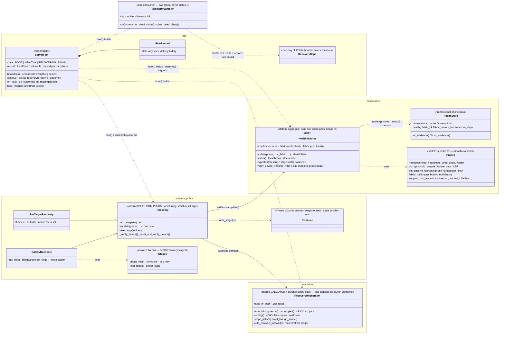
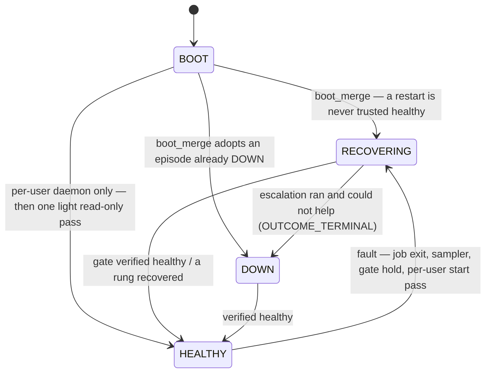
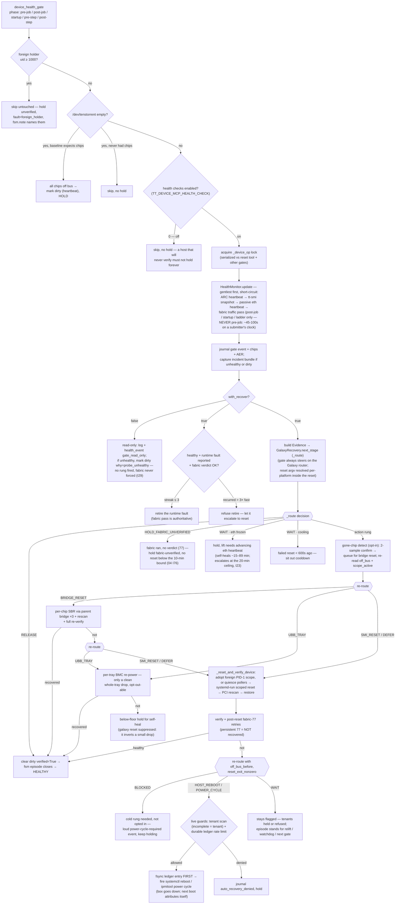

<!--
SPDX-FileCopyrightText: © 2026 Tenstorrent USA, Inc.

SPDX-License-Identifier: Apache-2.0
-->

# Health

Scope: the ServerFsm root system, HealthMonitor and its probes (heartbeat, pci/snapshot, eth,
fabric, subproc), TelemetrySampler, the between-job health gate, the boot flow and platform
resolution, and the degraded-hold / self-heal-relift model. Recovery policy and reset execution
(the ladder, platforms, `RecoveryMechanism`, stages) are spec 04; this spec describes only the
seam into them.

## Purpose

The broker must never dispatch a tenant job onto a wedged mesh, and must never let a wedge it
detected go unrecorded or unresolved. The health subsystem is the one owner of "is the device fit
for a tenant": a durable state machine (`fsm.ServerFsm`) roots a probe aggregate
(`health.monitor.HealthMonitor`), an always-on sampler (`telemetry.TelemetrySampler`), and the
between-job gate (`server._device_health_gate`) that decides hold, release, or escalation at every
job boundary.

## Invariants

No hold is unbounded. Every rule below that keeps a hold without a reset, a rung or a climb (I16,
I34, I40's fallback, I42, I46, I47, spec 04 I29/I30, and a 77-only hold with
`TT_DEVICE_MCP_FABRIC_RELIFT=0`) applies only while the hold is younger than the 10-min bound
(spec 04 I76). At the bound the broker runs its own full reset ladder, then the power cycle when the
full health check after it, fabric included, still fails; only the bounded boot / post-power-cycle
cooldown (spec 04 I65) holds longer.

- **I1 — Singletons are constructed exactly once, at boot, never per gate pass.**
  `server.boot_broker()` calls `ServerFsm.boot(RecoveryDeps)` once (guarded by `server._booted`);
  a fresh `HealthMonitor` would lose the fabric-verdict latch (`last_fabric_ok`) and the in-flight
  fabric-process handle, a fresh `RecoveryMechanism` the reset cooldown and durable ledger state.
  (Unanchored: enforced by `boot_broker`'s `_booted` guard and asserted for the suite in
  tests/conftest.py.)
- **I2 — Importing `server.py` never touches the device.** Boot (and the platform probe) runs at
  broker start, never at import.
- **I3 — Every FSM transition is persisted durably** — the whole record, atomic replace
  (same-directory temp file, `fsync`, `os.replace`), so state/why/since/dirty/latches survive a
  broker restart and a crash never exposes a half-written file. A persist failure degrades to
  in-memory-only, logged once, never a raised exception into the gate.
- **I4 — A restart is never trusted healthy.** `ServerFsm.boot_merge` always closes the door:
  RECOVERING(`startup_unverified`) absent an open episode; an episode still open on disk
  (RECOVERING or DOWN) is adopted unconditionally. There is no "clean boot, skip the verify"
  branch. Only the forced startup gate pass may open the door. A per-user daemon has no
  `boot_merge` and no fabric validator, but its start is not trusted either: it runs one light,
  read-only gate pass (`phase="startup"`, `with_recover=False`: host PCI, ARC heartbeat, tt-smi
  snapshot; no fabric, no ladder) before it serves, and a pass that finds the device unhealthy
  (or raises) leaves it RECOVERING under a self-heal hold (`off_bus`, not dirty), with the `gate`
  row journaled. A restart that loads HEALTHY from `fsm.json` runs the pass too; one that loads an
  open episode keeps it and skips the pass.
- **I5 — `why` is a closed vocabulary** (`fsm.FAULTS`). An unknown value asserts at the write
  site and clamps to `gate_error`; an unknown value read from disk clamps silently. The idle
  relift and the escalation routing branch on exact membership, so a value outside the set is a
  routing bug, not free text.
- **I6 — A cross-boot load voids the job context but keeps the device facts.**
  state/why/since/detail/latches/dirty all survive a reboot; only `job` is cleared (it cannot have
  survived), and `dirty` is deliberately NOT cleared — fail closed toward the owed reset attempt.
- **I7 — `OUTCOME_WAITING` never transitions the FSM.** Only `recovered` closes an episode
  (→ HEALTHY) and only `terminal` reaches DOWN; a platform with no ladder (per-target) reports
  waiting forever and must never be read as DOWN.
- **I8 — One UNHEALTHY observation makes the pass unhealthy; SKIPPED never heals.** A probe that
  could not run learned nothing, and a pass is healthy only when no probe that ran said otherwise.
  A crash or hang inside a check is UNHEALTHY, not inconclusive (`health.core.Verdict`).
- **I9 — Probe order is gentlest-first with short-circuit.** `HealthMonitor.update()`: host PCI →
  ARC heartbeat → tt-smi snapshot → passive eth heartbeat → fabric traffic pass. A failed host-PCI
  check, a frozen heartbeat, or a failed snapshot skips everything heavier; a frozen eth core MUST
  block the traffic pass (the pass is what shoves a frozen chip off the PCIe bus); an eth SKIP
  falls through to the pass.

  **Host PCI** (`monitors/hostpci.py`) leads because it is the only probe that needs nothing to
  have worked yet: pure sysfs bus reads, no device open, no ioctl, no UMD. It judges two things,
  both of which make the device unusable and neither of which any other probe can see — every
  Tenstorrent function on the bus is bound to tt-kmd, and no implemented BAR is left unassigned.
  A chip whose driver never bound has no `/sys/class/tenstorrent` entry at all, so the heartbeat
  is simply absent for it and the tt-smi snapshot fails for a reason it cannot name. UNHEALTHY
  rather than evidence because both faults are ones the gentlest rung repairs: a PCI rescan
  re-binds a driver that failed to attach, and places a BAR left unassigned after hotplug.

  A third verdict: no function's link reads as down (`hostpci.link_down`: `current_link_speed`
  `Unknown`, or `current_link_width` 63, the six-bit field all ones). A dead link reads all-ones
  from config space while the kernel still lists the node with its driver bound, so it looks
  present to every other sysfs read. A degraded but live link (a lower speed or width) is still
  evidence only, and an attribute that cannot be read is no evidence of anything. The same read
  keeps such a node out of spec 04's class A presence read (I37) and out of the I25 latch's
  all-back count, so a chip whose link is down never counts as back on the bus.

  The BAR rule is `flags != 0 && start == 0`. `flags` non-zero is what says the BAR exists — an
  unimplemented BAR reads all zeros across start, end and flags, and a 64-bit BAR leaves its
  second slot that way too — so a start of zero only means "unplaced" when there was something to
  place. Judging on the address alone reports every healthy device as broken and holds it.

  Everything else the probe reads is evidence and never alerts: IOMMU grouping and mode, a live
  link's speed and width, and AER totals on the endpoints **and their upstream bridges**. A correctable
  count is a trend, not a state — non-zero is ordinary on a healthy link — but the bridge half of
  the documented wedge-to-host-reboot path was not being recorded at all. `Verdict` has no third
  state by design (`health/core.py`), so a fact that must not alert belongs in `evidence`, never
  in a verdict.

  **Host-software floors are reported at boot, never enforced.** The startup preflight warns when
  tt-kmd is below `TT_DEVICE_MCP_KMD_MIN_VERSION` (2.9.0) or any chip's firmware bundle is below
  `TT_DEVICE_MCP_FW_MIN_VERSION` (19.11), both read from sysfs — `/sys/module/tenstorrent/version`
  and `tt_fw_bundle_ver`. Always a warning: an old bundle is a configuration gap, not a missing
  recovery capability, and a broker that refused to start over one would deny service for
  something nobody asked it to enforce. What it buys is the explanation for a probe result above
  — below bundle 19.9 the eth link-status telemetry is unpopulated, so the eth probe SKIPs, and
  without this line that skip reads as a broken probe rather than a host that cannot answer.
  Versions compare element-wise as integers, because `19.7.1.0` is below `19.11` and a string
  comparison says the opposite — wrong in the one direction that matters. tt-smi's own version is
  deliberately not checked: reading it means spawning tt-smi, and a boot-time probe that shells
  the device tool is the one thing a wedged host cannot afford.
- **I10 — `HealthMonitor.status()` never probes and never blocks.** It is the read side of the
  last `update()` pass — `None` before one has run — and may be minutes stale by contract.
- **I11 — `expected()` is a high-water baseline, never the survivor count.** A mesh that lost a
  tray must not lower its own bar. `TT_DEVICE_MCP_EXPECTED_CHIPS` overrides; the baseline only
  ratchets up; an unreadable baseline file fails closed to a nonzero expectation (its existence
  proves the host has shown chips).
- **I12 — The fabric traffic pass never runs on a submitter's clock.** Pre-job the gate never
  runs it, dirty or not — the flag is already the answer. It runs post-job on a failed job
  (forced, unless I36 or I38 lets a fresh green pass stand in), at startup (forced), inside the recovery ladder, after an operator's reset of a mesh
  (spec 04 I13 — the operator's clock, not a submitter's), on a `run_fabric` caller only when
  no pass is fresher than `FABRIC_CHECK_MIN_INTERVAL_SEC` (default 1200s), and post-job on a
  clean exit only when that exit's eth read reached no verdict (I30; a link-count-drop skip only
  when no pass is fresher than that interval).
- **I13 — The gate never resets over a tenant.** A foreign holder (uid ≥ `MIN_TENANT_UID`,
  1000, or below it in a broker job/exec scope or named in `TT_DEVICE_MCP_TENANT_UIDS`; 04 I6)
  skips the gate untouched: verification is deferred, an existing hold outlives the skip
  (`why=foreign_holder`), and `fsm.note` names the holder. The host rungs re-scan at fire time,
  and an incomplete scan counts as a tenant. The skipped probes are not waved through: the next
  job waits while a holder it can SEE stays (spec 01 I15). An incomplete scan does not hold
  dispatch.
- **I14 — Absence is never health.** An empty `/dev/tenstorrent` on a host whose baseline expects
  chips is every chip off the bus: mark dirty (`why=heartbeat`), hold, never release. A host that
  has never shown a chip skips with no hold — nothing there will ever verify.
- **I15 — Only proof releases.** A clear that verified (full pass) closes the episode; an
  unverified clear drops only the dirty bit (ends the RESETTING, never the doubt) and leaves the
  door held, with a durable `device_dirty_cleared` event naming whether it was verified.
- **I16 — A frozen active-eth-core verdict is held, not reset below the 10-min bound (spec 04 I76)**, dirty or not: it is the
  self-healing (~15–89 min) single-chip wedge, and the galaxy reset is the measured all-chip drop.
  Falling through to the reset needs both kill switches off: the hold's
  (`TT_DEVICE_MCP_ETH_FREEZE_HOLD=0`) AND the mass-drop floor's
  (`TT_DEVICE_MCP_RESET_MIN_DEAD_FRAC=0`, spec 04).
  A read that hangs past the caller's bound is frozen-core evidence (False), not a skip.
  A built-in reader killed on its own (tighter) timeout is waited on until it has exited, up to
  `ETH_REAP_SEC` (2s) and at most half the slack under the caller's bound, so the wait never turns
  that skip into the caller's frozen verdict (2s at 60s/45s, 0.5s at the 10s post-job bound). A
  holder scan run right after it then does not find the dying reader still listed by the driver
  and defer an escalation as an incomplete scan (spec 04 I7). The override runs at the caller's
  own bound, so it has no slack and does not wait.
- **I17 — A fabric pass that ran but reached no verdict (exit 77) holds fabric-unverified and is
  never a reset trigger.** enum+ARC cannot see a wedged eth core, so "could not check" must not
  read as fit, and 77 is not a fault a reset fixes. Only a real healthy fabric verdict lifts it.
  Its message keeps the validator's first error line, on the built-in path and in the wrapper
  script alike: a `what():` line, else a filesystem error, else a logged critical/error/`TT_THROW`
  line, else the `terminate called` banner (which sits ABOVE `what():` and names only the
  exception type), else the last line. A `TT_FATAL @`/`TT_THROW @` header names only the source
  line and the failed condition, so it carries the message from the line under its `info:`.
  A run that reached no verdict keeps its exit code and the last 64 KiB of its output (stderr
  included) in a `<stamp>_fabric_cannot_check_none` incident bundle (`fabric.log`, `incident.json`
  evidence `rc`/`reason`), rotated with the other incidents, and its detail names the bundle, so
  the cause reads without a rerun. A rerun with the same reason within an hour reuses that bundle.
- **I18 — A healthy device is not reset because a job ended badly.** A timeout or kill is a
  reason to look hard (the full check, fabric included, post-job), then believe the answer. The
  one exception is a runtime-reported device fault, which outranks checks that are blind to it.
- **I19 — `TelemetrySampler` never reads `HealthMonitor.status()`.** It samples raw sysfs on its
  own clock (`SAMPLE_INTERVAL_SEC`) — status() is the last gate pass, minutes stale, and the gate
  can itself be stuck inside a fabric check holding the device lock. Its dead-chip isolation is
  deliberately lock-free, requires two consecutive all-ones samples, is suppressed while a reset
  scope is live (a reset reads all-ones by design), treats an all-chips blackout as a global event
  (report, never amputate), and kills device holders BEFORE removing the endpoint — a mapping
  outlives the endpoint and a read through it stalls a CPU core and reboots the host.
  Its raw reads go through the chip-state gate (I66): it skips the sample while a reset step owns
  the chips, a chip it has confirmed lost reads as all-ones without a PCIe read until its re-read
  is due, and it stops the device pollers on the first hung sample, not the second.
- **I20 — A stalled sampler withholds the systemd watchdog ping.** The escalation ladder must
  never sit silently behind a dead sampler; a stall past `STALL_SEC` gets the broker restarted.
- **I21 — The idle relift lifts a hold only on proof, read-only for self-heal holds.**
  `eth_frozen` lifts only on a positively-advancing eth heartbeat; `off_bus` lifts once enum+ARC
  see the chip back, unless the eth read is affirmatively frozen or the last fabric verdict is
  UNHEALTHY, and only after the full gate, fabric included, passes (I52); a skip (`None`) never
  overwrites the fabric latch. The relift is
  rate-limited (`SELFHEAL_RELIFT_INTERVAL_SEC`, default 120s), single-flight, re-checks every
  guard under the device-op lock, and bails when the hold was re-dirtied or a chip drops
  mid-verify — a dirty device belongs to the pre-job gate, or with nothing queued to I68.
- **I22 — The fabric relift is the only relift path that runs the traffic pass, and it is off by
  default** (`TT_DEVICE_MCP_FABRIC_RELIFT`) except for a 77-only hold (I34) and an off-bus return
  (I52). It lifts only on an
  explicit healthy verdict; a 77 on retry or a failure holds. With it off, a fabric-unverified hold
  with any trace of a fault falls into the generic escalate category rather than standing forever.
- **I23 — Every hold terminates.** The hold-deadline watchdog puts a stuck hold on the durable
  timeline once per window; past the ceiling (`_stuck_hold_ceiling_sec`, default 600s; off-bus
  holds with an isolated chip get one early attempt, the one-shot) a tenant-free hold is
  force-escalated through the gate's own gentlest-first ladder (spec 04). Both re-arm per episode.
  The one-shot is due one sampler interval into the hold (`_offbus_one_shot_sec`, 10 s, so it runs
  10-20 s after the hold opens): the hold opened on a gate that declined to reset below the
  galaxy-reset floor, and a chip that left the bus never returns by waiting. The early run checks
  for a tenant quietly first; if one holds the device it gives the one-shot back with no device op,
  event or rung, and the one-shot then waits `_offbus_hold_ceiling_sec` (default 120s) from the hold
  start, where the stand-down below and spec 04 I7 apply. A pending host action (spec 04 I34)
  suppresses the early run as it does any forced run. Time to the first rung for an idle partial
  off-bus hold (spec 04 class B1) falls from about 120 s to 10-20 s; with a tenant, the ceiling
  windows, the whole-tray path (spec 04 I37) and the worst case are unchanged.
  A window whose forced run stood down on a live tenant is given back, not spent: the next tick
  with no tenant (checked quietly first) runs it. A one-shot past the ceiling claims that window; a one-shot given back on a
  live tenant gives back the window it claimed too, so a hold whose chips came back meanwhile runs
  that window on the next idle tick instead of waiting one more whole ceiling.
  The windows count from the episode start, kept on disk so a restart while held cannot rewind
  them. A start left by an earlier process is restored only by the first hold of a process that
  has not yet seen the device fit, only within the same boot (kernel boot id), and never for a hold
  opened on a foreign holder; the first fit verdict with no hold open clears it. The start stays a
  bare timestamp that older brokers can read; the boot id lives in a sidecar that only qualifies the
  start it names (otherwise: carries only if newer than btime). An unparseable start is never
  restored. A tenant hold writes nothing until the holder is gone and the device is still held.
- **I24 — `server.py`, `fsm.py`, and `telemetry.py` import health only through the
  `tt_device_mcp.health` facade** — enforced by an AST walk over those files.
- **I25 — `TT_DEVICE_MCP_HEALTH_CHECK=0` skips the gate with no hold.** A host that will never
  verify must not shut the door once and forever. Set by an operator, or by preflight when a
  non-root daemon has no tt-smi; no install shape sets it.
- **I26 — The evidence dict keeps the legacy vocabulary.** `HealthState.as_evidence()` emits
  `{"heartbeat": .., "snapshot": .., "eth_heartbeat": .., "fabric": ..}` (the `pci` observation
  relabels to `snapshot`; heartbeat's verdict key is `verdict`, not `ok`) and
  `from_evidence()` round-trips it — the durable journal and the test fakes are built on it.
- **I27 — Platform resolution commits nothing it cannot prove.** A declared
  `TT_DEVICE_MCP_RESET_MODE` commits without touching the device; otherwise one boot snapshot
  caches board types and decides; an unreadable mesh commits nothing and the per-pass fallback
  stands (pinning per-target on a degraded Galaxy would ship the reset that cannot recover it).
  A probe that raises never stops the broker booting.
- **I28 — The eth-heartbeat rung arms itself per host, and vouches only for the links it has
  seen.** The startup self-test times the read; a fast answer arms (a frozen verdict still counts
  as armed — the read worked), a read that never measured leaves the rung off, loudly, and a
  disarmed reader skips — it never delivers a HOLD. A self-test that failed with a reader present
  (could not check, over budget, not runnable) is retried from the idle sampler tick, a full
  `ETH_CHECK_REARM_INTERVAL_SEC` (600 s) after the previous attempt, only on a HEALTHY device
  with no job queued, running or re-adopted and no post-job gate pending, under the device-op
  lock, so a missed startup budget no longer leaves the rung off until the next restart. The same
  retry runs, unpaced, at the head of every full health pass while the rung is off (the startup
  gate, the gates' full passes, every post-reset verify and the idle relift of an `eth_frozen`
  hold), under the device-op lock its caller already holds, so a reset or a gate re-arms the rung
  before it reads the mesh rather than leaving it off for the broker's life. During an open fault
  episode (the device held or dirty for a fault; the `startup_unverified` hold every broker start
  opens is not one) a self-test that hung past its budget is evidence of a frozen eth core, the
  wedge that hangs the read: that pass records the eth read FROZEN, runs no traffic pass, and the
  device stays held (the gate's `eth_frozen` hold and its bounded escalation; a post-reset verify
  fails). Outside an episode a hung self-test only leaves the rung off, as before. A host
  with no eth reader at all is not retried. The built-in probe reports how many up links it
  measured; the broker keeps a high-water mark of that count (`eth_link_baseline.json` in the
  health dir, seeded by the self-test, written atomically; an unreadable file skips one read and
  is rewritten with the current count). An all-advancing read that measured fewer links than the
  mark is a skip, not a pass: the probe does not read a link that is down, so the count is the
  only place the loss shows. In the gate's own pass that changes the record (SKIPPED, not a
  HEALTHY eth reading) and not the route, since the traffic pass runs on a skip as on a pass. On a
  host with no cabling descriptor (`TTDEV_FABRIC_DESCRIPTOR` unset) it also changes that pass's
  verdict: the validator builds its mesh from the links it discovers, so a down link is left out
  and the traffic over the rest passes. Such a pass, while the last eth read counted below the
  mark, is a FAILED fabric check (`fabric_links_unseen`), never adopted (nor an operator
  verification job's, spec 01 I21) and never settling a post-reset debt (04 I32): the device stays
  held and takes the ladder, the 10-min hold ceiling, then the host rung, like any measured fabric
  fault. A clean exit's read that counts the drop fails the check the same way, without the pass
  and whatever its rate limit (I30). The drop belongs to the read that counted it: every eth read
  (the self-test's included) that prints no count (a crash, its own timeout, a 77, a disarmed
  reader, an override) clears it, so an old drop never fails a pass on a mesh a reset has since
  healed. With a descriptor the validator compares the links itself (I45). A new mark (no file, or
  an unreadable one rewritten) is journaled `eth_link_baseline_seeded`: those are the only ways
  the mark comes down. It also changes the idle relift: an `eth_frozen` hold whose frozen core's link went down stays held
  instead of lifting on the cores that are left. A frozen verdict stays frozen. An operator
  override is still judged on its exit code alone.
- **I29 — An externally-driven read-only pass records but never acts.** `with_recover=False`
  journals its verdict, holds an unhealthy device, and freezes an incident bundle, but enters no
  rung of the ladder and never runs the fabric traffic pass regardless of `run_fabric`,
  `force_fabric`, or a dirty device. An unhealthy verdict marks the device dirty with
  `why="probe_unhealthy"` (`fsm.FAULTS`) — never `job_killed`, since no job is in play — leaving
  the device dirty for the next gate: the prologue that drives it is on the critical path of every
  node in an allocation; the recovery it declines is the epilogue's work (spec 07 `post-step`).
  The per-user daemon's start pass (I4) is the one internal caller; it then converts that dirty
  mark into a self-heal hold.

  `post-step`'s recovering pass (`with_recover` defaulted True) is bound by
  `TT_DEVICE_MCP_POST_STEP_DEADLINE_SEC` (default 600s), as ONE absolute deadline for the WHOLE
  route — the reclaim and the gate together, not the gate alone. `deadline_at =
  time.monotonic() + deadline_sec` is computed once, before the reclaim starts; the reclaim
  (`_run_step_reclaim`) and the gate (`_run_step_gate`) each get whatever of that budget remains
  when they start, not a fresh allotment apiece. Splitting the deadline this way — rather than
  starting the clock only once the reclaim returns — matters because reclaim itself is not free:
  it can run two rounds (SIGTERM, then SIGKILL) with a real grace sleep between them, and a
  genuine ladder climb after it can exceed the budget on its own — a `tt-smi -r` alone runs ~15s,
  post-reset fabric retries add 45-100s each behind a 60s sleep, and a wedged mesh has measured a
  255s fabric timeout — two or three of those and 600s is gone regardless of the reclaim.

  The deadline bounds the ROUTE'S REPLY, not either phase's device work: both the reclaim and the
  gate run as background tasks and, on the deadline, the route returns `inconclusive` and leaves
  whichever task is still running — never cancelled. Reclaim SIGTERMs/SIGKILLs real processes, so
  cancelling it mid-round is exactly as unsafe as cancelling the gate mid-device-op; the gate's own
  device work happens in `asyncio.to_thread` calls (holder scans, heartbeat reads, snapshots,
  incident capture), and a cancellation cannot stop a thread already running — cancelling the
  coroutine around it only unwound the gate's `async with _device_op(...)`, releasing the lock
  while the thread kept touching the device — exactly the case a hung read produces, since a
  stalled read is *why* the deadline fires in the first place. Never cancelling either phase, and
  holding both `_device_op` and the reservation below until whichever task is running actually
  completes, is what keeps a second gate or a freshly dispatched job from overlapping it. (Spec 07
  I9 covers the CLI/exit-code side of this.)

  A step reserves the device against job dispatch (`_reserve_external_step` /
  `get_external_step_free_event`) from immediately after its in-flight check — before `post-step`'s
  reclaim runs, not just before the gate — until whichever background task the route is waiting on
  finishes, released from that task's own done-callback rather than when the step's reply is sent.
  Because reclaim and the gate run sequentially under the SAME token, only one of them ever owns
  the eventual release at a time: a done-callback is attached to reclaim's task only when reclaim
  itself overruns the deadline (the route then returns without ever calling the gate); on a normal,
  in-budget reclaim, nothing releases yet and the token passes straight to `_run_step_gate`, which
  attaches its own. `job_runner` awaits the reservation before it ever calls
  `_ensure_device_clean_for_next_job` or spawns a job's process, so a job cannot dispatch underneath
  a step's holder scan, its `_device_op`, or (for `post-step`) its straggler reclaim — closing the
  window where the reclaim's own `to_thread` hand-off used to let a freshly dispatched job's
  process be misread as a stale straggler and SIGTERM/SIGKILLed. This is one-directional (the step
  never waits on the runner), so there is no lock and no cycle to deadlock on; `_device_op` itself
  cannot be held across the gate call for the same reason (`device_health_gate` acquires that same
  non-reentrant lock internally).

  **Step routes serialize against each other.** Both wait out any reservation already held
  (`_await_external_steps_clear`) before taking their own, bounded by the route's one absolute
  deadline. Overlapping was the earlier design and it was wrong: an Epilog and the next Prolog
  can each pass the in-flight check during the OTHER's pre-`_device_op` window (for `post-step`
  that window is the reclaim's own grace sleeps, up to ~20s), and a Prolog that answers in that
  window reads the epilogue's stragglers as foreign holders, reports the mesh `unfit`, and drains
  the node plus requeues the job (spec 07 I9) over a device that was seconds from being handed
  over clean. Its probes also run concurrently with the reclaim's signals, and two reclaims would
  interleave SIGTERM/SIGKILL rounds and each audit kills the other may have made.

  Waiting rather than refusing, because a refusal has the identical drained-node outcome.
  `external_step_active` therefore still never joins `_broker_work_in_flight`'s refusal
  predicate. The wait costs nothing in the ordinary case — nothing is reserved, so it returns at
  once — and a step still holding the device when the deadline expires means a recovery genuinely
  is in progress, so `inconclusive` is the true answer there, not a false verdict from a gate that
  never ran. The loop re-checks after every wake rather than trusting one event fire, so a step
  that reserves between the event being set and the waiter resuming is waited on too.

  The reservation is keyed by token (`_external_step_holders: dict[token, phase]`), not a plain
  flag. Two simultaneous holders are no longer reachable through the routes, but the keying is
  what makes relying on that serialization safe: a release clears only its own claim, and a
  double release (a bug, or a caller's own cleanup racing its task's done-callback) is a no-op
  instead of an under-count that would free the device while a still-live token remains.
  `get_external_step_free_event` is `set()` only when the holder map is empty.

  Both step routes ALSO refuse up front while the device is not idle of broker work
  (`_broker_work_in_flight`): a queued or running job, a running job's own teardown window (a job
  that just went `HUNG` is no longer `RUNNING`, but the runner still owns the device until it
  reaps the process and clears its own bookkeeping — read from that bookkeeping directly, not
  `JobStatus`, so this window is covered), or a broker device op already in flight outside any job
  (a reset, a fabric pass). This check is a snapshot, not a lock — the reservation above is what
  actually excludes job dispatch — but it still matters for what the reservation does not cover: an
  operator's own `tt_device_reset` takes `_device_op` directly and answers to nothing the
  reservation gates. `post-step` re-checks it after the reclaim returns and before the gate, so a
  reset that started during the reclaim's `to_thread` yield still stops the gate from running over
  it; a second refusal there still carries whatever the reclaim already found
  (`reclaimed`/`survivors`).

  A gate call that raises (rather than times out) still must produce a verdict, never an unhandled
  500 — both routes catch it via the gate task's outcome. The two routes are asymmetric here
  exactly as their in-broker twins are: `post-step`'s twin (`_verify_device_after_job`) marks the
  device dirty with `why="gate_error"` on a gate exception, so `post-step`'s gate task's
  done-callback does the same; `pre-step`'s twin (`_ensure_device_clean_for_next_job`) only clears
  and retries, taking no destructive action, so the read-only `pre-step` marks nothing and reports
  `inconclusive` — it found nothing it can vouch for, and marking the device dirty on the strength
  of an exception a read-only pass never diagnosed is not this pass's call to make. Marking dirty
  happens in the done-callback, not in the route's reply path, so it still happens even when the
  exception arrives after the deadline already sent an `inconclusive` reply. That same
  done-callback MUST retrieve the task's exception (`task.exception()`) whether or not it acts on
  it — skipping that logs "Task exception was never retrieved" at garbage collection, the asyncio
  warning this project's own history already hit once for the previous `wait_for`-based version of
  this code.

  The done-callback's own body — the log line, `_mark_device_dirty` (sysfs reads via
  `chip_snapshot_event`, `fsm.on_fault`'s durable persist) — does real work and can itself raise;
  asyncio swallows a done-callback's own exception into the loop's exception handler, so it never
  propagates to anything that could notice or retry. The release (`_step_gate_tasks.discard` +
  `_release_external_step`) therefore runs in a `finally` around that body, not after it: a plain
  sequential release would skip both on exactly this kind of error and leak the reservation
  permanently, wedging `job_runner`'s dispatch until the broker restarts — a worse outcome than any
  race this whole mechanism exists to close.

  A step's reservation can hold `job_runner`'s dispatch for as long as its own gate call actually
  takes — unbounded past the step's deadline once a `post-step` recovery-ladder climb is under
  way, or forever if a `to_thread` read never returns at all (the wedged-chip read-hang signature).
  That cost is acceptable only because it is visible, not silent: the moment `job_runner` defers on
  the reservation it emits a `job_deferred_for_external_step` health_event and a matching log line
  naming the holder, and `_get_queue_status` (spec 02's `tt_device_queue_status` /
  `tt-device-mcp status`) reports `external_step_active` and a RUNNING row reading "external step
  reserved: `<phase>` (job dispatch deferred)" for exactly as long as the reservation stands.

  A reclaim that signals anyone is the one destructive thing this route can do to a process it
  does not own, so it gets the same durable record as every other privileged device action (the
  reset stream, `exec`): a `straggler_reclaim` `health_event` (signalled pids/uids, survivors, scan
  completeness) plus an action-log row. A reclaim that signals nobody writes neither — there is
  nothing to confess, and a row on every clean post-step would drown the ones that matter.

  "Signals anyone" is judged over every pid the reclaim actually sent a signal to across both
  escalation rounds (SIGTERM, then SIGKILL for whoever ignored it), not just the survivors of the
  last round it ran. A straggler that dies to SIGTERM drops out of the next round's targets by
  design (04's escalation only re-signals what is still there), but it was still signalled — the
  record must include it, or a run that SIGKILLed a tenant can land here with an empty audit.

  **The audit contract has no deadline.** A reclaim that overran its reply — or whose client
  disconnected — still killed real processes, and `inconclusive` going out to the scheduler is
  not a reason for those kills to go unrecorded. Both the in-budget path and the handed-off
  done-callback route their result through one helper (`_audit_straggler_reclaim`), so the record
  is identical either way; a `late` field marks the ones the reply that already went out could
  not mention. The earlier code discarded the eventual `ReclaimResult` on the timed-out path, so
  root SIGKILLing another user's pids appeared in neither the journal nor the action log.
- **I30 — A clean post-job exit reads the eth heartbeat when the rung is armed.** Enumeration,
  ARC and the snapshot cannot see a wedged eth core, so on an armed host (I28) the post-job gate
  on an exit-0 job also runs the passive eth read, bounded by `ETH_POST_JOB_TIMEOUT_SEC` (10s,
  the self-test's arming budget; a healthy read is ~1s). The reader's python import check
  (`eth.resolve_python`, up to three 10s spawns outside that bound) runs once per process, not
  per gate: its answer is cached and re-resolved only when the validator's `current` symlink is
  re-pointed, a candidate env var changes, the cached python or tree disappears, a built-in read
  crashes (exit 1) or cannot spawn, or a "no python" answer is older than 60s (one caused by an
  import check timing out is not cached). A frozen verdict — including
  that bound expiring (I16), and an operator override's own timeout — holds the door through the
  existing eth-frozen hold, with no reset.
  A read that reaches no verdict (the built-in probe's own timeout, a crash, exit 77, no runnable
  reader) runs the full fabric pass inside the same gate, exactly as a failed job's does, so its
  exit 77 holds fabric-unverified on a multi-chip mesh (I17). A read whose cores all advanced
  but whose measured link count is below the host's high-water mark (I28) is a skip of another
  kind: the drop stays until an operator deletes `eth_link_baseline.json` or a topology-mismatch
  lift re-baselines it (I45), so on a host with a cabling descriptor it runs the fabric
  pass only when no pass is fresher than `FABRIC_CHECK_MIN_INTERVAL_SEC`. Otherwise the gate
  records the eth read SKIPPED and releases, as on a disarmed host. Without that limit every
  clean job on such a host paid a 45–100s pass. With no descriptor no traffic pass can see the
  drop (I28), so neither the limit nor the pass applies: the check fails at once
  (`fabric_links_unseen`, no pass run) and the gate holds and takes the ladder, as after a reset. Accepted trade-off: a built-in read
  that armed in 9–10s outlasts its own 9s bound here, so that host pays the fabric pass after
  every clean job — fail-closed, and journaled. Only the startup self-test's arming (I28) turns
  this on; a disarmed host keeps the old clean-exit gate: snapshot only. The Slurm `post-step`
  gate on an exit-0 step gets the same read with the same fallback: its worst case (the 10s read,
  then a traffic pass bounded by `FABRIC_CHECK_TIMEOUT_SEC`) is no more than a failed step's
  forced pass already costs inside the same step deadline (spec 07 I9), and an overrun answers
  `inconclusive` while the gate runs on (I29). The read-only `pre-step` pass never runs it.
  Rationale: on the field data behind this rule, 76–87% of post-job passes were this light
  path, and a stuck eth read was followed by a fabric failure 23 times out of 23.
- **I31 — A short chip count is a drop, between gates too.** The live liveness read
  (`_device_liveness_reason`, behind every admission and status query) and the sampler's
  `check_for_dead_chips` compare the sysfs node count with `HealthMonitor.expected()` — the same
  count the gate's heartbeat verdict uses, so the units cannot drift. Fewer nodes than expected
  is a degraded reason at once in the liveness read (one sample, no sleep), and a dirty mark
  (`why=heartbeat`, `chips_missing` event) after two consecutive short samples in the sampler.
  The sampler flags it only on a HEALTHY box: under an open episode (an off-bus hold the gate
  placed `dirty=False`) the short count is that same fault, and re-dirtying it would undo the
  hold. A reset in flight is excused as for all-ones. More nodes than expected is healthy; a host
  with no baseline (expected 0), or with health checks off (I25), is unchanged.
- **I32 — A stale verdict is re-checked before dispatch.** When the device is HEALTHY but the
  last probe pass (`HealthMonitor.status().at`, or the last re-check) is older than
  `TT_DEVICE_MCP_DISPATCH_RECHECK_SEC` (default 300; 0 disables), `_ensure_device_clean_for_next_job`
  runs a light re-check before admitting the job: the chip count against `expected()`, the
  two-sample ARC heartbeat (where the driver exposes it), and the passive eth heartbeat read only
  when that rung is armed (I28) and no foreign tenant holds the device. It NEVER runs the fabric
  traffic pass (I12) or the tt-smi snapshot. A short count or failed heartbeat marks the device
  dirty (`why=heartbeat`), so the admission loop's next pass runs the pre-job gate and the job
  stays at the door until a verify releases it; a frozen eth read holds as I16. It runs as a
  device op and re-reads the state under it: a hold placed, or a reset scope still active, while
  it waited ends it without a read. A re-check that raises is logged and is not a verdict: the
  device is not marked. A fresh verdict costs nothing, and the re-check never runs inside `_device_liveness_reason`, which answers
  status queries and must not sleep.
- **I33 — The startup fabric pass waits for the 1G hugepage pool.** With
  `TT_DEVICE_MCP_EXPECTED_CHIPS` set, and a Tenstorrent function behind an identity IOMMU domain or
  none, the broker polls `nr_hugepages` (1G pool) for up to `STARTUP_HUGEPAGES_WAIT_SEC` (120 s)
  under the device-op lock before the pass. The count it waits for is one page per such PCI
  function, never the declared chip count: UMD pins one page per function and the vendor setup
  allocates per function, so a card with two chips behind one function (n300, T3K) keyed on chips
  would wait for pages nothing allocates, and its relift would never run. Still short, it runs no pass (one would only exit 77):
  it records could-not-check with the reason `hugepages not yet allocated: N/M` (a
  `fabric_check_unavailable` event and a `skipped` action row) and holds `fabric_unverified`; the
  idle relift re-runs the pass once the count is met. Sysfs reads only. A dirty carried episode
  still runs the gate; an unreadable pool or a translating IOMMU waits for nothing. The shipped
  wrapper (`deploy/tt-device-fabric-check.sh`) makes the same count itself, with or without
  `TT_DEVICE_MCP_EXPECTED_CHIPS`: on a short pool it exits 77 with `hugepage pool not ready: N/M`
  without opening the device, and it names a validator run that died on `Failed to pin pages for
  hugepage` the same way. It keeps each run's whole output in `<output>/last-run.log`, overwritten
  per run (head and tail of each validator run past `TTDEV_FABRIC_LAST_RUN_MAX_BYTES`, default 4 MiB;
  the topology rerun can so leave two). A cap that is not a byte count of at least 1024 is logged
  and read as the default, never turned into a fault.
- **I34 — A hold whose only cause is a fabric 77 is re-checked, not reset below the 10-min bound.** `fabric_unverified`,
  not dirty, no reported fault, no isolated chip, and no pass measured the fabric bad
  (`last_fabric_ok` is not False): a 77 is a missing prerequisite, and a reset cannot produce a
  fabric verdict. Below the 10-min bound (spec 04 I76) neither the idle relift's generic
  escalation, the hold-deadline forced escalation nor the watchdog resets it; the idle relift
  re-runs the read-only fabric pass instead (on by default; `TT_DEVICE_MCP_FABRIC_RELIFT=0` drops
  that re-run, except for the one startup pass I39 owes), after the hugepage pool is full. At the
  bound I76 runs the full ladder, then the power cycle, relift or not. Once a pass measures the fabric bad, the hold is no longer 77-only and I23 applies.
- **I35 — An operator's AICLK ceiling is proven before any load the broker drives, fail-closed.**
  Opt-in per host (`TT_DEVICE_MCP_AICLK_CEILING_MHZ`; unset, no step runs and no time is added).
  Every probe pass whose snapshot proved the chips present re-applies the firmware clock cap
  (`SET_ASIC_HOST_FMAX`) and reads it back, after the snapshot and before the eth read and the
  fabric pass; a chip it cannot bring to or below the ceiling is an UNHEALTHY pass that runs no
  traffic. The same apply runs at broker start, once the hugepage pool is ready, before the startup
  fabric verify, and at the job door
  whenever a job exit or reset may have cleared the cap since the last verified apply — a mesh
  reset, an adopted in-flight reset, a per-chip bridge reset and a tray re-power each mark it owed
  (one retry,
  then the device is marked dirty `probe_unhealthy` and the bounded ladder owns it — the door never
  wedges the queue). The helper sends only to a chip reading above the ceiling, so it never fights
  another holder of the same or a lower cap. A helper that cannot run on this host at all (exit
  77/126/127: wrong architecture, no telemetry support) disarms the feature for the process, loudly
  (`aiclk_ceiling_disarmed`), rather than holding healthy silicon on a configuration error.
- **I36 — A failed job that never reached the device does not force a second pass.** A FAILED
  job with a normal exit code of its own (not a signal death, timeout, kill or hang, and never a
  missing exit code) that ran under `NOOP_FAILURE_MAX_RUNTIME_SEC` (2s)
  (`_job_never_reached_device`) could not have opened the device. The exit code alone never
  qualifies a job: under `bash -c` with `set -e`, a script that used the device and then hit a
  missing or non-executable command also exits 127/126. Its post-job gate drops the forced
  fabric pass when all of these hold:
  the device is HEALTHY and not dirty, the eth rung is armed (I28), the last fabric verdict
  (`HealthMonitor.last_fabric_ok`) is OK, and the gate's last pass with a verdict is younger than
  `TT_DEVICE_MCP_NOOP_FAILURE_FABRIC_FRESH_SEC` (default 300s). The gate then runs the passive eth
  read of a clean exit (I30) and journals `forced_fabric_skipped`. A frozen read holds (I16); a
  read with no verdict runs the full pass in the same gate, a link-count-drop skip included (the
  interval that rate-limits that skip after a clean exit does not apply here). Any condition
  missing, the failed job pays the full pass as before. Only the in-broker job runner says a job
  never reached the device: a Slurm `post-step` still forces the pass, and so does a job the runner
  ended on its own error, before or after the spawn, however fast and whatever its exit code.
  Rationale: box A lost its host ~9s into a pass forced 2s after a green one by a job that had
  failed in 0s on a missing directory; the pass is the heaviest load the broker puts on the mesh,
  and that job told it nothing.
- **I37 — The stuck-hold alert hook is opt-in, backs off, and never blocks.** With
  `TT_DEVICE_MCP_ALERT_CMD` set, the first `hold_stuck_past_deadline` of an episode also runs that
  command (argv split like shell words, no shell) with the event as JSON on stdin. Repeats wait 2,
  4, 8 … deadline windows, the gap capped at 24 h, and re-arm with the episode; the backoff is kept
  on disk with the episode (`hold_alert_backoff.json`), so a broker restart mid-episode does not
  page again. The command runs on its own thread under `TT_DEVICE_MCP_ALERT_TIMEOUT_SEC` (its
  process group is killed past it), one at a time; its output is read in chunks and only the last
  4 KB kept, and its own exit ends the run even if a child it left behind holds the pipe. A failure
  is only logged, as is a command that does not parse (which leaves the hook off). Unset, nothing
  runs and the timeline is unchanged.
- **I38 — A clean exit-1 failure may skip the forced pass while an OK pass is fresh.** Off by
  default: `TT_DEVICE_MCP_EXIT1_FABRIC_WINDOW_SEC` = 0 keeps the forced pass. Set above 0, a FAILED
  job that exited 1 on its own (`_job_failed_exit1_clean`) and whose log tail (the same bounded
  tail `_scan_output_for_device_fault` reads) holds none of `_DEVICE_FAULT_SIGNATURES` and no hang or
  timeout text (`_EXIT1_HANG_SIGNATURES`: a pytest-timeout abort, `TIMEOUT: device timeout`,
  `Timed out`) drops the post-job forced pass when all of these hold: the device is HEALTHY, not
  dirty and has no reported fault, the eth rung is armed (I28), `HealthMonitor.last_fabric_ok` is
  OK, and the gate's own last OK pass (`last_fabric_ok_monotonic`) is at most the window old with
  no reset since. Only an OK verdict sets that stamp; an UNHEALTHY verdict clears it, a pass with no
  verdict (exit 77) leaves it, and every reset or recovery attempt clears it: the gate ladder, an idle
  relift, a hold escalation, a host power cycle and an operator reset clear it as they start (a
  bridge reset or tray re-power runs inside one of these), every device action row but the pass
  itself clears it, and the mechanism's last reset time is a backstop. A missing
  log, a signal death, exit 124 or any code but 1, and a KILLED, TIMEOUT or HUNG job never qualify.
  The cheap reads still run (host PCI, ARC heartbeat, snapshot, the passive eth read of I30): any
  that is not clean takes today's path (a frozen read holds, I16; an unhealthy read takes the
  ladder; a read with no verdict runs the full pass in the same gate). All clean, the gate logs
  `fabric: not run - exit 1 with clean reads, last OK pass Ns ago (window Ws)`, worded so it never
  reads as a fabric verdict, and journals `exit1_fabric_not_run`. The RUNG INVENTORY line at boot
  reports the window. Only `post-job` qualifies: startup and Slurm `post-step` are unchanged.
  Rationale: the pass is the heaviest load the broker puts on the mesh and sometimes takes a
  marginal chip off the bus; after an exit-1 failure with a clean tail and a recent OK pass it
  rarely finds anything the cheap reads miss.
- **I39 — A startup pass that a missing prerequisite turned into a 77 is owed again once it lands.**
  The broker can start before `install-fabric-validator.sh` publishes the pinned validator's
  `current` link (its timer runs minutes after boot), and the startup pass then exits 77. When the
  validator (its binary, runtime root and, if configured, cabling descriptor) was missing as the
  startup pass began, or the I33 hugepage wait ran out, and the pass leaves a 77-only hold (I34),
  the broker watches for the missing pieces with stat and sysfs reads only, backing off from 5 s to
  60 s, for up to `STARTUP_PREREQ_WAIT_SEC` (2.5 h, past the validator service's own start
  timeout). Once all are present it marks that hold episode as owed one fabric pass. The idle relift
  runs it even with `TT_DEVICE_MCP_FABRIC_RELIFT=0`, under the device-op lock with every guard of
  I22/I34. It lifts only on a healthy verdict and never resets. The pass is owed once: another 77
  leaves the hold standing, and the debt never carries to a later episode. The watch stops as soon
  as the hold is lifted or replaced by any other path, and it never runs the pass itself. With the
  validator present at startup, the only added cost is up to three stat calls.
- **I40 — A 77-only hold is bounded; past the bound the startup checks gate it, never forever.**
  Each idle-relift pass that 77s again on the same 77-only hold episode (I34) counts one retry.
  After `TT_DEVICE_MCP_FABRIC_77_MAX_RETRIES` (3) retries, or once the episode is
  `TT_DEVICE_MCP_FABRIC_77_BOUND_SEC` (600 s) old with at least one retry behind it (a hugepage 77,
  I48, needs none), or on the first retry of a hold that owes the climb (04 I79: its reset already came
  back UNKNOWN, or this boot is a 77 reboot's result with the cold rung due), the broker
  journals `fabric_check_unrunnable_bound` (on every such pass), sends the alert hook (I37) once
  per hold episode (a page the hook dropped goes out on the next pass) and gates on the startup
  checks instead of the fabric pass: enum+ARC (already passed on that relift) plus a positively
  healthy eth-heartbeat read, which also compares the up-link count with the host's baseline, so a
  link that went down never reads healthy. Only that releases the hold, with a warning
  (`device_relift_fabric_unverified`; the fabric stays unverified and the next gate re-runs the
  pass), and at most once per `TT_DEVICE_MCP_FABRIC_77_RELEASE_WINDOW_SEC` (6 h). A frozen or
  unreadable eth read, a link-count drop, or a second 77-only hold inside the window climbs the
  present-mesh rung of the ladder with every guard of the stuck-hold escalation. A post-reset
  fabric that is still a 77 after the eth-training retries (spec 04) is UNKNOWN, not a failed
  reset: it never clears the hold, never arms the reset cooldown or the gate's two strikes, and
  drives the idle ladder's host-rung climb only through a refused fallback, by way of spec 04 I29.
  The reset settles as this 77-only hold (not dirty, the reported fault it was the remedy for
  retired), its post-reset passes count toward this bound (so the next relift that 77s gates on
  the startup checks at once), and this bound ends it. Not while a reset still owes a fabric pass
  (spec 04 I32): the startup checks prove no fabric after a reset, so such a pass climbs the
  present-mesh rung instead of releasing, and the reset's hold ends in a passing fabric pass or the
  ladder's bounded climb (spec 04 I29). That climb also reaches the host rung when the last-chance
  sweep still reads a 77 with no known no-reset cause: once per episode, then an operator hand-off
  (spec 04 I29), the device held until a full check with fabric passes. A 77-only hold that followed
  no reset releases as above.
  Idle path only: no added time between
  jobs. The hardware fault of the first job after a
  topology-mismatch lift (I42) is outside this bound: no release or rung can fix cabling. A
  topology mismatch whose traffic-only rerun could not run is inside it (I45). Below the 10-min
  bound the deadline escalation resets neither (spec 04 I30); at the bound it runs the full ladder,
  then the power cycle (spec 04 I76). The validator's `Encountered
  unrecoverable state` (links still missing after its retrains) is a measured fault, never a 77.
- **I42 — A cabling-descriptor topology mismatch is never a reset; its lift is bounded by one job.**
  When the validator stops on `Connection mismatch detected` (the links it discovered are not the
  descriptor's; tray ids come from PCI bus numbers, so a moved uplink or an absent cable mismatches
  on every run), `classify()` returns a skip whose detail starts with `topology mismatch`, never a
  measured-bad verdict. The built-in path and `deploy/tt-device-fabric-check.sh` rerun once without
  the descriptor, so traffic still crosses every discovered link, and classify that run with the
  usual table: bad links are still a fault, a run that did not measure stays a topology skip (77).
  A pass is OK and carries the `TOPOLOGY MISMATCH vs <descriptor>: N missing, M extra` marker (the
  wrapper's last line before exit 0). The broker journals `fabric_topology_mismatch` with the trays
  whose chips moved since the last clean pass (`fabric_ok_asic_bus.json` in the health dir) and
  pages the operator once per distinct mismatch. The first job after that lift is watched: if it
  fails on the fabric, the skipped links are a hardware fault, the device is held fabric-unverified
  and every later fabric check is withheld (a 77-only hold, no reset, reboot or power cycle) until
  an operator restarts the broker or the hold reaches the 10-min bound, where spec 04 I76 lifts the
  latch, runs the full ladder and lets the full check decide, then the power cycle. Below the bound
  the page is the hold's only signal, so each idle-relift
  pass that still holds pages it again once `TT_DEVICE_MCP_MESH_HOLD_REPAGE_SEC` (3600 s; `0` pages
  once) has passed since the last page of the same hold episode; a page the hook dropped goes out on
  the next pass, and a new hold episode pages anew. Any later job is outside the bound. A clean pass without the
  marker ends the lift.
- **I43 — A foreign-holder hold whose holder is gone is verified at once, not reset at the ceiling.**
  A hold placed only because a tenant held the device when the gate wanted to verify
  (`why == "foreign_holder"`) carries no measured fault. When the idle relift reaches it (the generic
  branch, so `TT_DEVICE_MCP_GENERIC_HOLD_ESCALATE` must be on) and a fresh holder scan shows no
  tenant, no RUNNING job, no reaped job's leftover and a complete scan, it runs the pre-job verify
  (enum+ARC, no traffic pass) under the device-op lock. It lifts on a healthy read only when no
  runtime-named fault is pending and the last fabric verdict did not read UNHEALTHY, and only if the
  hold is still the same undirtied foreign-holder hold after the verify. Any other outcome falls
  through to the existing ceiling escalation (I23 generic), which is unchanged. A tenant still there
  means no probe at all. It emits `foreign_holder_verify` with `lifted` either way.
- **I44 — An idle foreign holder is named, never signalled.** A tenant process (`is_tenant`) that
  holds a device fd outside every broker job/exec scope and is not a descendant of the broker is
  tracked by its `/proc/<pid>/stat` CPU time (utime+stime+cutime+cstime), keyed on (pid, starttime)
  so a reused pid is a new process. Once that CPU time has not changed for
  `TT_DEVICE_MCP_IDLE_HOLDER_SEC` (default 900 s; 0 or less turns the detector off) the broker emits
  one `idle_foreign_holder` health event and sends one alert through the I37 hook naming the user
  and pid; an alert the busy hook dropped is retried on the next scan, the event is not repeated.
  The sampler drives one detached scan every 60 s. The broker never kills, signals or otherwise
  touches the holder: this only tells a person who to ask, because nothing bounds a hold beside a
  live tenant (I13).
- **I45 — A topology-mismatch lift re-baselines the eth link mark for its chip-to-bus map.** A
  lift (I42) keys `eth_link_baseline.json` to the current chip-to-PCI-bus map and keeps the pre-lift
  mark as `high_water`; the next eth read sets the mark at the links it measured (the ones the
  traffic-only pass just crossed) and journals `eth_link_rebaselined`, so the heartbeat vouches for
  the reduced mesh instead of skipping on every read. From then on the mark is a high-water rule
  again: a link lost after the re-baseline is a drop (I28), and a later lift on the same map keeps
  that mark. A read on another map (trays moved again) falls back to `high_water`. A clean pass
  without the marker restores `high_water` as the mark. The built-in path caches the mismatch per
  chip-to-bus map and descriptor (`fabric_topology_mismatch.json` in the health dir), including
  one whose rerun could not measure: while both match, a gate skips the descriptor run that can
  only throw the same mismatch (~19 s) and goes straight to the traffic-only rerun. The cache is
  dropped by a clean pass without the marker, and by an eth read on the keyed map whose count
  differs from the re-baselined mark (the cabling changed), so the next pass runs the descriptor
  again. Deleting either file re-baselines by hand. A traffic-only rerun that could not run arms
  the same re-baseline, so the hold it leaves takes the bounded fallback (I40) judged against the
  mesh's own links, never the descriptor's; a release on a topology-mismatch hold is a lift, bounded
  by its first job (I42).
- **I46 — Jobs that keep dying on the fabric after passes that could not run are a known fault,
  held without a reset.** A finished job that failed on the fabric's routing (`could not find any
  forwarding direction`, `fabric router sync: timeout`, `waiting for active ethernet core`) right
  after a fabric pass that reached no verdict (a 77) ran on a mesh no pass cleared. After
  `TT_DEVICE_MCP_FABRIC_ROUTE_FAULT_JOBS` (default 2) such jobs in a row, the broker declares a
  known fabric fault: it journals `fabric_known_fault`, pages once through the alert hook, holds
  the device fabric-unverified with that reason and does not mark the job's failure dirty (the
  dirty flag's post-job reset only ends in another 77). The hold is outside the I40 bound (no
  fallback release) and below the 10-min bound the deadline escalation holds it without a reset
  (spec 04 I30) unless a runtime fault is reported; at the bound spec 04 I76 lifts the latch, runs
  the full ladder and then the power cycle. Any other job outcome, or a fabric pass that measured, breaks
  the streak. A healthy fabric verdict ends the fault; otherwise it expires after
  `TT_DEVICE_MCP_FABRIC_KNOWN_FAULT_HOLD_SEC` (default 21600 s) and the usual 77 path gets one more
  try, with the streak left one short so the next job that dies the same way declares it again.
  Bounds the loop one Galaxy host ran: a 77, a reset, a release on another 77, and the next job
  dead on routing, 24 resets in 2.5 h.
- **I47 — A missing cable is a hardware verdict, not a pass that could not run.** When the
  descriptor run reports a connection mismatch whose cabling-descriptor links are missing with
  none extra (a moved tray shows both and stays on the I42 path) and the traffic-only rerun
  reaches no verdict, the pass is a HARDWARE FAULT: the broker declares the I46 known fabric fault
  at once (`fabric_known_fault`, `cause=missing_cable`, the missing count and the descriptor in
  its reason), pages once per distinct reason and holds without a reset as I46 does, with the same
  expiry. The wrapper reports it as exit 78 (`FABRIC_CHECK_HARDWARE_FAULT_RC`), and a configured
  check that exits 78 is read the same way; a validator that measured bad links never leaves on
  77 or 78. A rerun that passes still lifts per I42 and one that measures bad links stays
  UNHEALTHY. No reset, re-power or ladder rung reconnects a cable: without this the pass was a 77
  and the broker reset and climbed until the 77 bound ran out.
- **I48 — A 77-only hold re-checks on a backoff and is never stranded.** The idle relift re-runs
  the fabric pass of a 77-only hold (I34) only once its next step of
  `TT_DEVICE_MCP_FABRIC_77_BACKOFF_SEC` is due (comma-separated seconds, default `120,300,600,1200`,
  each clamped to 60..1200 s, the last step repeating; a malformed value reads as the default; a hold
  that owes the climb, 04 I79, uses the first step only). The
  first step counts from the hold's opening, each later one from the last re-check that read a 77
  again. An owed startup pass (I39) is not held back. The I40 bound's third retry so lands about
  17 min into the episode, and a hold nothing could end gets a fresh pass every 20 min rather than on
  every relift tick. For a hold a reset left owing its fabric pass, the backoff is not the only end:
  the escalation's sweep and host rung (spec 04 I29) bound it, and the backoff keeps re-checking
  meanwhile. A rung that ran and left the fabric still only 77ing measured no fault, so its
  terminal outcome does not take the broker DOWN (a state no idle path re-checks): the hold stays
  RECOVERING and the backoff keeps re-checking. A hold with a measured fabric fault or a named
  runtime fault goes DOWN on a terminal rung as before. A 77 whose output names the hugepage pool
  (`hugepage pool not ready`, or `Failed to pin pages for hugepage`) re-checks every
  `FABRIC_77_HUGEPAGES_RECHECK_SEC` (30 s) instead, below the relift interval too: boot fills the pool
  within a minute or two of the broker's start. Those re-checks spend none of the I40 retries, which
  at 30 s would release a box no job can open yet; the I40 age bound still applies and ends such a
  hold on its own. The age counts from the episode's `since` as the FSM writes it
  (`%Y-%m-%dT%H:%M:%SZ`, UTC); a stamp in any other form has no age, and every 77 on it, a hugepage
  one too, then counts as a retry, so the retry bound still ends the hold.
- **I49 — A fabric-unverified DOWN carried from an earlier boot is re-verified, never held forever.**
  The FSM record carries state, why, since and latches across a reboot, so a startup fabric pass
  that 77s lands its hold on a DOWN episode a previous boot left, which no idle path re-checks.
  When the record was written under another boot (both boot ids read and differ) and the startup
  77 found every chip present, no runtime-named fault, no isolated chip and no pass that measured
  the fabric bad, the gate reopens it once as RECOVERING. The check reads the record after the
  gate's own 77 hold, which sets `why` to fabric_unverified and clears `dirty`, so a carried DOWN of
  any cause or dirty mark reopens, as a fresh record's 77 hold would open: `why` kept, a fresh
  `since` (so the I40 bound and the hold clock count from this boot), the `escalated` latch dropped
  (`ubb_reset_fired` kept), and one startup pass owed as I39 (even with
  `TT_DEVICE_MCP_FABRIC_RELIFT=0`). It journals `boot_fabric_reverify` with the prior `since`. The
  relift, the I48 backoff and the I40 bound then lift it or fall back; a known fabric fault or a
  missing cable (I46/I47) stays held without a reset below the 10-min bound (spec 04 I76). A DOWN written this boot, or any finding
  above, keeps the hold as it was. With `TT_DEVICE_MCP_FABRIC_RELIFT=0` set the reopened hold gets
  only the owed pass; if that pass 77s again the hold stands to the 10-min bound, where spec 04
  I76 runs the full ladder and then the power cycle, as for every 77-only hold (I34). With I33 and I48 this ends the boot race in which the broker
  starts before the 1G hugepage pool is filled: the startup pass waits for the pool, or, when it
  77s on it anyway, the reopened hold re-checks every 30 s and lifts within 30 s and one relift tick
  of the pool filling, with no reset; a missing cable found then stays held.
- **I50 — A fabric check cut off by a broker stop is journaled, never lost.** systemd stops the
  broker by signalling its whole cgroup, the validator with it. While a check runs the broker keeps
  `fabric_check_inflight.json` in the health dir and removes it when the check returns. A
  cancelled check journals `fabric_check_interrupted` (`how=cancelled`) at once; a mark left by a
  SIGTERM or SIGKILL is journaled once by the next startup (`how=broker_stopped`, with when it
  started and whether it was the same boot) and cleared. Nothing is taken from the cut-off run:
  the startup gate runs its own full pass (I4).
- **I51 — Only the broker's main pid notifies systemd.** The unit sets `NotifyAccess=main`. At
  startup, before its first spawn, the broker records its pid and takes `NOTIFY_SOCKET` out of its
  environment, so no job, check or tool it starts inherits the socket. `_sd_notify` refuses a call
  from any other pid (logged once per kind) instead of sending one systemd would drop.
- **I52 — An off-bus return is gated by the full health gate, fabric included.** A chip that left
  the bus came back through a reset of some kind (its own, a tray's, the driver's), so no relift
  reopens the door on it until the full gate passes after its return: the 1G hugepages are allocated
  (a shortfall holds without running anything), enum+ARC read healthy, and the fabric pass returns an
  explicit healthy verdict. A 77 (`ok` None) or a failure holds. This applies to the `off_bus` self-heal
  relift (I21) and to a DOWN episode whose `why` is `off_bus` or `heartbeat`: DOWN is the terminal
  rung, but once every expected device node is back, no chip's ARC heartbeat reads all-ones and none
  is ARC-not-ready (04 I24: the gate would only fail on it, so the re-check holds without running it), the
  idle tick re-checks it on the relift pacing (`SELFHEAL_RELIFT_INTERVAL_SEC`) under the device-op
  lock. That re-check never resets. It lifts only on a passing gate, and only if the episode
  (`since`, `why`, `detail`, `dirty`) is unchanged after it, so a chip that drops mid-verify keeps it
  DOWN. A failed or unverifiable gate leaves it DOWN for the next tick. The pre-job gate runs no
  fabric pass (I12), so it never lifts such a hold either: with every chip back and enum+ARC healthy
  but no explicit healthy fabric verdict in that pass, it keeps the device held as a clean `off_bus`
  hold (`offbus_release_deferred`), even when no broker reset owes the fabric debt (a chip that came
  back with no cached BDF, an external tray re-power, a driver rescan), and the idle relift lifts it
  on the full gate. A drop the gate sees below the reset floor is an `off_bus` hold even when a
  runtime fault was reported with it, never `eth_frozen` (which is kept for a present-mesh wedge), so
  its lift and its DOWN re-check run this gate. An open `eth_frozen` episode whose detail names chips
  off the bus (tagged that way by an earlier build) counts as an off-bus hold for both. This is the
  system broker's rule: a per-user daemon (`should_privsep()` false) has no staged fabric validator, so no pass of
  its could read True. There the `off_bus` hold its start pass places (I4) lifts on the enum+ARC
  re-read, and the DOWN re-check is not armed.
- **I53 — A 77 with eth links measured down is a fault, not a missing verdict.** The validator
  cannot build a mesh with links missing and exits 77 instead of failing them. So when the last eth
  read measured fewer up links than the host's high-water mark, the fabric-unverified hold is not a
  77-only hold (I34) and not a no-reset hold: the idle relift sends it to the present-mesh rung (a
  galaxy reset, then the full post-reset check, fabric included) on its first pass instead of
  re-running the pass on the I48 backoff up to the I40 bound, and the hold deadline may escalate it.
  Only a passing post-reset fabric verdict releases the device; a 77 or a failure keeps it held. A
  read back at the mark clears the drop. Not for a known cable fault (a 78, I46/I47), a topology
  mismatch or fault, or a missing prerequisite (the hugepages, at startup too, or the validator):
  no reset fixes those, so they keep their no-reset hold. With every link up, a 77 keeps I48/I40.
- **I54 — A job that holds the device but does no device work reads `DEVICE IDLE`.** While a job
  runs, a host-side sampler (`device_activity`) reads once a second whether any of the job's
  processes holds a device node (the driver's per-device pid record, or the job's own fds where the
  driver does not publish one) and whether those holders' CPU time moved. No job holder, or holders
  with flat CPU time, is no work. The job's row, `tt_device_job_status`, `/health`, the CLI and
  `watch` show `DEVICE IDLE for <n>` only after no work on every sample for MORE than the threshold
  (`TT_DEVICE_MCP_DEVICE_IDLE_AFTER_SEC`, default 1 s); a shorter gap reads active, and one sample
  with work clears it. A read that cannot answer (an unreadable driver record or fd list, a holder
  gone mid-read, a read that raised, a sampler silent for 5 intervals) is unknown, and unknown is
  never shown as idle. The sampler never opens the device, takes a lock or sends an ioctl, and AI
  clock is not used (it reads "open", not "working"). It starts when the job's process is spawned
  and is cancelled, never awaited, when the process is gone, before the end-of-job sweep and the
  post-job gate, so it adds nothing to the between-jobs path. It is status only: it never kills,
  signals or holds a job, and no reset or health path reads it. The job keeps its total idle time
  (footer `DEVICE IDLE:`, `idle_total_sec`).
- **I55 — A dispatch failure on a green fabric over a present mesh resets once, then re-proves.**
  When the fabric wrapper's links pass but its mesh dispatch fails (`dispatch FAILED on a green
  fabric`), every expected chip is on the bus, no chip reads ARC-frozen and the eth heartbeat gave
  no positive frozen reading, the gate does not hold the mesh for self-heal: no idle read can see a
  dispatch path come back, so that hold had no exit but the relift and the deadline escalation.
  It fires the present-mesh rung (`tt-smi -glx_reset`) once per hold episode, and only the full
  post-reset check (fabric traffic and the dispatch probe) releases the device. A failed post-reset
  check keeps it held and goes on up the bounded ladder (the host rungs when opted in, the idle
  relift and the hold deadline); a second dispatch failure in the same episode takes the
  self-heal hold and that ladder, never a second gate reset. Under an outage hold or
  `TT_DEVICE_MCP_AUTO_MESH_RESET=0` (spec 04 I28) no reset fires: the gate holds and pages
  (`mesh_reset_held`), and its log names the held reset instead of an escalation that will not come.
  The fabric verdict names the dispatch failure: `first_reason()` reads the wrapper's dispatch line
  first and, past a `TOPOLOGY MISMATCH` marker, never the descriptor run's downgraded
  `Connection mismatch detected`; a hold naming a dispatch failure is never a topology-mismatch
  hold (spec 04 I30). The below-floor and frozen-eth hold messages promise an escalation only when
  it is armed, and the off-bus hold message promises the whole-tray power cycle (spec 04 I37) only
  while the auto power cycle is armed; otherwise it says the broker cannot power-cycle the drop.
  With `TT_DEVICE_MCP_FORCE_ESCALATE=0` they say that the ladder still runs at the
  10-min hold bound (spec 04 I76), never that the hold has no automatic exit. When I28 holds the
  mesh reset, the RUNG INVENTORY logs a `RUNG GAP` warning at boot and `/health` carries
  `hold_exit_gap` naming why a held present mesh has no automatic exit (`null` otherwise); the
  relift and forced-escalation switches alone open no gap, since the I76 bound ignores them. An
  unkillable reaped leftover fencing every reset shows as `leftover_fence` with its fault class,
  deadline and escalation stage (spec 04 I70).
- **I56 A measured fabric failure on a present mesh resets on the first idle relift, no grace.**
  When a hold stands for a frozen/unverified eth (`eth_frozen`) on a fully present mesh, the last
  fabric pass measured a failure (`last_fabric_ok is False`, not a 77 skip) and the relift's eth
  read is not a positive frozen reading (`None` or advancing), the fault is already proven: the
  present-mesh galaxy reset runs on that relift instead of after the present-mesh grace. This is
  the job-failed class (a job dies, the post-job gate measures fabric rc 1 with every chip present),
  budget 5 min: hold → first relift → glx_reset → full check, fabric included (04 I32), about 3 min
  instead of about 5. Every other guard stays: the arm switch, retry pacing (one grace window
  between resets), reset scope, and no tenant (I13). A positive frozen read, or no measured
  failure, keeps the grace.
- **I63 — A probe killed by a host shutdown or the broker's own stop is not a verdict.** systemd
  stops a unit by signalling its whole cgroup, so a host reboot SIGTERMs a running fabric,
  eth-heartbeat, aiclk-ceiling or tt-smi probe in the same instant it SIGTERMs the broker. A probe
  that exits by SIGTERM/SIGKILL (-15, -9, 143, 137) while the host is going down (system state
  `stopping`, or a queued shutdown/reboot/poweroff/halt/kexec/final target job), the broker's unit
  is `deactivating`, or the broker has received its stop signal, raises
  `CheckInterruptedByShutdown` (a `CancelledError`): it is logged `INTERRUPTED BY SHUTDOWN` and
  journaled `check_interrupted_by_shutdown`, and the pass unwinds as a cancellation. No failure is
  counted, no hold escalates, no ladder rung fires, no reboot or power cycle is requested and the
  device is not released: it stays as it was, and after the boot the hugepage-gated startup pass
  decides (I4). Anything else fails as before: the broker's own timeout kill (it reports no exit
  code and is never checked against shutdown), a signal outside a shutdown, and any doubt (a
  systemd read that fails counts as not stopping). Time to recover: unchanged for every fault
  class; the check costs at most three bounded systemd reads, only after a signal death.
- **I66 — No broker poller reads a lost chip, or any chip while a reset step owns them.** Each read
  of a chip's KMD sysfs telemetry (`tt_heartbeat`, `tt_aiclk`, ...) is a PCIe read of its BAR; on a
  chip that left the bus or hung it waits for the completion timeout, stalls a CPU core, and enough
  of them escalate to a machine check that resets the host. `health/chip_state.py` gates every
  poller read (`read_heartbeats`, `chip_sample`, `chip_snapshot`, so the sampler, `/health`,
  `device_dirty`/`capture_incident` snapshots and the idle relift's reads). A chip is *lost* once
  the sampler reads it all-ones on two consecutive samples (marked before it is isolated); a gated
  read of a lost chip returns all-ones without touching it, what its last real read said, so every
  count and rung decides as before. A lost chip is read again only when (a) its sysfs node was
  re-created (rescan, tray re-power, hotplug), (b) in the 120 s grace after a broker reset or
  recovery step ends, at most once a second, so the post-reset verify reads the chip for real, or
  (c) as a backstop once per `TT_DEVICE_MCP_LOST_REPROBE_SEC` (default 30 s, floor 5), or (d) by a
  decision read, which is not a poll: the gate's heartbeat verdict (between-jobs gate, dispatch
  recheck, idle relift, post-reset verify), the per-host reset gate's off-bus count, the gate's rung
  counts and reboot decision, the DOWN off-bus recheck, the hold-deadline escalation, the recovery
  ladder's reads, and the tenant verdict of job admission, `tt_device_exec` and a Slurm step. A
  decision read reads a lost chip whose last real read is at least 1 s old, so no hold, rung or
  refusal rests on a value nobody read, and back-to-back decisions read a dead chip once. Status and
  `/health` stay gated. A read that is not all-ones clears *lost*. While a reset step owns the chips (`reset_in_flight`, or a reset
  scope still cycling them after the broker stopped waiting) every chip is *recovering*: the
  sampler skips its sample, `/health` serves the last live picture and reads nothing, and only the
  step's own reads run, ungated. The device pollers (telemetry services) stop on the FIRST sample
  that shows a present chip hung (all-ones, or a heartbeat that did not move), not the second; a
  whole-mesh blip or a reset does not count. They are not restored after a failed or timed-out
  reset, an unrecovered tray walk or a tray re-power that did not fire, even while the FSM still
  reads HEALTHY: the device stays held and their start is owed to the next close to HEALTHY,
  reached only through a passing full check, fabric included (04 I12's deferred restore). The state is
  published atomically to `chip-state.json` (spec 06) and on `/health`, so other readers on the
  host can stay off a chip the broker knows is lost or under reset. The post-reset full health
  check, fabric included (I4, 04 I32), is unchanged: it runs inside the op or its grace and reads
  every chip. Time to recover: unchanged for whole-tray drop, partial off-bus, ARC not ready,
  fabric/health-check failure, dispatch failure, hold-deadline expiry and dirty boot (their rungs
  re-create the nodes or run in the op or its grace). A chip that returns on its own on the same
  node, outside any broker step, is seen by the next decision at once (the sampler and `/health` see
  it within 30 s instead of 10 s), so it never starts a hold, a rung or a refusal; the DOWN off-bus
  recheck no longer waits another relift interval (up to 120 s) on it, and the hold-deadline
  escalation no longer takes the off-bus ladder for it. A decision on a chip still lost costs at most
  one read of it per second. Pollers left stopped after a failed reset are a telemetry gap
  only. Lost and recovering state lives in process memory: a reset step clears recovering on every
  exit (return, raise, cancel) and opens the grace, and a fresh broker publishes a clean
  `chip-state.json` at boot, over a file a crashed process left.
- **I65 A release wakes a held job at once; the wake never dispatches.** A tenant job held at the
  door (spec 01 I15) waits on a wake, not only on `TENANT_HOLD_POLL_SEC`. Any close of the device
  episode to HEALTHY (the startup gate, a reset, the idle relift, a forced escalation — every path
  through the FSM), a `device_released`, and a retired runtime fault (`device_fault_cleared`) wake
  every held job, which re-runs its full admission gate at once (at most one gate pass per
  `TENANT_HOLD_WAKE_MIN_GAP_SEC`, 1 s, per hold). Only that gate's own verdict dispatches: a wake
  while the device is still held for any reason keeps the job held. The poll stays as the
  governor for holds no release path ends. Queue-resume latency after any hold is about 1 s, not
  up to 60 s, for every fault class.
- **I61 — A clean exit's timed-out eth read on a present mesh takes the one present-mesh reset.**
  When a post-job gate after a clean job exit (no dirty mark, no runtime-reported fault, no isolated
  chip) reads the passive eth heartbeat and the read times out with no verdict (`could not check`:
  `read timed out`, not a link-drop skip, not a frozen verdict, not a probe crash or exit 77), while
  host-pci is OK and the snapshot shows every expected chip with ARC healthy on a multi-chip mesh,
  the gate skips the pre-reset fabric traffic pass and fires the present-mesh rung
  (`tt-smi -glx_reset`) through the same `STAGE_SMI_RESET` path and the same per-episode latch as
  I55: one present-mesh reset per hold episode, shared by both. The incident is captured first
  (`eth_timeout`, with the eth reason), the gate logs one line naming the cause and journals
  `eth_timeout_mesh_reset`. Only the full post-reset check (fabric traffic and dispatch included)
  releases the device; a failed one keeps it held and climbs the bounded ladder like I55. A spent
  latch, an outage hold (spec 04 I28), a reset cooldown, a dirty exit, an off-bus chip, an
  unhealthy ARC or host-pci keeps today's path (the fabric pass in the same probe). Time to
  recover for this class drops by one fabric pass (~45-100 s): measured on two production Galaxy
  hosts since 2026-09-14, 51 of 51 such timeouts were followed by a failed or skipped pass. No wait
  is added. A rung the gate fires from a clean exit (I55 or I61) first opens the hold episode
  (marked dirty, `probe_unhealthy`), so the door is shut while the reset is unproven.
- **I69 — A job the broker stopped mid-run is followed by a reset, then the full check.** A job
  that hit its timeout, one the hung reaper stopped (HUNG), or a running job stopped by a requested
  kill (`tt_device_job_kill`, the REST kill, or a `tt_device_job_run` whose client went away, spec
  01 I66), owes the mesh one reset. So does a preemption (spec 01 I20) the job did not end on
  SIGINT alone: when `_preempt_job`'s ladder reached SIGTERM or `systemctl stop`, or the window's
  SIGKILL, the broker could only end it by force, and that is a broker-side timeout like any other
  (`preempt_forced_job_ids`, read and dropped at the job's end). A preempted job that unwound on
  SIGINT released the mesh itself and owes none. A kill mid-run is how a mesh is left wedged mid-collective, and
  a fabric pass that happens to pass does not clear what it cannot see. Every submit path (MCP,
  REST `tt_device_job_run_bg`, the CLI) runs through the same runner, so each owes it the same way.
  The runner records the debt when the job ends, and `_monitor_readopted_scope` records it for a
  re-adopted job (spec 01 I7) that its timeout, a requested kill or a preemption past SIGINT
  stopped; that path drops the job's requested-kill and forced-preemption marks at the job's end
  either way. A job a reset or recovery killed (its own
  kill), and one that named a known fabric or topology fault (held without a reset, I42/I46), owe
  none. Every process tree the broker kills logs one INFO line in server.log (`JOB_RUNNER
  job_id=<id> KILLED process tree: reason=<why>; ...`) naming the unit or process group and pids
  it stopped and the ladder step that ended it: the timeout, hung and kill ladders, a preemption
  (its SIGKILL at the window's end included, `ladder ended at SIGKILL (preempt window)`) and a
  reset that stops a re-adopted job's scope (`reason=device reset`). The next post-job gate pays it: it skips the
  pre-reset fabric traffic pass and the passive eth read, captures the incident (`job_killed`),
  logs one line and journals `kill_mesh_reset`, and fires `STAGE_SMI_RESET` through the same path
  and per-episode latch as I55/I61 (`tt-smi -glx_reset` on a Galaxy, `tt-smi -r` per target
  elsewhere). Only when every chip reads present and ARC healthy: anything else is a different
  fault and takes its own rung on the same evidence. Only the full post-reset check (fabric
  traffic and dispatch included, spec 04 I32) releases the device; a failed one keeps it held
  and climbs the bounded ladder like I55, never a release. A spent latch, an outage hold (spec 04
  I28) or a reset cooldown journals `kill_reset_skipped`, clears the debt and keeps today's path
  (the dirty exit's fabric pass). Any reset since the job ended also settles the debt. A debt
  still open when the runner takes the next job (a re-adopted job's, which has no post-job gate of
  its own) is paid before that job's door by the same post-job gate (`job_failed`: one reset, then
  the full check), after the foreign-holder wait and the external-step wait and just before the
  pre-job gate, so its holder scan is never taken under a pre-step gate's; never by the pre-job gate, which runs no fabric pass; on an idle queue the I68
  relift pays it. A reaped job's leftover still holding the device (spec 01 I16) makes the gate
  skip before it reads the debt: no reset runs over it, the debt and the dirty flag stay, and no
  wait is added (the leftover's own escalation bounds that hold). The debt lives in memory only:
  a broker restart or host reboot drops it, and the startup gate (I4) re-proves the mesh with the
  full check, fabric included. A debt still open at the startup gate is paid there (I74). Time to
  recover (a timed-out or killed job, the job-kill class): kill ladder (unchanged, at most 75 s),
  then one reset (bounded by `DEVICE_RESET_TIMEOUT_SEC`; ~62 s for a Galaxy `glx_reset`, ~15 s
  for a per-target `tt-smi -r`), then one full check (fabric pass bounded by
  `FABRIC_CHECK_TIMEOUT_SEC`). Against today, a wedged mesh saves the failed pre-reset fabric pass
  (~45-100 s), and a mesh that was fine pays the reset minus that pass (~+0-20 s on a Galaxy,
  ~+15 s per target). No wait is added. A preemption past SIGINT (the preemption class) now pays
  the same: its stop window (at most `PREEMPT_GRACE_SEC`, 60 s, unchanged), then one reset, then
  the full check, where it used to get only the dirty flag's fabric pass; the same ~+0-20 s
  (Galaxy) or ~+15 s (per target) on a fine mesh, and the failed pre-reset fabric pass saved on a
  wedged one. A preemption that unwound on SIGINT is unchanged. The door payment's move adds no
  wait: the foreign-holder and external-step waits it now follows already ran before the job's
  gate, with their own bounds.
- **I74 — The startup gate pays a kill-reset debt it finds open: reset, then the one full check.**
  A re-adopted job (spec 01 I7) that the broker stopped before the startup check ran (its timeout,
  a requested kill, or a preemption past SIGINT) leaves an I69 debt open when the startup gate (I4)
  runs. That gate pays it the way the post-job gate does: no fabric pass or eth read before the
  reset, one reset
  (`kill_mesh_reset`, same latch and skips as I69), then the one full check, fabric included,
  before release. A failed post-reset check keeps the device held and climbs the bounded ladder; it
  never releases. The read-only startup probe (`with_recover=False`) leaves the debt open. A debt
  owed after the startup gate is still paid by the post-job gate (I69). Time to recover (the
  job-kill class at broker start): one forced fabric pass (~55-60 s on a Galaxy) less, and no
  release then re-hold between the startup check and the runner's door. The hold clock of any
  off-bus episode the reset starts is not shortened.
- **I57 — An incident bundle never presents another pass's fabric transcript as its own.** The
  monitor stamps `last_fabric_output_at` with the start of the run that produced
  `last_fabric_output`; the gate records when its pass began and hands both to
  `capture_incident`. Output from this pass goes to `fabric.log` under a header naming its run
  start (UTC ISO 8601), and `incident.json` records `fabric_output: {at, stale: false}`. Output
  from an earlier pass, or with no stamp, is left out: no `fabric.log`, and `incident.json`
  records `fabric_output: {at, stale: true, omitted: true}`. A caller that passes no pass start
  keeps the output as given.
- **I68 — A dirty device with nothing queued gets the post-job gate from the idle relift.** The
  relift's other categories bail on a dirty device (I21), and the gate that owns one runs only
  with a job. So a device left dirty with an empty queue (most often a job's leftover that let go
  after the post-job gate skipped over it, spec 01 I16 and I67) waited for the next job or the
  600 s ceiling (I23). The idle relift now runs the post-job gate itself, with the forced fabric
  pass (the full check), on a device that is RECOVERING and dirty with `why` `job_killed` or
  `foreign_holder`, while no job is queued, running, re-adopted or owed its own post-job gate,
  no device op or reset scope runs, no external step holds the device, no chip is off the bus,
  and the holder scan sees no tenant and no reaped leftover. It runs once per hold episode (keyed
  on `since`) and rechecks those conditions every `DIRTY_IDLE_GATE_RECHECK_SEC` (10 s); a
  dropped chip, a different `why` or a held job keeps today's owner. The gate releases only on a
  pass; a failure takes its own ladder (a reset, then the full check after it, fabric
  included) and the hold stays with the bounded escalation of I23 if that does not heal it.
  Time to recover (class J): from the release of the last holder to the gate's start is at most
  one recheck period plus one sampler tick, against waiting up to the 600 s ceiling before.

## Interfaces

**What the main loop consumes.** `server.py` owns the job runner and the gate; it drives the
subsystem through the root:

- `fsm.observe(expected, log, phase=, run_fabric=, recovery=)` — trigger one probe pass, routed
  through the platform's `_verify_device` seam; returns `(healthy, evidence)` and stores the pass
  on `monitor.status()`. The FSM folds in no verdict of its own — classification is the caller's.
- `fsm.on_fault(why, detail=, job=, dirty=)` / `fsm.on_readings(state)` /
  `fsm.on_outcome(outcome)` — the three write paths: a fault (dirty=True: owes the next gate a
  reset attempt; dirty=False: an affirmative hold), a healthy reading (only the healthy direction
  is live), and an escalation outcome. `fsm.note(detail)` rewords an open episode without
  touching state. `latch`/`set_latch` carry the per-episode once-only marks.
- `Recovery.next_stage(Evidence)` / `Recovery.escalate(...)` — the seam into spec 04: the gate
  builds the `Evidence` this pass read, asks the router for the one rung it justifies, fires it
  through `escalate()`, and folds the outcome back via `fsm.on_outcome()`.
- `HealthMonitor.status()` — the last pass, for readers (`/health` internals, telemetry snapshot,
  Recovery); never a fresh probe.
- `device_health_gate(job_log_file, phase=, run_fabric=, force_fabric=, with_recover=)` — the
  decide-and-act cycle itself, public so an external scheduler can drive it (spec 07's
  `pre-step`/`post-step`). `with_recover=False` runs the pass and records the verdict but never
  enters the ladder. Returns `None` and never raises; a caller reads the verdict afterwards from
  `_device_unavailable_for_tenant()`. `_device_health_gate` remains as an alias.
- `_slurm_step_verdict(require_free=)` — the externally-driven step's verdict. *Fit* reuses
  `_device_unavailable_for_tenant()` and `_device_liveness_reason()`, the same predicates queue
  admission reads, so an external driver and a queued job can never disagree about one device.
  *Free* (`require_free=True`, `pre-step` only) applies the reset gate's tenant rule: a holder at
  or above `MIN_TENANT_UID`, or an incomplete scan, is not free (04 I7).
- `/health` (REST, `server._health_payload`) — `status: ok|degraded` (degraded exactly while the
  device is HELD: degraded, refused to tenants, no recovery op running), `fsm_state`, `fsm_why`,
  `held`/`held_since`/`held_reason`/`held_age_sec`, `device_degraded`, queue counts, version.
  `held_reason` and `fsm_why` keep the reason the hold opened with; the live fields say where it
  stands now, read fresh from sysfs on every call with no device touch: `isolated_chips` (always),
  and where the heartbeat detector and a chip baseline exist, `off_bus` (chips off the PCIe bus now,
  the count the rungs use), `arc_not_ready` (on the bus, heartbeat ENODATA on a bound endpoint, 04
  I24) and `expected_chips`. A chip that is back on the bus leaves `isolated_chips` right after the
  reset, tray re-power or PCI rescan that brought it back (the reset mechanism's rescan, each tray
  walk step, the tray-down prelude rescan, the isolated-chip rescan), whatever the verify after it
  says. Dropping it never releases the device or clears a hold: only the full gate does (I52).
  The chip-state fields (I66): `reset_in_flight` (this broker's reset op is running),
  `recovering` (a reset step owns the chips: nothing is read and `off_bus`/`arc_not_ready` are the
  last live values), `lost_chips` (confirmed lost, not polled), `off_bus_chips` (the ids behind
  `off_bus`), `hung_chips` (sysfs node present, reading all-ones) and `resetting_chips` (every
  expected chip while `recovering`, else empty).

**Test monkeypatch seams.** The module globals `server.health_monitor`,
`server.recovery_mechanism`, `server.galaxy_recovery`, `server.per_target_recovery`,
`server.select_recovery`, `server.sampler` are aliases onto the root's members, assigned by
`boot_broker()` and kept solely because the suite monkeypatches them by name. Server-state
accessors flow into the subsystem through the ONE `server._recovery_deps` bag (`RecoveryDeps`, 47
fields) as late-bound lambdas over `server.py` module names, so a monkeypatch of the server
function still governs the subsystem. Three monitor-bound fields (`board_types_provider`,
`glx_board_types_provider`, `journal_skip_once`) are wired by `ServerFsm.boot()` itself — they
read the monitor being built there. `Recovery._verify_device` is the wholesale probe-pass
replacement seam (`patch_recovery("_verify_device", ...)`), returning the legacy evidence dict.

## Structure

This class diagram spans health AND recovery; spec 04 references it from here.

## Behavior

### Boot flow

`main()` MUST call `boot_broker(probe_platform=True)` before serving: construct the subsystem
(`fsm.boot`), then `resolve_platform()` — declared mode first, else one bounded tt-smi snapshot
(`BOOT_PLATFORM_PROBE_TIMEOUT_SEC`, default 20s) purely to cache board types (I27).
`boot_broker` is idempotent so every entry point (transports, stdio shim, test fixture) may call
it blind. A caller with no device (`probe_platform=False`) gets construction only; the platform
resolves per pass until a later snapshot succeeds.

`run_startup_tasks()` then runs once, before the job runner: re-adopt running scopes, restore the
queued backlog, self-test and arm the eth-heartbeat rung (I28), close any orphaned hold, then
`fsm.boot_merge()` — always closed (I4), with this boot's auto-recovery ledger attribution folded
into `detail` on the boot's first broker start only (a later restart in the same boot was not
caused by that escalation and carries no attribution) — followed by an async startup-health report (sysfs heartbeat only, records what
came back after a reboot and marks dirty if degraded; on the boot's first broker start only, a
degraded mesh after a broker-fired warm reboot goes on to the post-reboot verify, spec 04) and the
forced startup gate on every start
(`phase="startup"`, `force_fabric=True`), which queues behind re-adopted jobs and is the only
thing that may lift the `startup_unverified` hold. A per-user daemon (`should_privsep()` false)
skips all of this: it has no re-adopted privsep jobs to protect and no staged fabric validator to
prove the mesh with. It resolves BOOT to HEALTHY and then, still before the job runner exists,
runs one light read-only gate pass (I4) — host PCI, ARC heartbeat and the tt-smi snapshot. That
is about a second on a healthy device; a stalled ARC can stretch the snapshot to its own timeout,
and the socket opens that much later. An unhealthy pass, or one that raises, converts the gate's
dirty mark into a self-heal hold (`off_bus`, not dirty): a dirty per-user device that later reads
healthy routes to `HOLD_FABRIC_UNVERIFIED`, since this shape has no validator to give a fabric
verdict, and that hold is not lifted by default. The self-heal hold is lifted by the idle relift's
read-only re-read once the device reads healthy; a device that stays bad stays held, and past the
stuck-hold ceiling the forced escalation ladder applies (spec 04). A foreign holder makes the
pass skip and the daemon stays HEALTHY, as before: holding on it would leave a `foreign_holder`
hold that nothing lifts short of the stuck-hold escalation, over a device the user may simply have
open themselves. If `fsm.json` loaded an open episode, the daemon keeps it as it is and runs no
pass; a loaded HEALTHY state is probed like a first start.

The `dirty` bit is a second axis orthogonal to `why`: whether the next gate pass owes this episode
a real reset attempt, versus an affirmative hold the gate placed on purpose. A dirty mark landing
on an existing hold sets `dirty` without replacing the hold's `why`/`detail`, so the relift's
guards keep recognising the hold's own classification.

### Probe passes

`HealthMonitor.update(phase, run_fabric=, force_fabric=, indices=, expected=, log=)` is the ONE
probe-pass implementation; `Recovery._verify_device` is a thin adapter over it. Order and
short-circuit per I9. Each probe returns a tri-state that maps onto an `Observation`
(True→HEALTHY, False→UNHEALTHY, None→SKIPPED):

- **heartbeat** (`health/monitors/heartbeat.py`): the KMD's per-chip ARC counter from sysfs —
  the only liveness signal with zero device touches, and total (the driver always has a value).
  Two samples 0.5s apart; UNHEALTHY on empty sysfs, all-ones (off the bus), a short count against
  `expected`, a chip vanishing mid-probe, or a frozen counter. An over-count against a stale
  high-water mark is healthy. Skipped only where the driver never exposed the attribute
  (`heartbeat_supported()`; `sysfs_absent` and `attr_unreadable`, the counter present but no chip
  answering it, never latch the cache off). A chip whose heartbeat read fails is left out of the
  read but is still enumerated: the verdict names chips listed in sysfs with an unreadable
  heartbeat (`N chip(s) in sysfs, heartbeat unreadable on M`) apart from an empty sysfs, and the
  startup chip-index-to-PCI-address map the bridge rung uses is built from the class nodes
  (`pci.sysfs_chip_ids()`), never from heartbeat reads
  (`tests/test_heartbeat_unreadable.py`).
- **pci/snapshot** (`HealthMonitor.verify_device_health`): read-only `tt-smi -s`; healthy only if
  the snapshot succeeds, ≥ `expected` chips enumerate, and every chip has a board_id and live
  telemetry. Board types are cached from this snapshot — the reset argv must never issue a
  snapshot of its own — and an unidentified snapshot never poisons the cache.
- **eth heartbeat** (`health/monitors/eth.py`): passive read of each active-eth-core firmware
  heartbeat, no traffic pushed. Exit 0 advancing, sentinel 3 frozen, 77/anything-else
  could-not-check; the caller's own timeout expiring is FROZEN evidence, the probe's tighter
  inner timeout is a skip. Self-blocked until the startup self-test arms it (I28). Runs ahead of
  every fabric pass and, once armed, on its own after a clean post-job exit (I30). Prints an
  `eth-links: measured=<n> down=<n> unreadable=<n>` line ahead of its verdict; a measured count
  below the host's high-water mark turns exit 0 into a skip (I28). Delete the baseline file to
  re-baseline a host whose links really changed. Operator override:
  `TT_DEVICE_MCP_ETH_HEARTBEAT_CMD`, judged on exit code alone.
- **fabric** (`health/monitors/fabric.py`): the traffic pass — pushes packets across every
  inter-chip link; the only check that proves the fabric moves data. Exit 0 healthy, 77 no
  verdict (never a reset trigger, I17; its output tail is kept in an incident bundle), non-zero
  unhealthy; a broker-side timeout is unhealthy.
  Operator override: `TT_DEVICE_MCP_FABRIC_CHECK_CMD`, exit code only. The real verdict latches
  on `last_fabric_ok`; a skip never overwrites it.
- **aiclk ceiling** (`health/aiclk_ceiling.py`, I35): opt-in; runs
  `deploy/tt-device-aiclk-ceiling.py` (staged as `aiclk-ceiling.py`), which reads each chip's
  AICLK limit, sends the cap only where it reads above the ceiling, and re-reads. Exit 0 verified,
  1 a chip still above or unreadable, 77 cannot run here (disarm). Bounded by
  `TT_DEVICE_MCP_AICLK_CEILING_TIMEOUT_SEC` (8 s) with a 2 s per-chip bound inside; ~2 ms per chip
  on a healthy 32-chip host. Only the post-reset apply re-runs an exit-1 helper within a settle
  window (`TT_DEVICE_MCP_AICLK_CEILING_SETTLE_SEC`, 3 s; spec 04 I20); every other apply reports
  its first readback. Operator override: `TT_DEVICE_MCP_AICLK_CEILING_CMD`, exit code only.
- **subproc** (`health/monitors/subproc.py`): every traffic/firmware probe runs in its own
  session, tracked for the life of the call so the dead-chip path can kill it — it maps chip
  BARs, and `pci remove` does not revoke a mapping.

No-verdict skips journal once per (kind, reason) per process — a static condition's first skip is
the whole signal.

### The gate: decide-and-act

`device_health_gate(job_log_file, phase=, run_fabric=, force_fabric=, with_recover=)` runs while
the device is idle around a job (`phase` ∈ pre-job / post-job / startup, or an external scheduler's
pre-step / post-step; it labels, never steers). It stays in
`server.py`: it consumes the subsystem through `fsm.observe()` / `escalate()` / `on_outcome()`,
and what remains in it is loop-local policy — hold flavour, journaling, tenant wording. Every
device-touching step serializes on the device-op lock against the reset tool and other gates.
The gate always steers on the Galaxy router (`galaxy_recovery.next_stage`) — the ladder at a job
boundary is one ladder for every host; only the reset argv is platform-resolved, inside the
reset (spec 04).

Normative points the diagram compresses:

- The gate reads the FSM's coming-in state once per pass (`dirty`, reason, job) and never
  re-derives it mid-pass.
- `full` (run the fabric pass) is `with_recover and (not pre-job) and (dirty or force_fabric or
  (run_fabric and stale))` — I12, I29; a failed job that never reached the device clears
  `force_fabric` first when a fresh green pass stands in (I36), and so does a clean exit-1 failure
  inside `EXIT1_FABRIC_WINDOW_SEC` (I38). A clean post-job or post-step exit pays no fabric pass;
  when the eth rung is armed it pays the passive eth read instead (~1s, the read bounded at 10s),
  and the fabric pass only if that read reached no verdict (I30). A read-only pass never pays
  regardless of phase, dirty, or force_fabric.
- Every pass journals a durable `gate` event with the full evidence dict; an unhealthy-or-dirty
  pass freezes an incident bundle (trace ring, last reset/fabric output, kernel evidence) while
  it still exists.
- `with_recover=False` returns at the verdict: after the durable `gate` event and the incident
  bundle, before the first `next_stage`. Such a pass writes the FSM (a fault is a fault whoever
  drove the pass) and touches the device only through the probes it already ran.
- The eth-freeze kill switch is folded into the Evidence by the gate (`state.eth_frozen and
  _eth_freeze_holds()`), so with the hold off a frozen core falls to the ordinary unhealthy
  ladder; the hold's flavour and wording are the gate's either way.
- Everything past `next_stage` — floors, rungs, cooldown arithmetic, ledgers, host escalation —
  is spec 04; the gate's obligations at the seam are: build honest Evidence, fire only the rung
  the router named, fold every outcome into `fsm.on_outcome()`, and journal every suppression.

### Post-job clock check

The runtime raises a chip's AI clock when it opens the device (Blackhole 1350 MHz, Wormhole
1000) and lowers it only on a clean close (Blackhole 800, Wormhole 500). A job that dies
without closing leaves its chips at the busy clock until something opens and closes them again.

- After a job that did not complete with exit 0, once the post-job gate has run, the runner
  reads each chip's `tt_aiclk` from sysfs (no device access) and, if any chip reads above
  `IDLE_AICLK_MAX_MHZ` (default 800, `TT_DEVICE_MCP_IDLE_AICLK_MAX_MHZ`), journals one
  `aiclk_busy_after_job` event and writes one line to the job's log.
- It is a record only: it adds no device work and no time between jobs, and it never makes a
  device dirty. Lowering the clock needs a device open and close, which is the fabric pass's
  job (forced post-job on any non-success) or an operator's.

### Degraded hold & relift

A held device is refused to tenants, surfaced on `/health` (`status: degraded` exactly while
held with no broker op running), given one synthetic HOLD row and one durable
`device_held`/`device_released` pair per episode. Which `why` a hold carries decides what may
lift it:

- `SELFHEAL_WHYS = {eth_frozen, off_bus}` — the idle relift re-verifies read-only (I21); an
  `off_bus` lift then also passes the full gate, fabric included (I52).
- `fabric_unverified` — only a real healthy fabric verdict lifts; the perturbing retry is the
  opt-in fabric relift (I22), on by default when the hold's only cause is a 77 (I34), which is
  not escalated to a reset below the 10-min bound (spec 04 I76).
- `GENERIC_ESCALATE_WHYS = {gate_error, foreign_holder, startup_unverified}` — no read-only
  story: enum+ARC prove nothing these were placed for, so they never lift on a read; past the
  ceiling they escalate to the gate's own ladder (`TT_DEVICE_MCP_GENERIC_HOLD_ESCALATE`, on by
  default) instead of standing until a broker restart.

The relift runs from the sampler's clock as a detached task (never inline — a 60s eth read would
blind the dead-chip tripwire). Escalation from the relift and the forced watchdog goes through
the module-global Galaxy instance deliberately: the idle ladders apply on every platform (the
reset argv is re-derived per platform inside the reset), while a per-target host's own
`escalate()` reports WAITING forever. The forced hold-deadline escalation (I23) is the mechanical
guarantee that a hold always terminates: past the ceiling a tenant-free held box gets the
gentlest-first ladder forced past the fail-closed defers, keeping only the never-double-reset
scope guard, a real readable tenant, and the host rungs' rate limiter.

### The eth/fabric-wedge signature

The signature to recognise: ARC heartbeat HEALTHY on every chip while `tt-smi -s` and the fabric
traffic pass both time out. The first two readings contradict the second pair, and that
contradiction IS the eth/fabric wedge — heartbeat and snapshot both score a wedged mesh as fine.
The broker holds at `fsm_why=eth_frozen` (or `fabric_unverified`) and will not reset itself while
0 chips are off the bus — below the mass-drop floor — and the self-heal relift cannot lift it,
because the read that would clear the hold is the read that is wedged. An operator reset of the
mesh is therefore verified with the eth read and the fabric pass (spec 04 I13): it releases only on
a real `fabric: OK`, a failing pass leaves the mesh dirty (`reset_unhealthy`,
`why=operator_reset_unhealthy`), and a pass that still
cannot reach a verdict holds `fabric_unverified` (`reset_unverified`) with the reported fault kept.
Where no fabric check is installed the reset can only verify heartbeat + snapshot, the pair blind to
this fault, so there `reset_complete`/`health_ok: true` is not proof of recovery; only a later
gate's real `fabric: OK` (or a passing job) is. The hold model, not the reset procedure, is this
spec's contract; the reset path is spec 04.

## Per-user health

The per-user daemon runs the gate, including one light read-only pass at start (I4). The
snapshot, heartbeat and PCI presence probes all work unprivileged wherever the device nodes are
granted.

The eth-heartbeat pre-read and the fabric validator are staged by the system installer only, so a
per-user daemon has neither: preflight warns and the gate runs without them. A reset leaves the
device dirty, and a dirty multi-chip host with no fabric verdict routes to
`HOLD_FABRIC_UNVERIFIED` (spec 04), so an unproven mesh holds rather than admitting tenants.

Its ladder is whatever platform and privilege leave it (spec 04 I17). Root-bound rungs read OFF in
the boot rung inventory and `not_applicable` in metrics, never `blocked`.

The reset gate is not relaxed here. Where tt-kmd publishes its holder record the scan answers
completely without privilege (spec 04 I6); where it does not, the scan falls back to the fd walk,
reads incomplete, and fails closed — no automatic reset. Either way a visible foreign holder
refuses.

## Design decisions

- **ServerFsm is the root.** The durable record (which state, the closed-enum reason, the episode
  clock) and the object graph have one owner; `boot()` constructs the subsystem in the BOOT state
  because the singletons' state — fabric latch, cooldown, ledger — must outlive any one gate call
  (I1). The gate stays in `server.py` because what it adds is main-loop policy, not health logic.
- **The sampler reads raw sysfs on its own clock** because `status()` is the last gate pass,
  minutes stale by design (the gate runs at job boundaries, not on a cadence), and the gate can
  itself be the casualty: a host was lost with the gate stuck inside a fabric check holding the
  device lock — the chip died 17 seconds into a traffic pass, and nothing looked at the device
  again until the machine was gone. The tripwire must be beholden to nothing it might be waiting
  on, including the device lock (I19).
- **`startup_unverified` until the first pass** because sysfs reads perfectly healthy across a
  wedged ethernet link: nothing available at `boot_merge` time is proof the mesh is fit, so a
  restart closes the door and only the forced startup gate — the one caller of the fabric pass on
  broker start — opens it. `/health` reports `fsm_state: recovering, fsm_why: startup_unverified`
  until then, by contract. In the health journal the fresh hold is a `startup_fabric_hold` row,
  closed by exactly one `startup_fabric_released` row (`prior_why`, `detail`, `held_s`) on
  whichever path next reaches HEALTHY — normally the startup gate itself, with
  `prior_why: startup_unverified`; another value means the hold turned into that fault before it
  lifted. This pair is separate from `device_held`/`device_released`, which is written only once a
  tenant is refused. The release hook is in memory, so a restart settles the pair from the journal:
  a hold still open whose episode `boot_merge` carried over gets its release re-armed and no second
  hold row (whatever fault it has turned into); a hold still open under a fresh episode is closed
  first (`prior_why: closed on broker start`), then the fresh hold is written. A carried-over
  fault episode with no open hold (a broker power cycle, a host crash) gets no hold row, since its
  own rows opened it, but the path that lifts it writes one `startup_fabric_released` with
  `carried_over: true` and `episode_since` (the episode's `since`; `held_s` runs from it): without
  it the episode's end shows only as a verified `device_dirty_cleared`, and a reader timing
  recovery runs it into the next episode. A restart before the lift re-arms it with no second row,
  and a startup check that fails (fabric included) writes none: the device stays held. Otherwise
  `held_s` is the hold's own length, measured from its `startup_fabric_hold` row on every path
  that closes it. A stale hold closed on broker
  start runs to the first row after it that shows the door reopened (a verified
  `device_dirty_cleared`, or a `device_released` that is not an older broker's
  `why: closed on broker start` bookkeeping), and to the restart only when the journal shows none.
- **A carried-over `device_held` is released only after the startup gate.** A `device_held` the
  last broker died holding is closed on start by a `device_hold_orphan_closed` row (`reason`,
  `held_s`), never by `device_released`: readers time recovery from `device_released`, and nothing
  has checked the device yet. Its `device_released` (`held_since`, `held_s` from the original hold,
  `prior_why`) is written once the device next reaches HEALTHY, which after a start needs the full
  check with a passing fabric pass (04 I32), run after the hugepages are ready (I33). A restart
  before then carries the same hold over with no second close row. A tenant refused first opens
  this broker's own `device_held` with `carried_from` naming the original hold, and that hold's
  release is the only one. A carried-over fault episode (an `eth_frozen` persisted across a reboot)
  writes no `startup_fabric_hold`, but the door is still shut: the FSM is not HEALTHY, so every
  tenant is refused, and `held: false` on `/health` during the startup gate only means the gate's
  own broker op is in flight.
- **The fabric pass is billed to nobody.** It is both the authoritative check and the heaviest
  perturbation the broker aims at the mesh (a host was lost with one in flight), so it runs where
  it costs no submitter and no healthy silicon: post-job on failure (not after a fresh green
  pass when the job never reached the device, I36, nor inside the exit-1 window, I38), post-job on a clean exit
  whose eth read reached no verdict (I30), startup, ladder, stale-window — never pre-job (I12),
  never on a frozen core (I9), never as a relift default (I22).
- **Asymmetric error costs** (`health.core.Verdict`): a needless reset of an idle device costs
  ~60s; a missed wedge costs everyone on the box. So a broken check is UNHEALTHY, not
  inconclusive — but the reset it triggers is single, serialized, quiesced, and never over a
  tenant (I13).
- **Expected is a ratchet** because every prior check took the bar from the survivors, and a
  24-of-32 box verified 24/24 and reported healthy for hours (I11).

## Test anchors

| Claim | Anchors (pytest node ids) |
|---|---|
| I2 | `tests/test_boot_platform.py::test_importing_the_server_never_touches_the_device` |
| I3 | `tests/test_fsm.py::test_survives_restart`, `tests/test_fsm.py::test_dirty_survives_restart`, `tests/test_state_paths.py::test_fsm_survives_restart_at_the_per_user_default_health_dir` |
| I4 | `tests/test_fsm.py::test_boot_with_no_open_episode_starts_closed`, `tests/test_fsm.py::test_boot_open_episode_is_adopted`, `tests/test_fsm.py::test_terminal_episode_survives_boot_merge`, `tests/test_fsm.py::test_boot_sentinel_is_not_an_open_episode`, `tests/test_readopt.py::test_a_per_user_daemon_start_runs_a_light_probe_and_a_pass_reads_healthy`, `tests/test_readopt.py::test_a_per_user_daemon_start_on_a_bad_device_stays_recovering`, `tests/test_readopt.py::test_a_per_user_daemon_start_beside_a_holder_stays_healthy`, `tests/test_readopt.py::test_a_failed_per_user_start_reopens_once_the_device_reads_healthy`, `tests/test_readopt.py::test_a_per_user_restart_keeps_a_loaded_open_episode`, `tests/test_readopt.py::test_a_per_user_restart_from_a_saved_healthy_state_probes_again`, `tests/test_readopt.py::test_a_per_user_start_probe_that_raises_holds_the_device`, `tests/test_readopt.py::test_the_privsep_broker_start_does_not_run_the_per_user_probe`, `tests/test_fsm.py::test_boot_merge_attributes_the_escalation_only_on_the_boots_first_broker_start`, `tests/test_device_safety.py::test_a_restart_later_in_the_boot_does_not_blame_the_boots_power_cycle`, `tests/test_device_safety.py::test_a_stale_startup_hold_is_closed_with_the_time_it_was_really_held`, `tests/test_device_safety.py::test_a_stale_startup_hold_with_no_lift_in_the_journal_runs_to_the_restart`, `tests/test_device_safety.py::test_the_startup_release_measures_held_s_from_the_hold_row`, `tests/test_device_safety.py::test_an_orphaned_hold_is_released_only_after_the_startup_gate_passes`, `tests/test_device_safety.py::test_a_restart_before_the_gate_carries_the_orphaned_hold_without_a_second_row`, `tests/test_device_safety.py::test_a_tenant_refused_before_the_gate_takes_over_the_carried_hold`, `tests/test_device_safety.py::test_a_persisted_eth_frozen_hold_dispatches_nothing_until_the_startup_fabric_pass`, `tests/test_recent_jobs.py::test_a_hold_the_last_broker_died_holding_gets_a_row`, `tests/test_device_safety.py::test_a_carried_over_episode_lifted_by_the_startup_gate_writes_one_release`, `tests/test_device_safety.py::test_a_carried_over_episode_stays_held_with_no_release_when_the_startup_check_fails`, `tests/test_device_safety.py::test_a_restart_before_a_carried_over_episode_lifts_writes_one_release` |
| I5 | `tests/test_fsm.py::test_an_unknown_why_on_disk_clamps_on_load` |
| I6 | `tests/test_fsm.py::test_cross_boot_load_voids_job_but_keeps_device_facts`, `tests/test_fsm.py::test_a_dirty_mark_survives_a_cross_boot_load`, `tests/test_fsm.py::test_a_file_with_no_boot_id_is_treated_as_cross_boot`, `tests/test_fsm.py::test_same_boot_restart_keeps_job_and_dirty` |
| I3/I5 robustness | `tests/test_fsm.py::test_a_wrong_shape_file_degrades_to_boot_not_a_crash`, `tests/test_fsm.py::test_malformed_field_types_degrade_to_boot_not_a_crash`, `tests/test_device_safety.py::test_a_non_dict_job_on_disk_never_poisons_the_gate` |
| I7 | `tests/test_fsm.py::test_waiting_outcome_never_transitions`, `tests/test_device_safety.py::test_a_per_target_gate_pass_never_reaches_down` |
| I8 | `tests/test_health_core.py::test_healthstate_any_unhealthy_is_unhealthy`, `tests/test_health_core.py::test_healthstate_skipped_never_heals` |
| I9 | `tests/test_monitor.py::test_update_short_circuits_on_an_unhealthy_snapshot`, `tests/test_monitor.py::test_update_never_runs_the_fabric_pass_after_a_frozen_eth_core`, `tests/test_monitor.py::test_update_still_runs_the_fabric_pass_when_eth_is_skipped`, `tests/test_device_safety.py::test_a_frozen_eth_core_skips_the_traffic_probe` |
| I9 host PCI leads the pass, and skips where the bus shows no chip | `tests/test_monitor.py::test_update_logs_and_sets_device_op_detail_per_probe`, `tests/test_hostpci.py::test_a_bus_with_no_tenstorrent_function_has_no_opinion` |
| I9 host PCI: unbound driver and unassigned BAR are both UNHEALTHY, reported together | `tests/test_hostpci.py::test_a_chip_bound_to_another_driver_is_unhealthy`, `::test_a_chip_with_no_driver_at_all_is_named`, `::test_an_implemented_but_unplaced_bar_is_unhealthy`, `::test_both_faults_are_reported_together` |
| I9 host PCI: a link that reads down (speed Unknown or width 63) is UNHEALTHY; a degraded live link or an unreadable attribute is not | `tests/test_hostpci.py::test_a_link_that_reads_down_fails_the_verdict` |
| I9 host PCI BAR rule: an unimplemented BAR is not an unplaced one | `tests/test_hostpci.py::test_an_unimplemented_bar_is_not_an_unplaced_one`, `::test_an_unreadable_resource_file_is_not_a_fault`, `::test_malformed_resource_lines_do_not_raise` |
| I9 host PCI evidence never alerts (AER, bridge AER, IOMMU) | `tests/test_hostpci.py::test_aer_counters_are_evidence_and_never_a_verdict`, `::test_upstream_bridge_aer_is_recorded`, `::test_the_iommu_mode_is_recorded_but_never_alerts` |
| I9 host PCI opens no device | `tests/test_hostpci.py::test_the_probe_opens_no_device` |
| I9 version floors: element-wise compare, warn-only, no spawn | `tests/test_hostpci.py::TestVersionFloors::test_dotted_versions_compare_element_wise_not_as_strings`, `::test_firmware_below_the_floor_warns_once_naming_the_eth_consequence`, `::test_an_unreadable_version_is_not_a_violation`, `::test_the_floors_never_spawn_anything` |
| I9 host PCI and the firmware read against real hardware | `tests/test_device_hardware.py::test_the_host_pci_probe_reads_the_real_bus`, `::test_the_real_firmware_bundle_versions_are_readable` |
| I9 AER totals do not double-count the kernel's own TOTAL_ERR line | `tests/test_device_safety.py::test_sum_aer_does_not_double_count_the_kernels_own_total` |
| I10 | `tests/test_monitor.py::test_status_never_blocks_before_the_first_update`, `tests/test_monitor.py::test_update_overwrites_readings` |
| I11 | `tests/test_device_safety.py::test_a_mesh_that_lost_chips_does_not_lower_its_own_bar`, `tests/test_device_safety.py::test_expected_chip_count_survives_an_unreadable_baseline`, `tests/test_device_safety.py::test_an_unreadable_baseline_with_no_chips_present_is_not_read_as_device_less`, `tests/test_device_safety.py::test_a_host_with_no_baseline_and_no_chips_stays_device_less` |
| I12 | `tests/test_device_safety.py::test_the_pre_job_gate_never_runs_the_slow_fabric_pass`, `tests/test_device_safety.py::test_a_clean_job_does_not_pay_for_a_fabric_pass`, `tests/test_device_safety.py::test_a_failed_job_forces_a_fabric_pass_even_inside_the_quiet_window`, `tests/test_device_safety.py::test_gate_fabric_pass_respects_the_stale_interval[540-False]`, `tests/test_device_safety.py::test_gate_fabric_pass_respects_the_stale_interval[660-True]`, `tests/test_device_safety.py::test_fabric_interval_defaults_to_twenty_minutes`, `tests/test_reset.py::test_an_operator_reset_on_a_mesh_releases_only_on_a_fabric_pass` |
| I13 | `tests/test_readopt.py::test_startup_hold_names_the_foreign_holder_blocking_the_verify`, `tests/test_device_safety.py::test_governor_never_reboots_over_a_tenant`, `tests/test_device_safety.py::test_a_tenant_arriving_before_the_reboot_decision_blocks_it`, `tests/test_device_safety.py::test_stuck_hold_escalation_holds_under_a_foreign_tenant`, `tests/test_device_safety.py::test_the_gate_skips_over_a_scoped_service_account_holder` |
| I14 | `tests/test_device_safety.py::test_an_empty_dev_dir_on_a_host_that_expects_chips_holds_not_releases`, `tests/test_device_safety.py::test_a_device_less_host_never_reads_an_empty_sysfs_as_a_drop` |
| I15 | `tests/test_device_safety.py::test_an_unverified_clear_holds_the_device`, `tests/test_device_safety.py::test_a_gate_that_errored_holds`, `tests/test_device_safety.py::test_a_clean_device_is_not_held_by_an_unverified_clear`, `tests/test_device_safety.py::test_a_dirty_flag_dropped_without_a_check_leaves_a_durable_trace`, `tests/test_device_safety.py::test_a_verified_clear_names_itself_and_records_it_was_verified` |
| I16 | `tests/test_device_safety.py::test_a_frozen_eth_verdict_is_held_not_reset`, `tests/test_device_safety.py::test_a_frozen_eth_verdict_holds_the_door_even_when_not_pre_dirty`, `tests/test_device_safety.py::test_frozen_eth_reset_needs_both_kill_switches`, `tests/test_device_safety.py::test_eth_heartbeat_hang_reads_as_frozen_not_skipped` |
| I16 (a reader killed on its timeout is reaped within the caller's bound) | `tests/test_eth_probe.py::test_run_probe_reaps_its_timed_out_child_before_returning`, `tests/test_eth_link_baseline.py::test_the_eth_read_reaps_its_killed_reader_within_the_outer_bound` |
| I17 | `tests/test_device_safety.py::test_dirty_device_is_not_reset_when_the_fabric_cannot_be_checked`, `tests/test_device_safety.py::test_an_unverified_fabric_is_never_recorded_as_verified_healthy`, `tests/test_fabric_probe.py::test_fabric_classification[77-cannot check-None]`, `tests/test_fabric_check_reason.py::test_first_reason_prefers_the_cause_over_the_terminate_banner`, `tests/test_fabric_check_reason.py::test_builtin_path_skip_detail_names_the_cause`, `tests/test_fabric_check_reason.py::test_override_path_reason_names_the_cause`, `tests/test_fabric_check_reason.py::test_wrapper_77_final_line_keeps_the_validators_first_error_line`, `tests/test_startup_fabric_hugepages.py::test_override_reason_prefers_the_cause_over_the_terminate_banner`, `tests/test_startup_fabric_hugepages.py::test_a_77_run_keeps_its_stderr_tail_and_exit_code_in_an_incident_bundle` |
| I18 | `tests/test_device_safety.py::test_a_healthy_device_is_not_reset_just_because_a_job_timed_out`, `tests/test_device_safety.py::test_a_runtime_reported_fault_holds_the_device` |
| I19 | `tests/test_device_safety.py::test_a_dead_chip_is_isolated_without_waiting_for_the_device_lock`, `tests/test_device_safety.py::test_a_chip_dead_on_two_consecutive_samples_is_isolated`, `tests/test_device_safety.py::test_a_transient_all_ones_does_not_amputate_a_chip`, `tests/test_device_safety.py::test_a_reset_in_flight_must_not_look_like_dead_chips`, `tests/test_device_safety.py::test_a_reset_that_outlives_our_wait_still_shields_its_chips`, `tests/test_device_safety.py::test_every_chip_at_once_is_a_global_event_not_32_dead_chips`, `tests/test_device_safety.py::test_a_dead_chip_kills_the_processes_that_still_map_it` |
| I20 | `tests/test_device_safety.py::test_watchdog_ping_gates_on_sampler_liveness` |
| I21 | `tests/test_device_safety.py::test_idle_relift_lifts_a_self_healed_hold`, `tests/test_device_safety.py::test_idle_relift_lifts_an_off_bus_floor_hold_without_the_eth_reader`, `tests/test_device_safety.py::test_idle_relift_still_holds_an_off_bus_hold_whose_eth_is_frozen`, `tests/test_device_safety.py::test_idle_relift_holds_an_off_bus_hold_while_the_fabric_is_unhealthy`, `tests/test_device_safety.py::test_idle_relift_holds_when_eth_read_is_inconclusive`, `tests/test_device_safety.py::test_idle_relift_holds_a_still_frozen_eth_core`, `tests/test_device_safety.py::test_idle_relift_holds_a_still_off_bus_chip_without_resetting`, `tests/test_device_safety.py::test_idle_relift_bails_if_a_chip_drops_during_the_verify`, `tests/test_device_safety.py::test_idle_relift_bails_on_a_re_dirtied_hold`, `tests/test_device_safety.py::test_idle_relift_is_rate_limited`, `tests/test_device_safety.py::test_maybe_spawn_idle_relift_gates_and_single_flights`, `tests/test_device_safety.py::test_idle_relift_is_inert_when_kill_switched` |
| I22 | `tests/test_device_safety.py::test_fabric_relift_is_off_by_default`, `tests/test_device_safety.py::test_idle_relift_lifts_a_fabric_unverified_hold_when_fabric_reverifies`, `tests/test_device_safety.py::test_idle_relift_holds_a_fabric_unverified_hold_when_the_check_still_cannot_run`, `tests/test_device_safety.py::test_idle_relift_holds_a_fabric_unverified_hold_when_fabric_now_fails`, `tests/test_device_safety.py::test_idle_relift_escalates_a_fabric_unverified_hold_when_relift_is_off` |
| I23 | `tests/test_device_safety.py::test_a_hold_that_outlives_the_deadline_is_flagged_to_the_durable_timeline`, `tests/test_device_safety.py::test_a_hold_within_the_deadline_is_not_flagged_stuck`, `tests/test_device_safety.py::test_the_stuck_hold_watchdog_re_alerts_each_window_and_re_arms_per_episode`, `tests/test_device_safety.py::test_an_offbus_hold_escalates_long_before_the_general_ceiling`, `tests/test_device_safety.py::test_a_present_mesh_hold_still_waits_the_full_ceiling`, `tests/test_device_safety.py::test_a_closed_episode_re_arms_the_forced_escalation_windows`, `tests/test_device_safety.py::test_idle_relift_escalates_a_generic_arms_neither_hold`, `tests/test_device_safety.py::test_a_one_shot_past_the_ceiling_claims_that_window`, `tests/test_device_safety.py::test_a_tenant_deferred_ceiling_window_runs_on_the_next_idle_tick`, `tests/test_post_reset_gate.py::test_a_tenant_deferred_off_bus_one_shot_runs_on_the_next_idle_tick`, `tests/test_post_reset_gate.py::test_a_given_back_one_shot_gives_back_the_ceiling_window_it_claimed` |
| I23 (off-bus one-shot: one sampler interval on a tenant-free box, the tenant wait once a tenant is found, suppressed by a pending host action; a failed early run keeps the hold and the ceiling window still climbs to the power cycle; release only through the full post-reset check, fabric included) | `tests/test_offbus_one_shot_idle.py::test_an_idle_below_floor_offbus_hold_escalates_within_two_sampler_ticks`, `tests/test_offbus_one_shot_idle.py::test_a_live_tenant_keeps_the_offbus_tenant_wait`, `tests/test_offbus_one_shot_idle.py::test_a_pending_power_cycle_request_still_suppresses_the_early_one_shot`, `tests/test_offbus_one_shot_idle.py::test_a_failed_early_one_shot_keeps_the_hold_and_reaches_the_power_cycle_at_the_ceiling`, `tests/test_dispatch_failure_reset.py::test_floor_message_promises_escalation_only_when_armed` |
| I23 (episode clock: restored only while held since broker start, in the same boot, from a device-fault hold; cleared by the first fit verdict) | `tests/test_device_safety.py::test_the_hold_clock_survives_a_broker_restart`, `tests/test_device_safety.py::test_a_healthy_startup_gate_clears_a_dead_brokers_hold_clock`, `tests/test_device_safety.py::test_a_hold_after_the_device_was_seen_fit_never_inherits_the_clock`, `tests/test_device_safety.py::test_a_device_held_at_broker_start_keeps_counting_from_the_original_drop`, `tests/test_device_safety.py::test_closing_an_orphaned_hold_leaves_the_clock_for_the_startup_verdict`, `tests/test_device_safety.py::test_a_hold_clock_from_an_earlier_boot_is_not_restored`, `tests/test_device_safety.py::test_a_tenant_holds_clock_is_not_restored_after_a_restart`, `tests/test_device_safety.py::test_a_foreign_holder_fault_marks_the_clock_as_a_tenant_hold`, `tests/test_device_safety.py::test_a_bare_timestamp_clock_carries_only_within_this_boot`, `tests/test_device_safety.py::test_the_hold_clock_file_stays_a_bare_timestamp_for_an_older_broker`, `tests/test_device_safety.py::test_an_unreadable_boot_id_falls_back_to_btime`, `tests/test_device_safety.py::test_an_unparseable_hold_clock_is_never_restored`, `tests/test_device_safety.py::test_a_corrupt_or_foreign_sidecar_falls_back_to_btime`, `tests/test_device_safety.py::test_a_sidecar_left_after_an_older_broker_cleared_the_clock_restores_nothing`, `tests/test_device_safety.py::test_a_fault_hold_a_foreign_holder_later_joins_still_carries`, `tests/test_device_safety.py::test_a_tenant_hold_that_turns_into_a_fault_starts_carrying_its_clock`, `tests/test_device_safety.py::test_an_orphaned_pre_boot_hold_does_not_drive_the_deadline_escalation`, `tests/test_device_safety.py::test_a_hold_clock_with_an_earlier_boot_id_is_ignored_by_the_deadline`, `tests/test_device_safety.py::test_a_fresh_post_boot_hold_still_escalates_at_its_deadline` |
| I24 | `tests/test_health_surface.py::test_imports_only_the_facade[src/tt_device_mcp/server.py]`, `tests/test_health_surface.py::test_imports_only_the_facade[src/tt_device_mcp/fsm.py]`, `tests/test_health_surface.py::test_imports_only_the_facade[src/tt_device_mcp/telemetry.py]` |
| I25 | `tests/test_device_safety.py::test_switched_off_verification_does_not_brick_the_host`, `tests/test_device_safety.py::test_a_non_root_daemon_without_tt_smi_degrades_to_a_serializer`, `tests/test_device_safety.py::test_the_same_host_as_root_still_refuses_to_serve` |
| I26 | `tests/test_health_core.py::test_healthstate_as_evidence_relabels_pci_to_snapshot`, `tests/test_health_core.py::test_healthstate_from_evidence_round_trips_through_as_evidence`, `tests/test_health_core.py::test_healthstate_as_evidence_matches_the_legacy_verify_device_shape`, `tests/test_health_core.py::test_healthstate_from_evidence_matches_the_gates_old_dict_reads` |
| I27 | `tests/test_boot_platform.py::test_a_declared_mode_commits_without_touching_the_device`, `tests/test_boot_platform.py::test_a_probe_that_reads_galaxy_boards_commits_the_galaxy_ladder`, `tests/test_boot_platform.py::test_a_probe_that_reads_non_galaxy_boards_commits_per_target`, `tests/test_boot_platform.py::test_an_unreadable_mesh_commits_nothing_and_keeps_the_per_pass_fallback`, `tests/test_boot_platform.py::test_a_probe_that_raises_never_stops_the_broker_booting`, `tests/test_boot_platform.py::test_a_committed_platform_short_circuits_per_pass_selection` |
| I28 | `tests/test_rung_arming.py::test_a_fast_clean_read_arms_the_rung`, `tests/test_rung_arming.py::test_a_frozen_verdict_still_counts_as_armed`, `tests/test_rung_arming.py::test_a_slow_read_never_arms`, `tests/test_rung_arming.py::test_a_cannot_check_read_leaves_the_rung_off_with_a_reason`, `tests/test_rung_arming.py::test_a_disarmed_rung_skips_instead_of_delivering_a_verdict`, `tests/test_rung_arming.py::test_the_armed_flag_is_not_inherited_from_a_stale_environment` |
| I28 (the probe reports its link count; exit codes unchanged) | `tests/test_eth_heartbeat_probe.py::test_main_counts_a_down_link_and_still_reads_ok`, `tests/test_eth_heartbeat_probe.py::test_main_frozen_keeps_its_exit_code_with_the_count_line`, `tests/test_eth_heartbeat_probe.py::test_main_all_links_down_is_still_cannot_check`, `tests/test_eth_heartbeat_probe.py::test_main_counts_an_off_bus_core_as_unreadable` |
| I28 (link high-water mark; a drop is unverified, not a pass) | `tests/test_eth_link_baseline.py::test_the_link_count_is_parsed_from_the_probe_output`, `tests/test_eth_link_baseline.py::test_the_link_baseline_keeps_its_high_water_mark`, `tests/test_eth_link_baseline.py::test_an_unreadable_link_baseline_fails_closed_once_then_rebaselines`, `tests/test_eth_link_baseline.py::test_an_advancing_read_that_lost_a_link_is_not_a_pass`, `tests/test_eth_link_baseline.py::test_an_advancing_read_at_the_mark_passes_and_ratchets`, `tests/test_eth_link_baseline.py::test_a_frozen_read_stays_frozen_whatever_the_count`, `tests/test_eth_link_baseline.py::test_an_override_is_judged_on_its_exit_code_alone`, `tests/test_eth_link_baseline.py::test_a_link_drop_is_recorded_as_skipped_and_the_traffic_pass_still_runs`, `tests/test_device_safety.py::test_idle_relift_holds_a_frozen_core_whose_link_went_down`, `tests/test_eth_link_baseline.py::test_the_selftest_seeds_the_link_baseline` |
| I28 (no descriptor: a passing traffic pass over a link drop fails the check) | `tests/test_eth_link_drop_no_descriptor.py::test_a_descriptorless_full_check_fails_on_a_link_drop_and_passes_a_full_count`, `tests/test_eth_link_drop_no_descriptor.py::test_a_descriptor_run_judges_the_links_itself`, `tests/test_eth_link_drop_no_descriptor.py::test_an_operator_verification_pass_is_not_adopted_over_a_drop`, `tests/test_eth_link_drop_no_descriptor.py::test_a_new_link_mark_is_journaled`, `tests/test_eth_link_drop_no_descriptor.py::test_a_post_reset_link_drop_with_no_descriptor_fails_and_never_releases`, `tests/test_eth_link_drop_no_descriptor.py::test_a_post_reset_check_that_finds_every_link_releases`, `tests/test_eth_link_drop_no_descriptor.py::test_the_held_drop_runs_the_ladder_at_the_10_min_mark_then_the_host_rung` |
| I28 (no descriptor: a clean exit's drop fails without the pass, whatever the rate limit; a full count releases) | `tests/test_eth_link_drop_no_descriptor.py::test_a_clean_exit_link_drop_fails_without_a_pass_whatever_the_rate_limit`, `tests/test_eth_link_drop_no_descriptor.py::test_a_clean_exit_full_count_releases_without_a_pass`, `tests/test_eth_link_drop_no_descriptor.py::test_the_clean_post_job_gate_holds_a_descriptorless_drop_inside_the_fabric_interval` |
| I28 (the drop belongs to the read that counted it) | `tests/test_eth_link_drop_no_descriptor.py::test_a_read_with_no_count_leaves_no_old_drop_to_fail_a_healed_mesh`, `tests/test_eth_link_drop_no_descriptor.py::test_a_counted_read_still_below_the_mark_still_fails`, `tests/test_eth_link_drop_no_descriptor.py::test_a_selftest_read_with_no_count_clears_an_old_drop` |
| I28 (a failed self-test is retried while idle) | `tests/test_eth_link_baseline.py::test_a_failed_selftest_rearms_from_the_idle_tick`, `tests/test_eth_link_baseline.py::test_the_idle_relift_tick_drives_the_rearm`, `tests/test_eth_link_baseline.py::test_the_rearm_is_rate_limited`, `tests/test_eth_link_baseline.py::test_the_rearm_waits_for_an_idle_device`, `tests/test_eth_link_baseline.py::test_a_job_queued_before_the_lock_is_taken_cancels_the_rearm`, `tests/test_eth_link_baseline.py::test_a_selftest_that_could_not_check_is_retryable`, `tests/test_eth_link_baseline.py::test_a_host_with_no_eth_reader_is_never_retried` |
| I28 (every full pass and reset verify re-arms first; a hung self-test in a fault episode reads FROZEN) | `tests/test_eth_rearm_on_check.py::test_a_hung_selftest_in_a_fault_episode_is_frozen_evidence`, `tests/test_eth_rearm_on_check.py::test_a_hung_selftest_outside_a_fault_episode_only_leaves_the_rung_off`, `tests/test_eth_rearm_on_check.py::test_a_full_pass_rearms_the_rung_before_it_reads`, `tests/test_eth_rearm_on_check.py::test_a_full_pass_in_a_fault_episode_holds_on_a_hung_selftest`, `tests/test_eth_rearm_on_check.py::test_a_full_pass_outside_an_episode_still_runs_the_traffic_pass_on_a_hung_selftest`, `tests/test_eth_rearm_on_check.py::test_a_full_pass_does_not_retry_an_armed_or_unretryable_rung`, `tests/test_eth_rearm_on_check.py::test_the_post_reset_verify_holds_on_a_hung_selftest`, `tests/test_eth_rearm_on_check.py::test_the_post_reset_verify_reads_eth_once_rearmed`, `tests/test_eth_rearm_on_check.py::test_the_eth_frozen_relift_holds_while_the_selftest_still_hangs`, `tests/test_eth_rearm_on_check.py::test_the_eth_frozen_relift_rearms_then_reads` |
| I29 (read-only never enters the ladder) | `tests/test_slurm_steps.py::test_a_read_only_pass_never_enters_the_recovery_ladder` |
| I29 (read-only still holds an unhealthy device) | `tests/test_slurm_steps.py::test_a_read_only_pass_still_holds_an_unhealthy_device` |
| I29 (read-only never runs fabric) | `tests/test_slurm_steps.py::test_a_read_only_pass_never_runs_the_fabric_traffic_pass` |
| I29 (read-only marks `probe_unhealthy`, not `job_killed`) | `tests/test_slurm_steps.py::test_a_read_only_pass_marks_the_fault_probe_unhealthy_not_job_killed` |
| I29 (in-flight guard: broker device op) | `tests/test_slurm_steps.py::test_a_step_refuses_while_a_broker_device_op_is_in_flight` |
| I29 (in-flight guard: a dispatched job's teardown window, past HUNG) | `tests/test_slurm_steps.py::test_the_in_flight_guard_catches_a_hung_jobs_teardown_window` |
| I29 (in-flight guard re-checked after the reclaim yields, before the gate) | `tests/test_slurm_steps.py::test_post_step_re_checks_the_guard_after_the_reclaim_before_the_gate` |
| I29 (a gate exception still returns a verdict, never a 500) | `tests/test_slurm_steps.py::test_pre_step_returns_a_verdict_not_a_500_when_the_gate_raises`, `tests/test_slurm_steps.py::test_post_step_returns_a_verdict_and_marks_dirty_when_the_gate_raises` |
| I29 (the reservation excludes job dispatch for the gate's whole lifetime, not just its snapshot check) | `tests/test_slurm_steps.py::test_a_job_queued_during_a_steps_gate_defers_dispatch_until_the_reservation_clears` |
| I29 (the reservation covers post-step's reclaim, so it never signals a job dispatched in its scan window) | `tests/test_slurm_steps.py::test_post_step_reclaim_never_races_a_job_dispatched_in_its_scan_window` |
| I29 (the deadline bounds the reply, not the gate task; the task and the reservation outlive it) | `tests/test_slurm_steps.py::test_a_steps_deadline_leaves_the_gate_task_running_and_the_reservation_held` |
| I29 (the deadline is one absolute budget for the whole post-step route — reclaim plus gate — not the gate alone) | `tests/test_slurm_steps.py::test_the_post_step_deadline_bounds_reclaim_too_not_just_the_gate` |
| I29 (step routes serialize; the second waits rather than overlapping) | `tests/test_slurm_steps.py::test_a_second_step_waits_for_the_first_instead_of_overlapping` |
| I29 (a wait past the deadline is inconclusive, not a verdict from a gate that never ran) | `tests/test_slurm_steps.py::test_a_step_that_waits_past_its_deadline_reports_inconclusive` |
| I29 (the reservation is token-keyed, so one release cannot free another holder and a double release is a no-op) | `tests/test_slurm_steps.py::test_the_reservation_refcounts_so_one_release_cannot_free_another_holder` |
| I29 (a cancelled reclaim hands the reservation off instead of freeing it mid-signal) | `tests/test_slurm_steps.py::test_a_cancelled_reclaim_hands_the_reservation_off_instead_of_freeing_it` |
| I29 (a reclaim that overran its reply is still audited) | `tests/test_slurm_steps.py::test_a_reclaim_that_overran_its_deadline_is_still_audited` |
| I29 (the gate task's done-callback always retrieves its exception, even past the deadline, and marks dirty asymmetrically) | `tests/test_slurm_steps.py::test_the_gate_tasks_done_callback_retrieves_the_exception_with_no_warning`, `tests/test_slurm_steps.py::test_a_gate_that_outlives_its_deadline_and_then_raises_is_still_retrieved` |
| I29 (the done-callback's own failure — e.g. `_mark_device_dirty` raising — cannot leak the reservation) | `tests/test_slurm_steps.py::test_the_done_callbacks_own_failure_does_not_leak_the_reservation` |
| I29 (two overlapping steps each hold their own reservation; the first release does not free the device for the second) | **unanchored** — the refcount is exercised indirectly by the step tests, but no test drives two overlapping reservations |
| I29 (a deferred dispatch is diagnosable: health_event + log line, holder named in queue/status) | `tests/test_slurm_steps.py::test_a_deferred_dispatch_is_visible_in_the_health_log_and_the_queue_status` |
| I29 (straggler reclaim is audited: health_event + action-log row, quiet on a no-op) | `tests/test_slurm_steps.py::test_post_step_records_a_reclaim_that_signalled_something`, `tests/test_slurm_steps.py::test_a_no_op_reclaim_writes_nothing` |
| I29 (the audit covers every pid signalled across escalation rounds, not just the last round's residue) | `tests/test_device_holders.py::test_reclaim_reports_a_pid_that_died_to_an_earlier_round_as_signalled`, `tests/test_slurm_steps.py::test_post_step_audits_a_reclaim_with_mixed_outcomes` |
| I30 (clean exit on an armed host reads eth, pays no fabric pass) | `tests/test_device_safety.py::test_a_clean_job_on_an_armed_host_reads_eth_but_pays_no_fabric_pass`, `tests/test_monitor.py::test_update_run_eth_reads_eth_with_the_post_job_bound_and_skips_fabric` |
| I30 (a frozen clean-exit read holds, never resets) | `tests/test_device_safety.py::test_a_frozen_eth_read_after_a_clean_job_holds_without_a_reset`, `tests/test_monitor.py::test_update_run_eth_never_runs_fabric_after_a_frozen_eth_core` |
| I30 (a read with no verdict runs the fabric pass in the same gate; its 77 holds) | `tests/test_device_safety.py::test_a_clean_exit_eth_read_with_no_verdict_runs_the_fabric_pass_in_the_same_gate`, `tests/test_device_safety.py::test_a_fallback_fabric_pass_that_cannot_check_holds_fabric_unverified`, `tests/test_monitor.py::test_update_run_eth_runs_fabric_when_eth_reaches_no_verdict` |
| I30 (the reader's python is resolved once per process, re-resolved on change or a crashed read) | `tests/test_eth_probe.py::test_resolved_python_is_cached_across_calls`, `tests/test_eth_probe.py::test_build_on_every_gate_spawns_the_import_check_once`, `tests/test_eth_probe.py::test_repointing_current_re_resolves`, `tests/test_eth_probe.py::test_a_changed_pin_re_resolves`, `tests/test_eth_probe.py::test_a_cached_python_that_disappears_re_resolves`, `tests/test_eth_probe.py::test_no_python_is_cached_only_for_the_negative_ttl`, `tests/test_eth_probe.py::test_an_import_check_timeout_is_not_cached_as_no_python`, `tests/test_eth_probe.py::test_forget_python_forces_a_fresh_import_check`, `tests/test_device_safety.py::test_a_crashed_builtin_eth_read_drops_the_cached_python`, `tests/test_device_safety.py::test_a_builtin_eth_read_that_cannot_spawn_drops_the_cached_python`, `tests/test_device_safety.py::test_an_override_eth_read_with_no_verdict_keeps_the_cached_python` |
| I30 (a link-count-drop skip runs the fabric pass at most once per interval, with a descriptor; with none it fails at once) | `tests/test_device_safety.py::test_a_link_drop_after_clean_jobs_pays_at_most_one_fabric_pass_per_interval`, `tests/test_eth_link_drop_no_descriptor.py::test_the_clean_post_job_gate_holds_a_descriptorless_drop_inside_the_fabric_interval` |
| I30 (a disarmed host keeps the snapshot-only clean exit) | `tests/test_device_safety.py::test_a_clean_job_does_not_pay_for_a_fabric_pass`, `tests/test_device_safety.py::test_a_disarmed_host_keeps_the_clean_exit_gate_unchanged`, `tests/test_monitor.py::test_update_without_run_eth_or_fabric_reads_no_eth` |
| I30 (a clean Slurm post-step reads eth on an armed host, with the same hold and fallback; a failed step and the read-only pre-step do not) | `tests/test_slurm_steps.py::test_a_clean_post_step_on_an_armed_host_asks_for_the_eth_read`, `tests/test_device_safety.py::test_a_frozen_eth_read_after_a_clean_job_holds_without_a_reset`, `tests/test_device_safety.py::test_a_clean_exit_eth_read_with_no_verdict_runs_the_fabric_pass_in_the_same_gate` (both parametrized over post-job/post-step) |
| I31 | `tests/test_device_safety.py::test_a_short_chip_count_is_a_degraded_reason_at_dispatch`, `tests/test_device_safety.py::test_the_sampler_dirties_a_short_count_after_two_samples`, `tests/test_device_safety.py::test_a_host_with_no_baseline_is_unchanged_by_the_count_check`, `tests/test_device_safety.py::test_a_short_count_under_an_off_bus_hold_stays_held`, `tests/test_device_safety.py::test_health_checks_off_skip_the_count_check` |
| I32 | `tests/test_device_safety.py::test_a_stale_verdict_runs_the_heartbeat_once_before_dispatch`, `tests/test_device_safety.py::test_a_fresh_verdict_runs_no_recheck`, `tests/test_device_safety.py::test_a_failing_recheck_holds_the_job_at_the_door`, `tests/test_device_safety.py::test_the_dispatch_recheck_never_runs_the_fabric_pass`, `tests/test_device_safety.py::test_a_frozen_eth_read_at_the_recheck_holds_not_resets`, `tests/test_device_safety.py::test_the_dispatch_recheck_off_switch_tenant_and_errors`, `tests/test_device_safety.py::test_the_dispatch_recheck_skips_the_eth_read_beside_a_scoped_holder` |
| I33 | `tests/test_startup_fabric_hugepages.py::test_hugepages_shortfall_reports_a_short_pool_behind_identity_or_no_iommu`, `tests/test_startup_fabric_hugepages.py::test_hugepages_shortfall_is_none_behind_a_translating_iommu`, `tests/test_startup_fabric_hugepages.py::test_hugepages_shortfall_is_none_without_a_readable_pool`, `tests/test_startup_fabric_hugepages.py::test_hugepages_shortfall_is_none_with_no_function_on_the_bus`, `tests/test_startup_fabric_hugepages.py::test_hugepages_shortfall_counts_pci_functions_not_chips`, `tests/test_startup_fabric_hugepages.py::test_hugepages_shortfall_needs_a_page_only_per_identity_mapped_function`, `tests/test_startup_fabric_hugepages.py::test_the_broker_waits_only_when_the_expected_chip_count_is_set`, `tests/test_startup_fabric_hugepages.py::test_startup_fabric_pass_waits_for_hugepages_then_runs`, `tests/test_startup_fabric_hugepages.py::test_a_startup_hold_with_the_pool_ready_reaches_the_full_check_within_10s`, `tests/test_startup_fabric_hugepages.py::test_startup_records_cannot_check_when_hugepages_stay_short`, `tests/test_startup_fabric_hugepages.py::test_a_dirty_carried_episode_still_runs_the_startup_gate`, `tests/test_fabric_check_reason.py::test_wrapper_77s_on_a_short_hugepage_pool_without_running_the_validator`, `tests/test_fabric_check_reason.py::test_wrapper_runs_the_validator_when_no_hugepage_is_owed`, `tests/test_fabric_check_reason.py::test_wrapper_names_a_failed_hugepage_pin_as_the_pool_not_ready`, `tests/test_fabric_check_reason.py::test_wrapper_saves_the_whole_validator_output_in_last_run_log`, `tests/test_fabric_check_reason.py::test_wrapper_last_run_log_keeps_both_ends_past_its_cap`, `tests/test_fabric_check_reason.py::test_a_malformed_last_run_cap_falls_back_to_the_default`, `tests/test_boot_hugepage_race.py::test_a_broker_that_sees_the_pool_waits_for_it_before_the_startup_pass` |
| I34 | `tests/test_startup_fabric_hugepages.py::test_a_77_only_hold_arms_the_fabric_relift_not_the_generic_escalation`, `tests/test_startup_fabric_hugepages.py::test_the_77_only_relift_has_an_off_switch`, `tests/test_startup_fabric_hugepages.py::test_a_fabric_hold_after_a_measured_fail_is_not_77_only`, `tests/test_startup_fabric_hugepages.py::test_the_77_only_relift_reruns_the_fabric_pass_and_never_resets`, `tests/test_startup_fabric_hugepages.py::test_the_77_only_relift_waits_for_hugepages`, `tests/test_startup_fabric_hugepages.py::test_the_hold_deadline_still_escalates_a_measured_fabric_fault`, `tests/test_startup_fabric_hugepages.py::test_the_forced_escalation_bails_on_a_77_only_hold`, `tests/test_device_safety.py::test_a_startup_gate_77_leaves_a_77_only_hold_that_no_path_resets`, `tests/test_startup_fabric_hugepages.py::test_the_hold_deadline_forces_a_77_only_hold_only_at_the_bound` |
| I36 | `tests/test_device_safety.py::test_a_failed_job_that_never_reached_the_device_skips_the_forced_pass_after_a_fresh_green_one`, `tests/test_device_safety.py::test_a_failed_job_still_forces_the_fabric_pass_unless_every_skip_condition_holds`, `tests/test_device_safety.py::test_a_frozen_eth_read_after_a_skipped_forced_pass_holds_without_a_reset`, `tests/test_device_safety.py::test_an_eth_read_with_no_verdict_after_a_skipped_forced_pass_runs_the_pass`, `tests/test_device_safety.py::test_job_never_reached_device`, `tests/test_device_safety.py::test_the_runner_tells_the_post_job_gate_when_a_failed_job_never_reached_the_device`, `tests/test_device_safety.py::test_a_runner_error_still_forces_the_post_job_fabric_pass` |
| I37 | `tests/test_alert_hook.py::test_unset_hook_runs_nothing`, `tests/test_alert_hook.py::test_alert_fires_once_on_the_first_stuck_window_then_backs_off`, `tests/test_alert_hook.py::test_alert_backoff_is_capped_at_a_day`, `tests/test_alert_hook.py::test_alert_re_arms_when_the_episode_closes`, `tests/test_alert_hook.py::test_a_hung_hook_never_blocks_and_is_killed_on_timeout`, `tests/test_alert_hook.py::test_hook_gets_the_event_as_json_on_stdin`, `tests/test_alert_hook.py::test_a_restart_mid_episode_keeps_the_backoff`, `tests/test_alert_hook.py::test_a_backoff_from_another_episode_is_ignored`, `tests/test_alert_hook.py::test_the_episode_closing_clears_the_stored_backoff`, `tests/test_alert_hook.py::test_a_chatty_hook_cannot_grow_the_broker_memory`, `tests/test_alert_hook.py::test_a_hook_that_exits_frees_the_slot_even_if_its_child_holds_the_pipe`, `tests/test_alert_hook.py::test_a_hook_killed_on_timeout_is_reaped_even_if_an_escaped_child_holds_the_pipe`, `tests/test_alert_hook.py::test_an_unparseable_hook_is_logged_once` |
| I38 | `tests/test_postjob_fabric_relax.py::test_window_zero_forces_the_pass`, `tests/test_postjob_fabric_relax.py::test_fresh_ok_pass_and_clean_reads_skip_the_pass_and_say_so`, `tests/test_postjob_fabric_relax.py::test_without_a_fresh_ok_pass_the_pass_runs`, `tests/test_postjob_fabric_relax.py::test_an_unhealthy_verdict_clears_the_stamp_and_an_ok_one_sets_it`, `tests/test_postjob_fabric_relax.py::test_a_pass_with_no_verdict_does_not_refresh_the_stamp`, `tests/test_postjob_fabric_relax.py::test_a_dirty_or_unreadable_device_still_pays_the_pass`, `tests/test_postjob_fabric_relax.py::test_a_frozen_eth_read_holds_without_a_pass_or_reset`, `tests/test_postjob_fabric_relax.py::test_an_eth_read_with_no_verdict_runs_the_pass`, `tests/test_postjob_fabric_relax.py::test_a_failed_snapshot_goes_to_recovery`, `tests/test_postjob_fabric_relax.py::test_the_startup_gate_is_unchanged`, `tests/test_postjob_fabric_relax.py::test_job_failed_exit1_clean`, `tests/test_postjob_fabric_relax.py::test_only_the_log_tail_is_read`, `tests/test_postjob_fabric_relax.py::test_every_device_action_but_the_pass_clears_the_stamp`, `tests/test_postjob_fabric_relax.py::test_a_reset_after_the_ok_pass_makes_it_stale`, `tests/test_postjob_fabric_relax.py::test_rung_inventory_reports_the_window`, `tests/test_postjob_fabric_relax.py::test_the_runner_passes_a_clean_exit1_to_the_gate` |
| I39 | `tests/test_startup_fabric_hugepages.py::test_validator_missing_names_what_is_not_installed`, `tests/test_startup_fabric_hugepages.py::test_validator_missing_is_none_once_the_install_lands`, `tests/test_startup_fabric_hugepages.py::test_validator_missing_waits_for_a_configured_descriptor`, `tests/test_startup_fabric_hugepages.py::test_a_startup_77_without_the_validator_starts_the_watch`, `tests/test_startup_fabric_hugepages.py::test_a_startup_77_with_the_validator_present_starts_no_watch`, `tests/test_startup_fabric_hugepages.py::test_a_startup_hugepages_timeout_starts_the_watch`, `tests/test_startup_fabric_hugepages.py::test_the_watch_owes_the_pass_once_the_validator_lands`, `tests/test_startup_fabric_hugepages.py::test_the_watch_also_waits_for_the_hugepages`, `tests/test_startup_fabric_hugepages.py::test_the_watch_stops_once_the_hold_is_settled_elsewhere`, `tests/test_startup_fabric_hugepages.py::test_the_watch_gives_up_after_its_bound`, `tests/test_startup_fabric_hugepages.py::test_the_owed_pass_runs_once_with_the_relift_off_and_lifts_on_healthy`, `tests/test_startup_fabric_hugepages.py::test_the_owed_pass_is_owed_once`, `tests/test_startup_fabric_hugepages.py::test_an_owed_pass_does_not_carry_to_another_episode` |
| I40 | `tests/test_startup_fabric_hugepages.py::test_after_an_unknown_reset_the_next_relift_77_reaches_the_bound`, `tests/test_startup_fabric_hugepages.py::test_the_77_bound_pages_once_per_hold_episode`, `tests/test_startup_fabric_hugepages.py::test_a_77_only_hold_past_its_bound_lifts_on_a_healthy_eth_read`, `tests/test_startup_fabric_hugepages.py::test_a_77_only_hold_with_a_link_drop_climbs_the_ladder_not_released`, `tests/test_startup_fabric_hugepages.py::test_a_second_77_only_hold_inside_the_window_climbs_the_ladder`, `tests/test_startup_fabric_hugepages.py::test_a_77_only_hold_under_its_bound_still_just_holds`, `tests/test_startup_fabric_hugepages.py::test_the_first_job_hardware_fault_is_outside_the_77_bound`, `tests/test_device_safety.py::test_a_reset_that_leaves_the_fabric_unverified_is_unknown`, `tests/test_device_safety.py::test_an_idle_reset_whose_fabric_stays_77_does_not_climb_to_a_host_rung`, `tests/test_fabric_probe.py::test_fabric_classification`, `tests/test_fabric_check_reason.py::test_wrapper_reports_links_missing_after_retrains_as_resettable_not_77`, `tests/test_startup_fabric_hugepages.py::test_the_77_age_bound_counts_from_the_fsm_stamp`, `tests/test_startup_fabric_hugepages.py::test_an_unparseable_stamp_falls_back_to_the_retry_count`, `tests/test_post_reset_gate.py::test_the_77_fallback_never_releases_a_reset_with_no_passing_fabric_pass` |
| Fabric action-log row keeps the whole output (head and tail past its ceiling) | `tests/test_startup_fabric_hugepages.py::test_a_skipped_fabric_run_keeps_its_output_in_the_action_log`, `tests/test_startup_fabric_hugepages.py::test_a_failed_fabric_run_keeps_its_full_output_in_the_action_log`, `tests/test_startup_fabric_hugepages.py::test_only_output_past_the_ceiling_is_cut_and_both_ends_kept` |
| I42 | `tests/test_fabric_check_reason.py::test_a_topology_mismatch_is_a_skip_not_a_measurement`, `tests/test_fabric_check_reason.py::test_an_ok_carrying_the_topology_marker_stays_ok_and_names_the_mismatch`, `tests/test_fabric_check_reason.py::test_wrapper_reruns_a_topology_mismatch_without_the_descriptor_and_ends_on_the_marker`, `tests/test_fabric_check_reason.py::test_wrapper_topology_rerun_that_measures_bad_links_is_unhealthy`, `tests/test_fabric_check_reason.py::test_wrapper_topology_rerun_that_cannot_measure_is_77_and_says_so`, `tests/test_fabric_topology_mismatch.py::test_moved_trays_names_only_chips_whose_tray_changed`, `tests/test_fabric_topology_mismatch.py::test_a_mismatch_reruns_traffic_only_and_an_ok_names_it_and_pages_once`, `tests/test_fabric_topology_mismatch.py::test_a_mismatch_whose_rerun_measures_bad_links_is_unhealthy`, `tests/test_fabric_topology_mismatch.py::test_a_mismatch_whose_rerun_cannot_measure_stays_a_topology_skip`, `tests/test_fabric_topology_mismatch.py::test_the_lift_is_bounded_by_the_first_job_only`, `tests/test_fabric_topology_mismatch.py::test_a_fabric_failure_on_the_first_job_holds_the_check_without_a_reset`, `tests/test_fabric_topology_mismatch.py::test_a_first_job_that_fails_off_the_fabric_is_not_a_topology_fault`, `tests/test_startup_fabric_hugepages.py::test_the_topology_hw_fault_hold_repages_once_per_interval_per_episode` |
| I43 | `tests/test_device_safety.py::test_a_gone_foreign_holder_hold_lifts_on_the_pre_job_verify_without_a_reset`, `tests/test_device_safety.py::test_a_failed_fast_verify_falls_back_to_the_ceiling_reset`, `tests/test_device_safety.py::test_a_failed_fast_verify_inside_the_ceiling_holds`, `tests/test_device_safety.py::test_a_healthy_read_does_not_lift_over_a_named_fault_or_a_bad_fabric_verdict`, `tests/test_device_safety.py::test_the_fast_verify_never_probes_beside_a_tenant`, `tests/test_device_safety.py::test_the_fast_verify_does_not_lift_a_hold_re_dirtied_mid_verify`, `tests/test_device_safety.py::test_idle_relift_escalates_a_generic_arms_neither_hold` |
| I44 | `tests/test_idle_holder.py::test_a_flat_holder_past_the_threshold_is_named_once_and_never_signalled`, `tests/test_idle_holder.py::test_cpu_time_moving_restarts_the_clock`, `tests/test_idle_holder.py::test_broker_jobs_and_system_holders_are_never_counted`, `tests/test_idle_holder.py::test_a_child_of_the_broker_is_never_counted`, `tests/test_idle_holder.py::test_a_reused_pid_is_a_new_process`, `tests/test_idle_holder.py::test_a_busy_alert_hook_is_retried_without_a_second_event`, `tests/test_idle_holder.py::test_a_gone_holder_is_forgotten`, `tests/test_idle_holder.py::test_threshold_is_configurable`, `tests/test_idle_holder.py::test_threshold_zero_turns_the_detector_off`, `tests/test_idle_holder.py::test_read_proc_cpu_reads_this_process_and_none_for_a_gone_pid`, `tests/test_idle_holder.py::test_the_sampler_spawn_is_rate_limited` |
| I45 | `tests/test_fabric_topology_mismatch.py::test_a_lift_rebaselines_the_eth_mark_at_the_discovered_links`, `tests/test_fabric_topology_mismatch.py::test_trays_moving_again_drop_the_rebaseline_back_to_the_high_water_mark`, `tests/test_fabric_topology_mismatch.py::test_a_clean_pass_without_the_marker_restores_the_high_water_rule`, `tests/test_fabric_topology_mismatch.py::test_a_cached_mismatch_skips_the_descriptor_run_on_the_same_bus_map_only`, `tests/test_fabric_topology_mismatch.py::test_a_rerun_that_cannot_measure_arms_the_rebaseline_for_the_bounded_fallback`, `tests/test_startup_fabric_hugepages.py::test_a_topology_mismatch_whose_rerun_77s_takes_the_bounded_fallback` |
| I46 | `tests/test_fabric_known_fault.py::test_two_jobs_dying_on_routing_after_77_passes_are_a_known_fault`, `tests/test_fabric_known_fault.py::test_anything_else_breaks_the_streak`, `tests/test_fabric_known_fault.py::test_a_healthy_fabric_verdict_ends_the_known_fault`, `tests/test_fabric_known_fault.py::test_the_known_fault_is_bounded_and_rearms_one_short`, `tests/test_fabric_known_fault.py::test_the_runner_holds_a_known_fabric_fault_without_the_dirty_reset`, `tests/test_startup_fabric_hugepages.py::test_a_known_fabric_fault_hold_is_outside_the_77_bound`, `tests/test_device_safety.py::test_the_deadline_escalation_holds_a_known_fabric_fault_without_a_reset` |
| I47 | `tests/test_fabric_cable_fault.py::test_a_missing_cable_is_a_hardware_verdict_held_and_paged_once`, `tests/test_fabric_cable_fault.py::test_a_missing_cable_whose_rerun_passes_still_lifts_on_the_discovered_links`, `tests/test_fabric_cable_fault.py::test_a_moved_tray_with_no_rerun_verdict_stays_a_topology_skip`, `tests/test_fabric_cable_fault.py::test_an_override_wrapper_exit_78_is_the_hardware_verdict`, `tests/test_fabric_cable_fault.py::test_the_broker_holds_a_missing_cable_outside_the_77_bound_without_a_reset`, `tests/test_fabric_cable_fault.py::test_wrapper_exits_78_on_a_missing_cable_whose_rerun_cannot_measure`, `tests/test_fabric_cable_fault.py::test_wrapper_measured_bad_links_never_exit_on_a_sentinel` |
| I48 | `tests/test_startup_fabric_hugepages.py::test_the_77_backoff_parses_and_clamps`, `tests/test_startup_fabric_hugepages.py::test_the_77_only_relift_reruns_the_pass_only_once_its_step_is_due`, `tests/test_startup_fabric_hugepages.py::test_a_77_recheck_advances_the_backoff_step`, `tests/test_startup_fabric_hugepages.py::test_a_terminal_rung_on_a_77_only_hold_keeps_it_recovering`, `tests/test_startup_fabric_hugepages.py::test_a_hugepage_77_rechecks_every_30s_and_spends_no_retry`, `tests/test_startup_fabric_hugepages.py::test_a_hugepage_77_hold_past_its_age_bound_takes_the_fallback`, `tests/test_boot_hugepage_race.py::test_the_startup_pass_that_77s_on_the_pool_is_lifted_once_it_fills` |
| I49 | `tests/test_boot_fabric_reverify.py::test_a_carried_down_fabric_hold_reopens_on_a_startup_77`, `tests/test_boot_fabric_reverify.py::test_the_reopened_hold_lifts_on_a_healthy_relift`, `tests/test_boot_fabric_reverify.py::test_a_reopened_hold_that_77s_again_is_held_without_a_reset_then_bounded`, `tests/test_boot_fabric_reverify.py::test_a_reopened_known_fabric_fault_is_held_without_a_climb`, `tests/test_boot_fabric_reverify.py::test_a_carried_dirty_down_of_another_cause_reopens_on_a_clean_startup_77`, `tests/test_boot_fabric_reverify.py::test_with_the_relift_off_the_reopened_hold_gets_only_the_owed_pass`, `tests/test_boot_fabric_reverify.py::test_a_same_boot_down_is_not_reopened`, `tests/test_boot_fabric_reverify.py::test_a_carried_down_with_a_finding_is_not_reopened`, `tests/test_boot_fabric_reverify.py::test_reopen_after_boot_is_one_shot_and_needs_a_known_other_boot`, `tests/test_boot_hugepage_race.py::test_the_startup_pass_that_77s_on_the_pool_is_lifted_once_it_fills`, `tests/test_boot_hugepage_race.py::test_a_missing_cable_found_once_the_pool_fills_keeps_the_box_held` |
| I50 | `tests/test_fabric_check_interrupted.py::test_a_check_in_flight_is_marked_and_cleared`, `tests/test_fabric_check_interrupted.py::test_a_mark_left_by_a_stopped_broker_is_journaled_once_at_startup`, `tests/test_fabric_check_interrupted.py::test_an_unreadable_mark_is_still_journaled`, `tests/test_fabric_check_interrupted.py::test_a_cancelled_check_is_journaled_at_once`, `tests/test_fabric_check_interrupted.py::test_startup_journals_the_interruption_before_anything_else` |
| I51 | `tests/test_sd_notify_main_pid.py::test_the_main_pid_notifies`, `tests/test_sd_notify_main_pid.py::test_a_non_main_pid_is_refused_and_said_once`, `tests/test_sd_notify_main_pid.py::test_the_claim_keeps_the_socket_from_children` |
| I52 | `tests/test_device_safety.py::test_idle_relift_lifts_an_off_bus_floor_hold_without_the_eth_reader`, `tests/test_device_safety.py::test_idle_relift_holds_an_off_bus_hold_until_the_fabric_passes`, `tests/test_device_safety.py::test_a_down_offbus_hold_lifts_once_every_chip_is_back_and_the_full_gate_passes`, `tests/test_device_safety.py::test_a_down_offbus_hold_stays_down_unless_the_fabric_passes`, `tests/test_device_safety.py::test_a_down_offbus_hold_runs_no_gate_until_every_chip_is_back`, `tests/test_device_safety.py::test_a_down_offbus_recheck_holds_when_a_chip_drops_mid_verify`, `tests/test_device_safety.py::test_a_down_offbus_recheck_is_paced`, `tests/test_arc_not_ready.py::test_a_down_offbus_recheck_holds_on_arc_not_ready_chips_without_the_gate`, `tests/test_device_safety.py::test_a_per_user_daemon_neither_arms_the_down_offbus_recheck_nor_gates_on_fabric`, `tests/test_readopt.py::test_a_failed_per_user_start_reopens_once_the_device_reads_healthy`, `tests/test_device_safety.py::test_the_prejob_gate_holds_an_offbus_return_for_the_full_gate`, `tests/test_device_safety.py::test_an_offbus_hold_with_a_reported_fault_lifts_only_on_the_full_gate`, `tests/test_device_safety.py::test_a_down_episode_of_a_reported_fault_offbus_hold_is_rechecked`, `tests/test_device_safety.py::test_a_carried_eth_frozen_offbus_hold_lifts_only_on_the_full_gate`, `tests/test_device_safety.py::test_galaxy_reset_floor_hold_with_a_reported_fault_needs_the_full_gate_to_lift` |
| I53 | `tests/test_startup_fabric_hugepages.py::test_the_eth_read_records_a_measured_link_drop`, `tests/test_startup_fabric_hugepages.py::test_a_77_with_eth_links_down_escalates_on_the_first_relift`, `tests/test_startup_fabric_hugepages.py::test_a_77_with_eth_links_down_is_forced_past_the_hold_deadline`, `tests/test_startup_fabric_hugepages.py::test_a_77_with_eth_links_full_keeps_the_backoff`, `tests/test_startup_fabric_hugepages.py::test_a_78_cable_fault_with_eth_links_down_holds_without_a_reset`, `tests/test_startup_fabric_hugepages.py::test_a_77_eth_drop_reset_releases_only_on_a_passing_full_check`, `tests/test_startup_fabric_hugepages.py::test_a_startup_hugepages_hold_with_links_measured_down_stays_77_only` |
| I54 | `tests/test_device_activity.py::test_a_gap_of_one_second_or_less_never_reads_idle`, `tests/test_device_activity.py::test_a_gap_over_one_second_reads_idle_and_counts_up`, `tests/test_device_activity.py::test_idle_clears_on_the_first_sample_with_work_and_the_total_is_kept`, `tests/test_device_activity.py::test_unknown_is_never_idle_and_restarts_the_count`, `tests/test_device_activity.py::test_a_stale_view_reads_unknown_not_the_last_idle`, `tests/test_device_activity.py::test_no_job_process_holding_the_device_is_no_work`, `tests/test_device_activity.py::test_a_holder_whose_cpu_moves_is_work_and_a_flat_one_is_not`, `tests/test_device_activity.py::test_an_unreadable_holder_record_is_unknown`, `tests/test_device_activity.py::test_the_cadence_and_threshold_default_to_one_second`, `tests/test_device_activity.py::test_the_sampler_reads_once_per_interval_and_a_failed_read_is_unknown`, `tests/test_device_activity.py::test_the_sampler_runs_only_while_the_job_runs`, `tests/test_device_activity.py::test_the_sampler_is_stopped_before_the_post_job_gate`, `tests/test_device_activity.py::test_a_sampler_that_cannot_start_leaves_the_job_alone`, `tests/test_device_activity.py::test_queue_status_shows_device_idle_on_the_running_row`, `tests/test_device_activity.py::test_queue_status_without_a_sampler_has_no_activity_fields`, `tests/test_device_activity.py::test_health_carries_the_running_jobs_activity`, `tests/test_device_activity.py::test_job_status_tool_shows_idle_while_running_and_the_total_after`, `tests/test_device_activity.py::test_the_footer_records_the_idle_total_and_still_parses`, `tests/test_device_activity.py::test_the_cli_overview_marks_only_an_idle_job`, `tests/test_device_activity.py::test_cli_status_of_one_job_prints_its_device_line`, `tests/test_device_activity.py::test_watch_redraws_every_second` |
| I57 | `tests/test_verification_jobs.py::test_stale_fabric_output_is_left_out_of_the_bundle`, `tests/test_verification_jobs.py::test_fresh_fabric_output_is_stamped_with_its_run_time`, `tests/test_verification_jobs.py::test_a_caller_without_a_pass_start_keeps_the_old_bundle`, `tests/test_verification_jobs.py::test_the_monitor_stamps_its_fabric_output_with_the_run_start` |
| `with_recover` default preserves the broker's own gates | `tests/test_slurm_steps.py::test_with_recover_defaults_on_so_existing_callers_are_unchanged`, `tests/test_slurm_steps.py::test_a_recovering_pass_still_enters_the_ladder` |
| step verdict: fit from the queue's own predicates | `tests/test_slurm_steps.py::test_the_verdict_is_ok_on_a_healthy_free_device`, `tests/test_slurm_steps.py::test_the_verdict_reports_the_fsm_hold_as_the_reason`, `tests/test_slurm_steps.py::test_a_chip_off_the_bus_is_not_fit_even_with_a_healthy_fsm` |
| step verdict: free applies the tenant rule, fails closed | `tests/test_slurm_steps.py::test_a_foreign_holder_makes_the_device_not_free`, `tests/test_slurm_steps.py::test_infrastructure_holders_do_not_make_the_device_busy`, `tests/test_slurm_steps.py::test_an_incomplete_holder_scan_is_not_free`, `tests/test_slurm_steps.py::test_require_free_false_ignores_occupancy` |
| Gate journals skips once | `tests/test_device_safety.py::test_a_repeated_skip_journals_only_once`, `tests/test_device_safety.py::test_a_real_fabric_verdict_journals_no_skip` |
| Fault-retire streak guard | `tests/test_device_safety.py::test_a_self_healed_frozen_core_is_not_reset_over_a_lingering_reported_fault` |
| Heartbeat probe contract | `tests/test_device_safety.py::test_heartbeat_healthy_when_all_chips_advance`, `tests/test_device_safety.py::test_heartbeat_unhealthy_when_a_chip_arc_is_frozen`, `tests/test_device_safety.py::test_heartbeat_unhealthy_when_chips_drop_off_the_bus`, `tests/test_device_safety.py::test_heartbeat_healthy_when_more_chips_than_a_stale_expected`, `tests/test_device_safety.py::test_heartbeat_probe_touches_no_device`, `tests/test_device_safety.py::test_a_chip_dropping_off_the_bus_mid_probe_is_not_read_as_healthy` |
| Probe pass carries phase | `tests/test_monitor.py::test_update_logs_and_sets_device_op_detail_per_probe`, `tests/test_device_safety.py::test_verify_device_adapter_forwards_the_callers_real_phase`, `tests/test_health_core.py::test_healthstate_from_evidence_carries_the_callers_real_phase` |
| Deps seam | `tests/test_monitor.py::test_update_routes_heartbeat_through_the_injected_deps`, `tests/test_monitor.py::test_update_derives_present_from_dev_enumeration_not_heartbeat`, `tests/test_monitor.py::test_update_accepts_caller_supplied_indices_and_expected` |
| Hold surface (/health, rows) | `tests/test_arc_not_ready.py::test_health_reports_arc_not_ready_chips_as_on_the_bus_and_degraded`, `tests/test_arc_not_ready.py::test_drop_returned_isolated_takes_back_chips_out`, `tests/test_arc_not_ready.py::test_a_tray_re_power_drops_a_returned_chip_even_when_the_verify_fails`, `tests/test_arc_not_ready.py::test_a_reset_drops_a_returned_chip_after_its_rescan`, `tests/test_arc_not_ready.py::test_dropping_a_returned_chip_never_clears_the_hold`, `tests/test_device_safety.py::test_health_payload_reports_a_held_device_as_degraded`, `tests/test_device_safety.py::test_health_payload_reads_ok_on_a_fit_device`, `tests/test_device_safety.py::test_hold_state_latches_a_held_device_and_clears_when_fit`, `tests/test_device_safety.py::test_hold_state_suppressed_while_a_broker_op_runs`, `tests/test_device_safety.py::test_tenant_gate_writes_one_held_and_one_released_per_episode` |
| Startup health report | `tests/test_device_safety.py::test_startup_records_what_came_back_after_a_reboot`, `tests/test_device_safety.py::test_a_failing_startup_probe_never_blocks_the_broker_coming_up` |
| Sampler idle coverage | `tests/test_device_safety.py::test_an_idle_all_gone_drop_is_confirmed_by_the_sampler_and_put_on_the_timeline`, `tests/test_device_safety.py::test_an_all_gone_drop_on_a_held_not_dirty_box_still_journals_and_goes_dirty`, `tests/test_device_safety.py::test_an_all_chips_blackout_needs_two_samples_before_it_dirties_the_device`, `tests/test_device_safety.py::test_sampler_drives_the_idle_hold_ledger` |
| Eth/fabric exit-code contract | `tests/test_eth_probe.py::test_exit_laundering[0-True]`, `tests/test_eth_probe.py::test_exit_laundering[3-False]`, `tests/test_eth_probe.py::test_exit_laundering[77-None]`, `tests/test_eth_probe.py::test_hung_read_is_skipped_not_frozen`, `tests/test_fabric_probe.py::test_fabric_classification[0-all links healthy-True]`, `tests/test_fabric_probe.py::test_fabric_classification[None-partial output before hang-False]` |
| B-Post-job clock check | `tests/test_device_safety.py::test_aiclk_left_busy_names_only_chips_above_the_idle_clock`, `tests/test_device_safety.py::test_a_job_that_left_chips_busy_is_recorded` |
| I35 (AICLK ceiling: off unset, proven before traffic, fail-closed, door bounded, disarms on a host it cannot run on; startup waits for hugepages; a disarmed ceiling or a job's fmax restore never skips the capped full pass; <= ~10 s added per pass) | `tests/test_aiclk_ceiling.py::test_unset_or_invalid_ceiling_is_off`, `tests/test_aiclk_ceiling.py::test_update_unconfigured_has_no_ceiling_step`, `tests/test_aiclk_ceiling.py::test_update_applies_after_the_snapshot_and_before_any_traffic`, `tests/test_aiclk_ceiling.py::test_update_failed_ceiling_is_unhealthy_and_runs_no_traffic`, `tests/test_aiclk_ceiling.py::test_update_skips_the_ceiling_when_the_snapshot_failed`, `tests/test_aiclk_ceiling.py::test_startup_applies_before_the_startup_fabric_gate`, `tests/test_aiclk_ceiling.py::test_door_reapplies_an_owed_ceiling_before_admitting`, `tests/test_aiclk_ceiling.py::test_door_verified_ceiling_costs_nothing`, `tests/test_aiclk_ceiling.py::test_door_unverified_ceiling_flags_dirty_and_returns`, `tests/test_aiclk_ceiling.py::test_door_apply_error_flags_dirty_never_raises`, `tests/test_aiclk_ceiling.py::test_job_end_marks_the_ceiling_owed`, `tests/test_post_reset_gate.py::test_a_real_bridge_reset_owes_the_ceiling`, `tests/test_post_reset_gate.py::test_a_tray_re_power_owes_the_ceiling`, `tests/test_post_reset_gate.py::test_a_tray_walk_re_power_owes_the_ceiling`, `tests/test_post_reset_gate.py::test_an_adopted_reset_owes_the_ceiling`, `tests/test_aiclk_ceiling.py::test_apply_cannot_run_here_disarms_once`, `tests/test_aiclk_ceiling.py::test_helper_sends_only_to_chips_above_the_ceiling`, `tests/test_aiclk_ceiling.py::test_helper_chip_that_keeps_its_clock_fails`, `tests/test_aiclk_ceiling.py::test_helper_no_chips_is_a_failure_not_a_pass`, `tests/test_aiclk_ceiling_goal8.py::test_every_reset_path_runs_ceiling_then_full_fabric_pass_then_releases`, `::test_fabric_fail_after_any_reset_keeps_the_hold_and_enters_bounded_recovery`, `::test_startup_waits_for_hugepages_then_ceiling_then_full_fabric_pass`, `::test_startup_without_hugepages_applies_no_ceiling_and_stays_held`, `::test_disarmed_ceiling_still_runs_the_full_fabric_pass`, `::test_job_restoring_fmax_is_capped_again_before_post_job_traffic`, `::test_ceiling_apply_adds_at_most_10s` |
| I55 (a green-fabric dispatch failure on a present mesh: one glx_reset, then the full check; release only on a pass) | `tests/test_dispatch_failure_reset.py::test_dispatch_failure_on_a_present_mesh_resets_once_then_runs_the_full_check`, `tests/test_dispatch_failure_reset.py::test_a_second_dispatch_failure_in_the_episode_holds_instead_of_resetting_again` |
| I55 (a failed post-reset check stays held and climbs the bounded ladder) | `tests/test_dispatch_failure_reset.py::test_a_failed_post_reset_check_stays_held_and_climbs` |
| I55 (under the outage hold: no reset, held, paged, honest message) | `tests/test_dispatch_failure_reset.py::test_outage_hold_holds_and_pages_without_a_reset` |
| I55 (the verdict names the dispatch failure, never the downgraded mismatch) | `tests/test_dispatch_failure_reset.py::test_first_reason_names_the_dispatch_failure_over_a_downgraded_mismatch`, `tests/test_dispatch_failure_reset.py::test_a_dispatch_failure_hold_is_not_a_topology_mismatch` |
| I55 (rung gap warned at boot and on /health; floor message honest, the whole-tray power cycle promised only while armed) | `tests/test_dispatch_failure_reset.py::test_rung_gap_boot_warning_and_health_field`, `tests/test_dispatch_failure_reset.py::test_floor_message_promises_escalation_only_when_armed` |
| I56 (a measured fabric failure on a present mesh resets on the first relift; frozen read or no measured failure keeps the grace) | `tests/test_device_safety.py::test_idle_relift_resets_a_measured_fabric_failure_without_the_grace`, `tests/test_device_safety.py::test_idle_relift_keeps_the_grace_without_a_measured_fabric_failure`, `tests/test_post_reset_gate.py::test_the_measured_fabric_failure_reset_on_the_first_relift` (the real reset path: the verify after it runs the fabric pass, release only on a healthy verdict, 04 I32/I32a) |
| I63 (a probe killed during a shutdown raises, journaled; no verdict) | `tests/test_check_interrupted_by_shutdown.py::test_a_probe_killed_during_shutdown_raises_and_is_journaled`, `tests/test_check_interrupted_by_shutdown.py::test_fabric_interrupted_by_shutdown_is_journaled_and_not_a_verdict`, `tests/test_check_interrupted_by_shutdown.py::test_tt_smi_killed_during_shutdown_raises_else_fails` |
| I63 (no reboot, no further rung, no release over a shutdown-killed post-reset verify) | `tests/test_check_interrupted_by_shutdown.py::test_post_reset_verify_killed_by_shutdown_requests_no_reboot_and_releases_nothing` |
| I63 (a timeout kill and a signal outside a shutdown fail as before) | `tests/test_check_interrupted_by_shutdown.py::test_a_timeout_kill_keeps_the_old_failure_even_during_shutdown`, `tests/test_check_interrupted_by_shutdown.py::test_a_signal_outside_shutdown_keeps_the_old_failure`, `tests/test_check_interrupted_by_shutdown.py::test_fabric_signal_and_timeout_outside_shutdown_still_fail`, `tests/test_check_interrupted_by_shutdown.py::test_a_clean_or_failing_exit_never_asks` |
| I63 (shutdown detection: systemd state, shutdown target jobs, own unit deactivating, the broker's stop signal) | `tests/test_check_interrupted_by_shutdown.py::test_shutdown_in_progress_reads_systemd`, `tests/test_check_interrupted_by_shutdown.py::test_the_broker_stop_signal_counts_without_systemd` |
| I66 (a lost chip is not re-read within the reprobe window; a re-created node is read at once; a valid read clears lost) | `tests/test_chip_state.py::test_a_lost_chip_is_not_read_again_within_the_reprobe_window`, `tests/test_chip_state.py::test_a_re_created_node_is_read_at_once_and_a_valid_read_clears_lost`, `tests/test_chip_state.py::test_a_single_blip_is_not_marked_lost_but_two_samples_are` |
| I66 (no poller read while a reset step owns the chips; /health reads nothing then) | `tests/test_chip_state.py::test_the_sampler_reads_no_chip_while_a_reset_owns_them`, `tests/test_chip_state.py::test_health_reports_per_chip_state_and_reads_nothing_while_recovering` |
| I66 (pollers stop on the first hung sample, not on a mesh blip or reset; not restored after a failed reset, owed to the next HEALTHY) | `tests/test_chip_state.py::test_the_first_hung_sample_stops_the_pollers`, `tests/test_chip_state.py::test_a_whole_mesh_blip_or_a_reset_does_not_stop_the_pollers`, `tests/test_chip_state.py::test_a_failed_reset_leaves_the_pollers_stopped`, `tests/test_device_safety.py::test_a_step_that_did_not_complete_owes_the_pollers_even_on_a_healthy_fsm` |
| I66 (post-reset grace reads lost chips for real; the full check, fabric included, still runs) | `tests/test_chip_state.py::test_the_post_reset_grace_reads_lost_chips_for_real`, `tests/test_chip_state.py::test_the_post_reset_health_check_runs_fabric_on_chips_marked_lost` |
| I66 (a check reads a lost chip for real: one that answers again passes and clears, one still lost fails on one read; the reset gate does not count a returned chip) | `tests/test_chip_state.py::test_a_lost_chip_that_answers_again_passes_the_health_check_inside_the_reprobe_window`, `tests/test_chip_state.py::test_a_check_reads_a_still_lost_chip_once_and_judges_it_on_that_read`, `tests/test_chip_state.py::test_the_reset_gate_does_not_count_a_lost_chip_that_answers_again` |
| I66 (every decision read reads a lost chip for real, a dead one at most once a second; polls stay gated) | `tests/test_chip_state.py::test_a_decision_read_judges_a_lost_chip_on_a_real_read_and_reads_a_dead_one_once`, `tests/test_chip_state.py::test_the_recovery_ladder_reads_lost_chips_for_real`, `tests/test_chip_state.py::test_admission_and_exec_probe_a_lost_chip_status_does_not`, `tests/test_chip_state.py::test_the_down_offbus_recheck_does_not_hold_on_a_lost_chip_that_is_back`, `tests/test_chip_state.py::test_the_hold_deadline_escalation_does_not_count_a_lost_chip_that_is_back`, `tests/test_chip_state.py::test_each_tenant_decision_takes_the_probing_verdict` |
| I66 (stale state: a reset step, sweep or tray walk that raises or is cancelled clears recovering and opens the grace; a fresh broker publishes clean state at boot) | `tests/test_chip_state.py::test_a_reset_step_that_raises_or_is_cancelled_clears_recovering`, `tests/test_chip_state.py::test_the_galaxy_reset_sweep_clears_recovering_on_every_exit`, `tests/test_chip_state.py::test_the_tray_walk_clears_recovering_on_every_exit`, `tests/test_chip_state.py::test_a_fresh_broker_publishes_clean_state_over_a_stale_file` |
| I66 (published state: atomic, every expected chip, path follows the device-op lock) | `tests/test_chip_state.py::test_the_published_state_is_atomic_and_names_every_expected_chip`, `tests/test_chip_state.py::test_the_default_path_follows_the_device_op_lock` |
| I65 (a release wakes a held job at once; a wake while still held never dispatches; wakes cannot spin the gate) | `tests/test_tenant_hold_wake.py::test_startup_release_dispatches_a_held_job_within_a_second`, `tests/test_tenant_hold_wake.py::test_a_wake_while_still_held_does_not_dispatch`, `tests/test_tenant_hold_wake.py::test_a_release_from_another_thread_wakes_the_hold` |
| I55/I61 (a rung fired from a clean exit opens the hold episode first; a failed post-reset check never releases) | `tests/test_dispatch_failure_reset.py::test_a_clean_exit_dispatch_failure_whose_reset_fails_stays_held`, `tests/test_eth_timeout_reset.py::test_the_door_is_shut_while_the_reset_is_unproven` |
| I61 (a timed-out eth read on a present mesh: no pre-reset fabric pass, one reset, incident first) | `tests/test_eth_timeout_reset.py::test_a_timed_out_eth_read_resets_once_with_no_pre_reset_fabric_pass`, `tests/test_eth_timeout_reset.py::test_the_incident_is_captured_with_the_eth_reason_before_the_reset`, `tests/test_eth_timeout_reset.py::test_the_probe_pass_skips_the_fabric_pass_only_when_asked` |
| I61 (the full post-reset check gates the release; a failure stays held and climbs) | `tests/test_eth_timeout_reset.py::test_the_full_check_after_the_reset_gates_the_release`, `tests/test_eth_timeout_reset.py::test_a_failed_post_reset_check_stays_held_and_climbs`, `tests/test_eth_timeout_reset.py::test_a_failed_post_reset_check_without_a_host_rung_stays_held` |
| I61 (one reset per episode, latch shared with I55, re-armed at release) | `tests/test_eth_timeout_reset.py::test_a_second_timeout_in_the_episode_gets_no_second_reset`, `tests/test_eth_timeout_reset.py::test_a_spent_dispatch_reset_leaves_the_timeout_on_todays_path`, `tests/test_eth_timeout_reset.py::test_a_healed_reset_rearms_the_latch_at_the_next_admission` |
| I61 (every other shape keeps today's path) | `tests/test_eth_timeout_reset.py::test_other_no_verdict_reads_keep_todays_fabric_pass`, `tests/test_eth_timeout_reset.py::test_a_frozen_read_keeps_todays_hold`, `tests/test_eth_timeout_reset.py::test_an_off_bus_chip_or_unhealthy_arc_keeps_todays_path`, `tests/test_eth_timeout_reset.py::test_host_pci_not_ok_keeps_todays_fabric_pass`, `tests/test_eth_timeout_reset.py::test_an_outage_hold_refuses_the_reset_and_keeps_todays_pass`, `tests/test_eth_timeout_reset.py::test_a_dirty_exit_still_runs_the_fabric_pass` |
| I68 (a dirty job_killed/foreign_holder hold with nothing queued gets the post-job gate, fabric forced, once per episode; a failure keeps the hold; anything else owning the device defers it) | `tests/test_holder_release_wait.py::test_a_dirty_killed_hold_with_an_empty_queue_runs_the_full_post_job_gate_once`, `tests/test_holder_release_wait.py::test_a_failed_idle_gate_keeps_the_hold_and_runs_once_per_episode`, `tests/test_holder_release_wait.py::test_an_idle_gate_that_raises_keeps_the_device_held`, `tests/test_holder_release_wait.py::test_the_idle_gate_is_rate_limited`, `tests/test_holder_release_wait.py::test_no_idle_gate_while_anything_else_owns_the_device` |
| I69 (a timeout always resets with no pre-reset fabric pass, then the full check, fabric included, before release) | `tests/test_job_kill_reset.py::test_a_timeout_resets_then_runs_the_full_check_before_release`, `tests/test_job_kill_reset.py::test_a_requested_kill_of_a_running_job_owes_the_reset` |
| I69 (a failed post-kill check stays held and climbs the bounded ladder, never released) | `tests/test_job_kill_reset.py::test_a_failed_post_kill_check_stays_held_and_climbs`, `tests/test_job_kill_reset.py::test_a_failed_post_kill_check_without_a_host_rung_stays_held` |
| I69 (latch shared with I55/I61; outage hold or spent latch skip it onto today's path; a reset since settles it; a reset-killed or completed job owes none) | `tests/test_job_kill_reset.py::test_a_spent_latch_skips_the_kill_reset_onto_todays_path`, `tests/test_job_kill_reset.py::test_an_outage_hold_skips_the_kill_reset`, `tests/test_job_kill_reset.py::test_a_reset_since_the_kill_settles_the_debt`, `tests/test_job_kill_reset.py::test_no_debt_for_a_reset_killed_or_completed_job` |
| I69 (router: the kill reset takes STAGE_SMI_RESET only on a present, unfrozen mesh) | `tests/test_job_kill_reset.py::test_router_kill_reset_needs_a_present_unfrozen_mesh` |
| I69 (HUNG, runner and REST run-bg timeouts, and a re-adopted job's timeout or requested kill each owe the reset; the re-adopted path leaves no requested-kill id) | `tests/test_job_kill_reset.py::test_a_hung_job_owes_the_reset`, `tests/test_job_kill_reset.py::test_a_runner_timeout_owes_the_reset`, `tests/test_job_kill_reset.py::test_a_rest_run_bg_timeout_owes_the_reset`, `tests/test_job_kill_reset.py::test_a_readopted_job_past_its_timeout_owes_the_reset`, `tests/test_job_kill_reset.py::test_a_requested_kill_of_a_readopted_job_owes_the_reset_and_leaves_no_id` |
| I69 (a debt open at the next job is paid by the post-job gate before its door, the job still QUEUED) | `tests/test_job_kill_reset.py::test_the_runner_pays_an_owed_debt_before_a_queued_job` |
| I69 (every broker kill logs one KILLED process-tree line) | `tests/test_job_kill_reset.py::test_a_broker_kill_logs_the_process_tree_it_stopped`, `tests/test_job_kill_reset.py::test_a_preempt_sigkill_overrun_logs_the_process_tree`, `tests/test_job_kill_reset.py::test_a_reset_that_stops_a_readopted_job_logs_the_process_tree` |
| I69 (a preemption past SIGINT owes the reset and its job's own post-job gate pays it, reset then full check, before the waiting job's door; one that unwound on SIGINT owes none; the re-adopted path too, leaving no id) | `tests/test_job_kill_reset.py::test_a_preemption_past_sigint_is_a_broker_side_timeout`, `tests/test_job_kill_reset.py::test_a_preemption_that_unwinds_on_sigint_owes_no_reset`, `tests/test_job_kill_reset.py::test_a_sigkill_ended_preemption_owes_and_pays_the_reset_before_the_next_job`, `tests/test_job_kill_reset.py::test_a_preemption_debt_resets_then_runs_the_full_check_before_release`, `tests/test_job_kill_reset.py::test_a_preempted_readopted_job_past_sigint_owes_the_reset` |
| I69 (the door payment waits out an external step's reservation) | `tests/test_job_kill_reset.py::test_the_door_payment_waits_out_an_external_step` |
| I69 (a reaped leftover skips before the debt: no reset, debt kept, no wait; a reboot drops it and the startup full check runs; a cooldown skips and clears it with no wait) | `tests/test_job_kill_reset.py::test_a_reaped_leftover_defers_the_debt_with_no_reset_and_no_wait`, `tests/test_job_kill_reset.py::test_a_debt_inside_a_failed_resets_cooldown_is_skipped_with_no_wait` |
| I74 (the startup gate pays an open debt: one reset, one full check after it, no pass before; a failed check stays held; the read-only probe leaves it; a later debt is paid by the post-job gate) | `tests/test_job_kill_reset.py::test_the_startup_gate_pays_an_open_debt_with_one_full_check`, `tests/test_job_kill_reset.py::test_a_failed_startup_kill_check_stays_held`, `tests/test_job_kill_reset.py::test_the_read_only_startup_probe_leaves_the_debt`, `tests/test_job_kill_reset.py::test_a_debt_owed_after_the_startup_check_is_paid_by_the_post_job_gate` |

Env vars named here (`TT_DEVICE_MCP_HEALTH_CHECK`, `TT_DEVICE_MCP_EXPECTED_CHIPS`,
`TT_DEVICE_MCP_FABRIC_CHECK_CMD`, `TT_DEVICE_MCP_ETH_HEARTBEAT_CMD`, `TT_DEVICE_MCP_RESET_MODE`,
`TT_DEVICE_MCP_AICLK_CEILING_*`,
relift/escalation switches) are behavioral toggles owned by this subsystem; the state-path and
override matrix is spec 06. Transports serving `/health` are spec 02.
